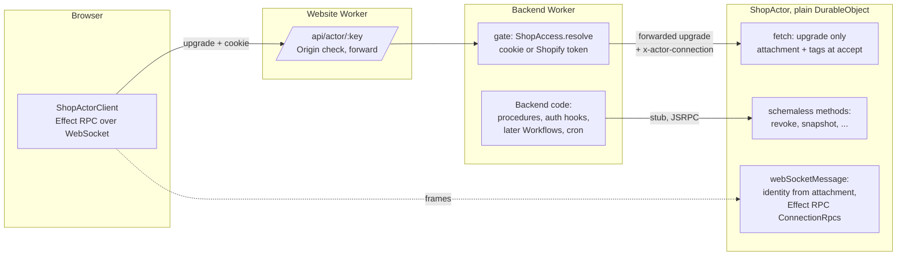
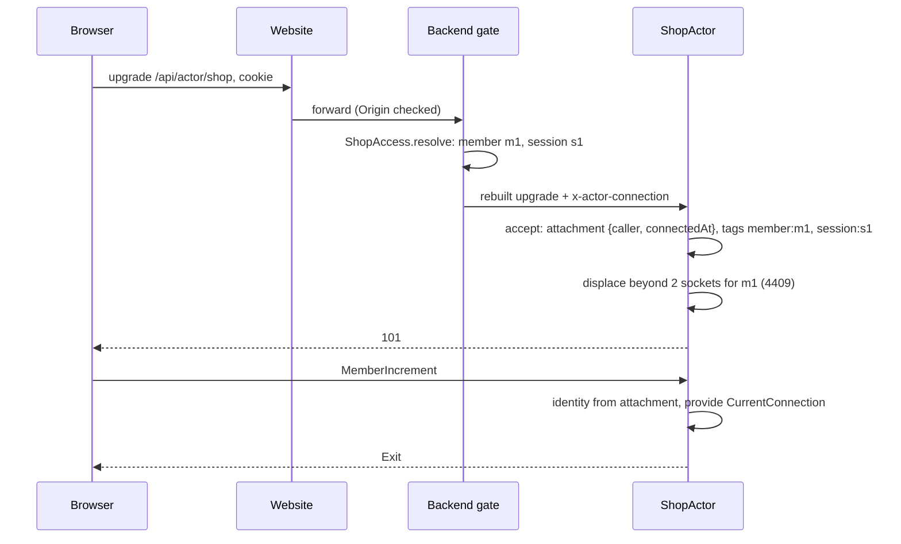

# Research: split the actor's two channels, identify the socket at the gate

Research date: 2026-10-13.
Status: decided in Plannotator on 2026-10-13; every question is answered. Q6, Q7 and Q12 went against the recommendation. Nothing is built.
Versions: Alchemy `2.0.0-beta.81`, Effect `4.0.1`. Do not bump dependencies.
Replaces: the design in [socket identity research](./socket-identity-research.md), implemented in `bd9d7a2` (Spike S1, not pushed). [Glossary](./glossary.md): **Actor**, **Backend**, **Website**, **Binding**, **Procedure**, **Group**, **Client**, **Notice**, **Shop key**.

Sources read for this document: `node_modules/alchemy/src/Cloudflare/Workers/{DurableObject,RpcDurableObject,RpcWebSocket,DurableObjectState,WebSocket,DurableObjectBridge}.ts`; `refs/alchemy/website/src/content/docs/apis/{index,schemaless}.mdx`, `refs/alchemy/website/src/content/docs/cloudflare/apis/schemaless-rpc.mdx`; `node_modules/effect/src/rpc/{RpcServer,RpcMiddleware,Rpc}.ts`; `refs/baton/src/lib/ShopAgent.ts` (`onConnect`, `getConnectionTags`), `refs/baton/src/lib/domain/Platform.ts` (`ConnectionRole`); this repo's `src/backend/{shop-actor,actor-client,ticket,shop-access,worker}.ts`, `src/api/shop-actor.ts`, `src/{shop-actor-client,ticket-client}.ts`.

## 1. Short answer

You are right, and the reason it feels complex is structural, not incidental.

The S1 design has one Effect RPC server inside the actor that is fed by two physically different channels: the Backend's stub (HTTP) and the browser's socket. So every call must first work out which channel it came on, and then who is on it, in a different way for each. On top of that, Alchemy's `RpcDurableObject` accepts the socket before any of our code sees the upgrade request. The Backend has already checked the cookie at that moment, but it has no way to hand the answer to the actor, so it throws the answer away and the browser has to prove itself a second time. Everything with "ticket" in its name exists only to get across that gap.

Your proposal removes both causes:

1. **Two channels, two kinds of RPC, no overlap.** The Backend (and later Workflows and cron) calls the actor with Alchemy's **schemaless RPC**: plain methods on a plain `Cloudflare.DurableObject`, over Cloudflare's native JSRPC. The browser calls the actor with **Effect RPC over its WebSocket**, and that Group is served on the socket only. The actor never has to ask "which channel is this?".
2. **Identity at the gate, once.** The Backend's gate already resolves who the browser is on the upgrade. It writes that onto the request it forwards, and the actor stores it in the socket's attachment (and tags) at accept, as Baton's `onConnect` and `getConnectionTags` do. Every later message reads it from the socket. No ticket, no secret, no first-call bind.

The one hard part is the one you named: Alchemy does not give us a hook between "upgrade arrives" and "socket accepted", and its socket RPC transport is internal. [§6](#6-the-hard-part-the-socket-transport) shows it can be done with about 80 lines of our own code that reuse Alchemy's transport unchanged, and what the fallback is if that internal module moves.

My recommendation is to do this, and to do it before `bd9d7a2` is pushed, since a push deploys staging.

## 2. Why S1 is complex, from first principles

What we actually need to know on every call: **who is calling, and may they call this procedure?**

There are only two kinds of caller, and they reach the actor by different physical paths:

| Caller                                        | Path                                  | Who vouches for them                                                |
| --------------------------------------------- | ------------------------------------- | ------------------------------------------------------------------- |
| Our own server code (Backend, Workflow, cron) | Durable Object stub, Worker to Worker | The Binding. Nothing else in the world holds it.                    |
| A browser (member or merchant)                | WebSocket, upgraded through the gate  | The gate, which checked the cookie or Shopify token on the upgrade. |

The first needs no identity check at all: holding the stub is the proof. The second needs the gate's answer to reach the actor once and stay with the socket.

S1 departs from this in three places, and each departure costs code:

| Departure                                                                                               | What it forced                                                                                                                                                                                                      |
| ------------------------------------------------------------------------------------------------------- | ------------------------------------------------------------------------------------------------------------------------------------------------------------------------------------------------------------------- |
| One Effect RPC server for both channels (`RpcDurableObject` serves HTTP and socket from the same Group) | `CallerMiddleware` sniffs `HttpServerRequest` to guess the channel; a `system` role, `RequireSystem`, `SystemRpcs`, and `CALLER_HEADER` on stub calls, so that a trusted caller is identified like an untrusted one |
| The actor never sees the upgrade request                                                                | The ticket: `TICKET_SECRET`, `Tickets.mint/verify`, `IssueActorTicket`, a ticket primed in the loader and dehydrated, a ticket fetched before every reconnect                                                       |
| The socket's identity is learned on its first call, not at accept                                       | `bindOnConnect` (a forked who-am-I call), `ticketMiddleware` (first-call header, retry on `Unauthorized`), `findSocket` (scan all sockets for a `clientId`), a `bound` cache, the `CLOSE_AFTER_RESPONSE` sleep      |

Roughly 900 lines of S1 (source and tests) exist for these three reasons: `ticket.ts`, `ticket.test.ts`, most of `ticket-client.ts` and its test, about half of `src/backend/shop-actor.ts`, most of `actor-client.ts`, and the ticket parts of the schema, handlers and loaders.

None of it is wrong. It is the price of working around two missing hooks without touching Alchemy. The proposal below pays a smaller price for the same two hooks.

## 3. What Alchemy says about the two channels

Alchemy's own guidance (`refs/alchemy/website/src/content/docs/apis/index.mdx`, "Choosing") matches your instinct exactly:

- **Schemaless RPC is the default for internal communication.** Worker to Durable Object rides native JSRPC, values move by structured clone, no Schema decode or encode on either side. The client type _is_ the class you bound.
- **Effect RPC is for trust boundaries** ("a browser, a partner service, anything outside your deploy"). It is "discouraged for internal service-to-service calls".
- **They interoperate on one host**: "a single Worker or Function can serve schemaless methods internally and a schema'd surface externally."

Our actor is that host: schemaless methods for the Backend, an Effect RPC Group for the browser.

What schemaless costs (from `schemaless.mdx`, "Errors over the wire" and "Limits"):

- No runtime validation. Fine: both ends are ours and ship together.
- A typed failure arrives as a plain `{ _tag, ...fields }`. `catchTag` works; `instanceof` does not, unless the class is listed in the Durable Object's `errors` prop, which rebuilds real instances.
- Defects are not enveloped; they surface as `RpcCallError`.

`RpcDurableObject` cannot serve both: its implementation returns a handler Layer and Alchemy builds `fetch` and the socket handlers from it (`makeHandlers` in `RpcDurableObject.ts`); there is nowhere to return extra methods. So the actor moves to plain `Cloudflare.DurableObject`, as you said.

## 4. The design



### 4.1 The schemaless channel (Backend to actor)

The actor returns ordinary methods next to `fetch` and the socket handlers. The Backend calls them on the stub, fully typed from the class:

```ts
Effect.gen(function* () {
  const actor = actors.getByName(key);
  yield* actor.revoke({ by: "member", id: memberId });
  return yield* actor.snapshot();
});
```

No header, no `system` role, no `RequireSystem`, no `SystemRpcs`, no `SystemActors.call` wrapper that stamps a header. If a method needs to know on whose behalf the Backend is acting (an audit row, a per-member read), that is a plain argument: the Backend has already authorized it.

This is also where S2's Workflow callbacks and S3's cron fan-out go, so neither needs an identity scheme of its own.

### 4.2 The socket channel (browser to actor)

**At the gate (Backend).** Unchanged: `ShopAccess.resolve` answers member, merchant, or a refusal. New: on an upgrade, the gate writes the resolved `ConnectionCaller` as JSON in one header, `x-actor-connection`, on the request it rebuilds from nothing (it already drops every incoming header but the handshake ones, so a browser cannot smuggle it). This is Baton's `x-baton-*` headers in one value.

**At accept (actor `fetch`).** Decode the header with Schema. Then accept the socket with:

- attachment `{ shopActor: { caller, connectedAt } }`, next to Alchemy's own key, which already survives hibernation (verified by S1's `socket-facts` test);
- tags `member`, `member:<memberId>`, `session:<sessionId>` for a member; `merchant` for a merchant. These are what revoke and displacement select by, as Baton's `getConnectionTags`.

A header that does not decode is a gate bug; the socket is accepted and closed 4403, as Baton does. Displacement runs here, at accept, with `getWebSockets("member:<id>")`: no "bind" moment, no scan.

**On every message (actor `webSocketMessage`).** Read the attachment (one structured-clone read; cacheable per activation in a `WeakMap` keyed by the raw socket). If the member's `sessionExpiresAt` has passed, close 3401 _before_ dispatching, so there is no response to race and the `CLOSE_AFTER_RESPONSE` sleep goes away. Otherwise provide `CurrentConnection` and hand the frame to the RPC transport.

**In the Group.** One Group per role, served on the socket only: `MemberRpcs` and `MerchantRpcs`, each with its role middleware reading `CurrentConnection`. No `CallerMiddleware` with two branches; no `system` role in the socket's types at all.

**Revoke** (a schemaless method): `getWebSockets("member:m1")` or `getWebSockets("session:s1")`, close each 3401. No decoding attachments to search.



### 4.3 How the browser learns why it was refused

S1's ticket fetch doubled as the "why" channel: a refused ticket came back as `Unauthorized` or `NotAShopMember`. Without tickets, a refused upgrade is an HTTP 401 or 404 that a browser's `WebSocket` cannot read; it just sees close 1006, the same as a network drop.

Two ways out ([Q4](#10-questions-with-recommendations)):

- **Accept and close at the gate.** On a refusal the Backend accepts a throwaway `WebSocketPair` and closes it at once with a code: 4401 not signed in, 4404 not a member, 4403 forbidden (operator, wrong shop), 1013 try again (D1 down). Every reason the browser can act on then arrives the same way, as a close code, and `retryPolicy` keys on codes alone.
- **Baton's way.** Refusals stay HTTP statuses. On 3401 the page re-runs its loader, which asks the Backend over HTTP and gets the real answer; the loader's answer unmounts the socket. Until then the socket retries 1006 with backoff.

### 4.4 Server rendering

S1 server-renders actor data by sending Effect RPC over HTTP through the gate (`serverProtocol`), which is why the actor's Group had to be served on HTTP too, with `x-actor-caller`. In the split, the actor's Effect RPC is socket-only, so server rendering reads through the Backend instead:

Website loader → `BackendRpcs` procedure (for example `ShopSnapshot`, cookie or Bearer checked by the same `ShopAccess`) → schemaless `actor.snapshot()` → loader.

That one call also replaces `loadTicket` as the loader's "not a member" check. The result is seeded into the browser's socket query atoms under their existing serialization keys, so the page hydrates and the socket takes over without a refetch ([Q5](#10-questions-with-recommendations)).

### 4.5 What stays exactly as it is

The gate (`ShopAccess`) and its statuses, the Website's Origin check, Baton's close codes (3401, 4403, 4409), the two-socket cap with displacement, revoke by member and by session from the Better Auth hooks and membership procedures, the session-expiry backstop, Notices as frames beside the RPC protocol, the connection-state atoms and the displaced banner.

## 5. Side by side

| Concern                           | S1 (implemented)                                                 | Split                                                                                               |
| --------------------------------- | ---------------------------------------------------------------- | --------------------------------------------------------------------------------------------------- |
| Backend to actor                  | Effect RPC over HTTP, `system` role in a header, `RequireSystem` | Schemaless method on the stub; the Binding is the proof                                             |
| Workflow, cron to actor (S2, S3)  | Would need the same header scheme                                | Schemaless methods                                                                                  |
| Which channel is this call on?    | Sniff `HttpServerRequest` in middleware                          | Never asked: each surface has one channel                                                           |
| Socket identity established       | First call, from a signed ticket                                 | At accept, from the gate's header                                                                   |
| Secret to manage                  | `TICKET_SECRET`                                                  | None                                                                                                |
| Extra round trips                 | Ticket with the page; one ticket fetch per reconnect             | None                                                                                                |
| Find a member's sockets           | List all sockets, decode every attachment                        | `getWebSockets("member:<id>")`                                                                      |
| Socket with no identity           | Possible until its first call (hence `bindOnConnect`)            | Impossible                                                                                          |
| Expired session on a call         | Fail the call, sleep 50 ms, then close                           | Close before dispatch                                                                               |
| SSR reads                         | Actor's Group over HTTP via the gate                             | `BackendRpcs` procedure, schemaless actor method                                                    |
| Browser learns why it was refused | From the ticket fetch                                            | Close code from the gate, or loader re-run ([§4.3](#43-how-the-browser-learns-why-it-was-refused))  |
| Depends on Alchemy internals      | Attachment key name `__alchemyRpcWebSocket.clientId`             | `RpcWebSocket.make` (internal module) or our own copy ([§6](#6-the-hard-part-the-socket-transport)) |
| Code (estimate)                   | ~900 lines for identity                                          | ~250 lines for identity and the transport adapter                                                   |

## 6. The hard part: the socket transport

Moving off `RpcDurableObject` means we wire Effect RPC onto the socket ourselves. Alchemy's transport for that is `RpcWebSocket.make` in `node_modules/alchemy/src/Cloudflare/Workers/RpcWebSocket.ts`. It is not exported from `alchemy/Cloudflare`, but the package's `"./*"` export maps `alchemy/Cloudflare/Workers/RpcWebSocket` to the built `lib/Cloudflare/Workers/RpcWebSocket.js`, which exists. It returns exactly the pieces a plain Durable Object needs:

```ts
{
  (protocol, fetch, webSocketMessage, webSocketClose, webSocketError);
}
```

It does the hard work we do not want to own: hibernation restore by `clientId`, the ping/pong auto-response heartbeat, pending-request bookkeeping in the attachment, closing sockets with unfinished requests on a restart (1012), and `waitUntil` while requests are in flight.

What it lacks is our two hooks. Both can be added from outside:

1. **Identity at accept.** Its `fetch` accepts the socket through `state.acceptWebSocket(socket, ["alchemy:rpc"])`, using the `DurableObjectState` it reads from context. We give it a decorated state whose `acceptWebSocket` adds our tags and writes our attachment key before delegating. The identity comes from a service our `fetch` provides around `transport.fetch`; it runs in the same fiber, so it is in context. Alchemy's `persist` spreads the previous attachment, so our key survives its writes.
2. **Identity per message.** Our `webSocketMessage` reads the attachment, checks expiry, and calls `transport.webSocketMessage(socket, message)` with `CurrentConnection` provided. Effect's RPC server runs each handler with the context of the fiber that delivered the message (`handleRequest` merges `requestFiber.context`), and Alchemy dispatches in the socket event's fiber ("Direct dispatch preserves this event's context"). S1's `HttpServerRequest` check already relies on this same propagation and its integ tests pass, so it is proven in this codebase.

Plus the small part of `makeHandlers` we would copy: build the handler Layer in an instance scope, run `RpcServer.layer` on the transport's `protocol`, and the `RpcRequestLifetime` middleware that keeps the object alive until each call's fiber ends. About 40 lines.

Three ways to get there ([Q2](#10-questions-with-recommendations)):

| Option                                   | Code we own                                                                            | Risk                                                                                                                                                                                                                                                   |
| ---------------------------------------- | -------------------------------------------------------------------------------------- | ------------------------------------------------------------------------------------------------------------------------------------------------------------------------------------------------------------------------------------------------------ |
| **A. Reuse Alchemy's transport** (above) | ~80 lines: decorated state, two wrappers, server wiring                                | Internal module; a bump can rename or change it. Pinned by an integ test that fails on any change to its shape                                                                                                                                         |
| **B. Our own copy of the transport**     | ~340 lines copied from `RpcWebSocket.ts`, with an accept hook and identity on dispatch | We own heartbeat and hibernation correctness; drifts from upstream fixes                                                                                                                                                                               |
| **C. Ask Alchemy for the hooks first**   | none until it lands                                                                    | Blocks S1 on an upstream release; the ask is real either way: an `onUpgrade` hook on `RpcDurableObject` that returns tags and an attachment from the request, or a refusal, the connection in handler context, and schemaless methods beside the Group |

A and B are the same design with the same tests; switching from A to B later touches one file. C is worth filing regardless ([Q7](#10-questions-with-recommendations)), and if it lands, the adapter in A shrinks to configuration.

## 7. What it costs and what could go wrong

- **The internal import (option A).** The largest risk. Mitigated by keeping it in one adapter file and an integ test that would fail on any change to its shape.
- **The gate's header is the trust boundary.** The same argument S1 already makes for `x-actor-caller` on HTTP: only the Backend holds the Binding, and it rebuilds the forwarded request from nothing. A Durable Object has no public route. This is also exactly Baton's argument.
- **Identity is a snapshot at connect.** Same as S1 and Baton: a role change is a revoke (3401), and the reconnect runs the gate again.
- **Schemaless errors.** Typed failures lose class identity across the stub unless listed in the Durable Object's `errors` prop. We list the few the Backend matches on.
- **SSR goes through the Backend.** One more hop than S1's forwarded HTTP read, but the same number of network legs: Website to Backend was already one, Backend to actor was already one.
- **The hydration seam ([§4.4](#44-server-rendering)).** Seeding socket query atoms from a Backend procedure's result is new; if it fights `AtomRpc`, the page can show the loader's snapshot until the socket's first answer.

## 8. What the spike must verify first

1. The subpath import `alchemy/Cloudflare/Workers/RpcWebSocket` builds and runs under Vite and workerd (option A only).
2. Tags and our attachment key written by the decorated `acceptWebSocket` are present after Alchemy's `persist` and after a hibernation.
3. `CurrentConnection` provided around `transport.webSocketMessage` is visible in the role middleware.
4. A close before dispatch (expired session) leaves the transport clean: no abort, no stuck pending request.
5. If [Q4](#10-questions-with-recommendations) is "accept and close": a close code sent by the Backend on a throwaway socket reaches the browser through the Website's forward.
6. If [Q5](#10-questions-with-recommendations) is the Backend procedure: a value seeded under a socket atom's serialization key hydrates without a refetch.

## 9. What would change

1. **Schema** (`src/api/shop-actor.ts`): drop `TicketClaims`, `TICKET_HEADER`, `CALLER_HEADER`, `TICKET_TTL_MILLIS`, `SystemCaller`, `Caller` (becomes `ConnectionCaller`), `CallerMiddleware`, `RequireSystem`, `SystemRpcs`; add `CONNECTION_HEADER`, `CurrentConnection`; `ShopActorRpcs` becomes `MemberRpcs.merge(MerchantRpcs)`.
2. **Actor** (`src/backend/shop-actor.ts`): plain `Cloudflare.DurableObject`; `fetch` (upgrade only, attachment, tags, displacement), `webSocketMessage` (identity, expiry, delegate), close and error handlers; schemaless `revoke` and `snapshot`; the transport adapter in its own file.
3. **Backend**: gate writes `x-actor-connection` on upgrades and no longer forwards HTTP RPC to the actor; `SystemActors` becomes a thin pass-through or disappears in favour of the stub; delete `ticket.ts`, `IssueActorTicket`, `TICKET_SECRET` in `alchemy.run.ts`; add `ShopSnapshot` to `BackendRpcs`.
4. **Browser**: delete the ticket step, `ticketMiddleware`, `bindOnConnect`, `setClient`, `serverProtocol`; `retryPolicy` keys on close codes only; loaders call `ShopSnapshot`.
5. **Tests**: drop ticket tests; keep revoke, displacement, expiry and role tests, reworded; add the six verifications in [§8](#8-what-the-spike-must-verify-first); add "a forged `x-actor-connection` from the browser is dropped by the gate".

## 10. Questions with recommendations

:::question
Q1. Direction?

Split the channels (schemaless stub for our code, Effect RPC on the socket only, identity at the gate), or keep S1 as implemented.

Recommendation: split. It removes the channel question, the ticket and its secret, the first-call bind and the timing hacks, it is Baton's model, and it gives S2 and S3 a channel that needs no identity scheme.

- [x] Split the channels
- [ ] Keep S1

Recommended: Split the channels
:::

:::question
Q2. Socket transport?

A: reuse Alchemy's internal `RpcWebSocket.make` through a subpath import, with a decorated state and two wrappers. B: our own copy of it. C: wait for Alchemy to add hooks.

Recommendation: A, pinned by an integ test, with B as the fallback if a bump breaks it, and C filed in parallel. A keeps Alchemy's hibernation and heartbeat logic, which is the part most likely to be subtly wrong in a copy.

- [x] A: reuse Alchemy's transport
- [ ] B: own copy
- [ ] C: wait for upstream

Recommended: A: reuse Alchemy's transport
:::

:::question
Q3. How identity reaches the actor on the upgrade?

One JSON header `x-actor-connection` set by the gate on the rebuilt request, or a signed header.

Recommendation: the plain header. The trust argument is the Binding plus a rebuilt request, the same as S1's HTTP path and Baton's gate; a signature would bring back a secret to protect against a caller that cannot exist.

- [x] Plain header from the gate
- [ ] Signed header

Recommended: Plain header from the gate
:::

:::question
Q4. How the browser learns why it was refused?

Accept and close at the gate with a code (4401, 4404, 4403, 1013), or Baton's loader re-run on 3401.

Recommendation: accept and close. One signal for every reason, `retryPolicy` decides from the code alone, and the socket does not depend on the router. Baton's way works but leaves the socket retrying 1006 until the loader answers.

- [x] Accept and close with a code
- [ ] Baton's loader re-run

Recommended: Accept and close with a code
:::

:::question
Q5. Server rendering of actor data?

A `BackendRpcs` procedure (`ShopSnapshot`) that calls a schemaless actor method and seeds the socket atoms, or no server rendering of actor data (the page fills in when the socket answers).

Recommendation: the Backend procedure. It keeps first paint as S1 has it, and it is also the loader's membership check, replacing `loadTicket`.

- [x] Backend procedure, seeded atoms
- [ ] No SSR of actor data

Recommended: Backend procedure, seeded atoms
:::

:::question
Q6. Website to Backend?

See [§11](#11-q6-revisited-website-to-backend). Authentication is fine either way. Baton's pattern (loaders call server functions, server functions call the Backend schemaless with the cookie) makes this hop schemaless with no duplication, but it replaces `BackendClient`, its atoms and the `/api/rpc` proxy.

- [ ] Keep `BackendRpcs` for now; research Baton's server-function pattern separately
- [x] Move to Baton's pattern as part of this work
- [ ] Keep `BackendRpcs` for good

Recommended: Keep `BackendRpcs` for now; research Baton's server-function pattern separately

Decided: move to Baton's pattern as part of this work; see [§12](#12-the-website-data-layer-batons-pattern).
:::

:::question
Q7. Upstream?

File an Alchemy issue for an upgrade hook on `RpcDurableObject` (tags and attachment from the request), the connection in handler context, and schemaless methods beside the Group.

Recommendation was: yes, after the spike. Decided: do not file; Alchemy is likely to add hooks on its own, and the adapter is small enough to drop when it does.

- [ ] File after the spike
- [ ] File now
- [x] Do not file

Recommended: File after the spike
:::

:::question
Q8. What happens to `bd9d7a2`?

It is committed and not pushed, and a push deploys staging.

Recommendation: do not push it alone. Land the split as a follow-up commit on `main` and push both together, so staging never runs the ticket design. History stays as it is. Decided: follow-up commit; if S1 is pushed first, staging running it for a while does no harm.

- [x] Follow-up commit, push both
- [ ] Push S1 now, rework later

Recommended: Follow-up commit, push both
:::

## 11. Q6 revisited: Website to Backend

**Authentication is not broken.** A guarded route's `beforeLoad` (`requireRole` in `src/routes/-guards.ts`) asks the Backend who the visitor is and redirects if nobody is signed in. Then every Backend procedure checks the cookie again (`CurrentUserMiddleware`). On the first page (SSR) the Website copies the visitor's cookie onto its call to the Backend; in the browser the cookie rides through `/api/rpc`. Same as Baton.

**What Baton does.** Baton has no Website/Backend split: it is one Worker. Loaders and `beforeLoad` call TanStack **server functions**. A server-function middleware (`memberServerFnMiddleware`) reads the session from the request's cookie and redirects if there is none. TanStack makes the call work both ways: on the first page it is a direct call on the server; on a client-side navigation it becomes an HTTP request to the same Worker. Inputs are validated with Schema in `.validator`.

**What that means here.** The earlier version of this section argued schemaless would mean writing every read twice. That was wrong: it assumed we keep `BackendClient` atoms. With Baton's pattern there is no duplication:

```
loader / beforeLoad
  → server function on the Website (input validated with Schema)
  → Backend schemaless method, passing the cookie
  → Backend checks the session (sessionFromCookie), as today
```

The server function is the one browser-facing entry point; Website to Backend becomes schemaless; authentication stays in the Backend. The one rule: pass the cookie, never a user id the Website worked out, since only the Backend can check a session.

**The cost.** It replaces the data layer, not just the actor: `BackendClient` and its atoms, the `/api/rpc` proxy, and the parked query-pattern plan that builds on them. Decided: do it in the same work; see [§12](#12-the-website-data-layer-batons-pattern).

## 12. The Website data layer: Baton's pattern

Decided with Q6. The Website is plain TanStack Start: no Effect, no `BackendClient`. Effect stays in the browser only for the actor socket.

### 12.1 The shape

The rule is by owner, not by kind of call: **what the actor owns goes over the socket once it is open; what the Backend owns goes through a server function.** A shop page's form that changes actor state (`MemberIncrement`, `MerchantResetCount`, and later orders and workflows) is an Effect RPC call on the socket, with no Website or Backend hop; that is what the socket is for.

| Need                                                   | How                                                                                                                                      |
| ------------------------------------------------------ | ---------------------------------------------------------------------------------------------------------------------------------------- |
| Page data the Backend owns (loaders)                   | Loader calls a server function. First page: runs on the server. Client navigation: TanStack calls it over HTTP. Same function both ways. |
| Guards (`beforeLoad`)                                  | A server function that returns who is signed in, or redirects. As today, only decides what renders.                                      |
| Writes the Backend owns (sign-in link, members, Shout) | Server functions, called from forms or event handlers.                                                                                   |
| Reads and writes the actor owns                        | Effect RPC on the socket, through its atoms and mutations. Only the first snapshot comes from the loader, because no socket exists yet.  |
| Server function to Backend                             | Schemaless method on the Backend, through `toRpcAsync<Backend>(env.BACKEND)`, passing the request's cookie.                              |
| Authentication                                         | In the Backend, on every method: `sessionFromCookie(cookie)`, as `CurrentUserMiddleware` does now.                                       |
| Input validation                                       | At the server function, the browser's entry point: Effect Schema in `.validator`.                                                        |
| Better Auth's own routes                               | Unchanged: `/api/auth/*` passed through to the Backend.                                                                                  |

```
first page or client navigation
  loader → server function (validate input)
         → backend.listMembers(cookie)   schemaless
         → Backend: sessionFromCookie, role check, query
then, on the shop page only
  browser ⇄ actor socket: reads and writes the actor owns (Effect RPC),
  identity from the gate (§4.2), no Website or Backend hop
```

### 12.2 What goes away

`BackendRpcs` and its six procedures (`Hello`, `Shout`, `RequestMagicLink`, `IssueActorTicket`, `Me`, `ListMembers`) as Effect RPC; `backend-client.ts`, `backend-transport.ts`, the `/api/rpc` route and `rpc-proxy.ts`; the Backend's per-request `RpcServer`; the Backend atoms in `session.ts`, `query.ts` and the pages that read them. The parked query-pattern plan, which was written for those atoms, is superseded; TanStack Router's loader cache (`staleTime`, `router.invalidate()`) takes its place.

`TestControlRpcs` is not browser-facing data; it can move to schemaless the same way or stay as is ([Q11](#123-questions)).

### 12.3 Questions

:::question
Q9. Who checks the session: each Backend method, or a server-function middleware?

Baton checks in a server-function middleware, then the handler uses the user. Here the session lives in the Backend, so a Website middleware would have to ask the Backend anyway.

- [x] Each Backend method takes the cookie and checks it
- [ ] A Website middleware asks the Backend once and passes the user id to later calls

Recommended: Each Backend method takes the cookie and checks it
:::

Each Backend method checking keeps authentication in one Worker and lets no Backend method trust a user id from outside. It costs one session lookup per call, the same as today.

:::question
Q10. How does the shop page's live data start?

The loader returns the actor snapshot (count, who am I) through a server function. The socket atoms then need a starting value.

- [x] Socket atoms start from the loader's data, then refetch on notices
- [ ] Render loader data until the socket's first answer, then switch to the atoms

Recommended: Socket atoms start from the loader's data, then refetch on notices
:::

:::question
Q11. Test control (`TestControlRpcs`)?

It is called by e2e tests through the Website, never by the app's pages.

- [x] Leave it as Effect RPC for now
- [ ] Move it to server functions and schemaless too

Recommended: Leave it as Effect RPC for now
:::

It is a test-only surface with its own token, and moving it buys nothing for the app.

:::question
Q12. Order of work?

- [ ] Website data layer first, then the actor split
- [ ] Actor split first, then the data layer
- [x] Both in one change

Recommended: Website data layer first, then the actor split

Decided against the recommendation: both in one change.
:::

The data layer is the smaller, well-understood change, and it gives the shop page the server-function snapshot the actor split needs for first paint.
