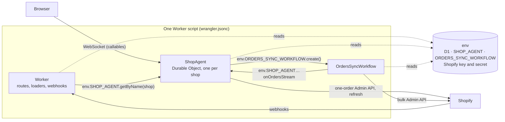
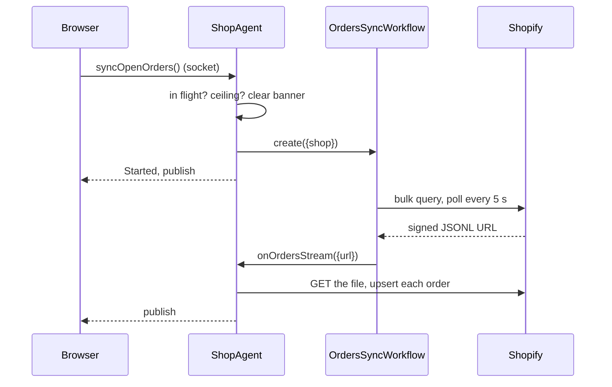
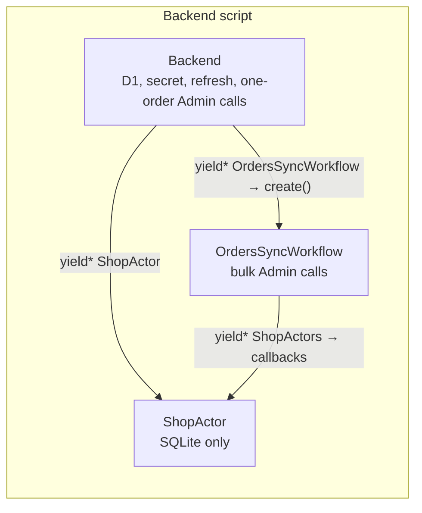
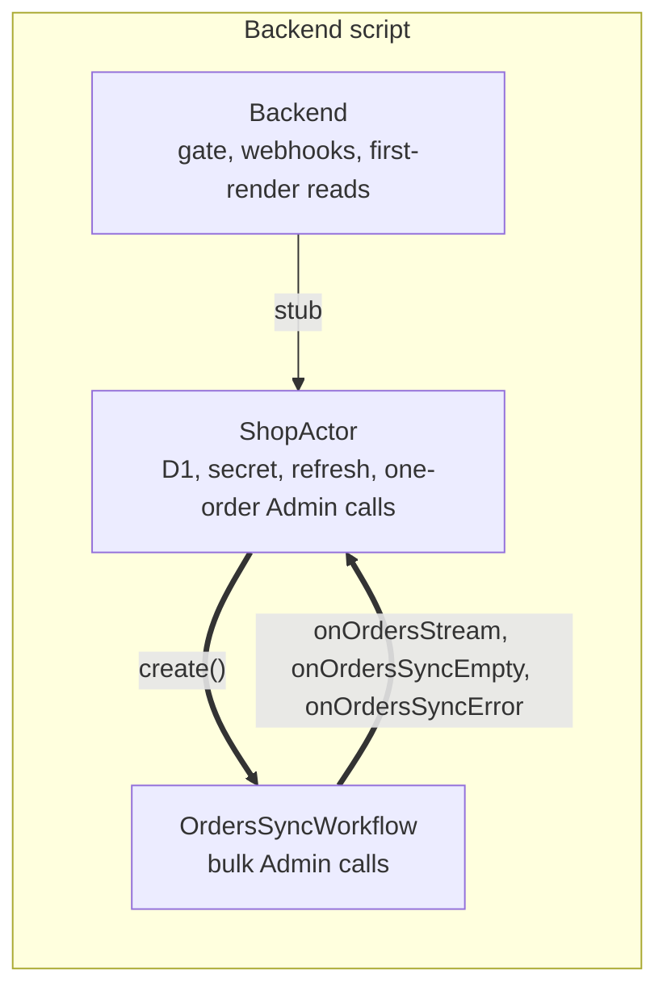
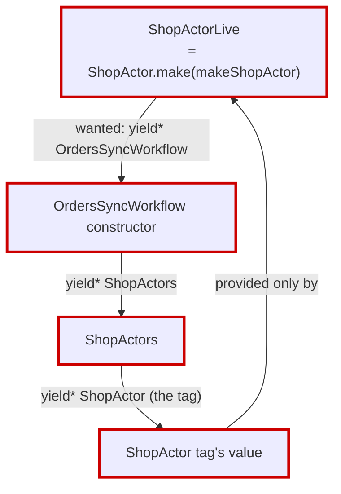
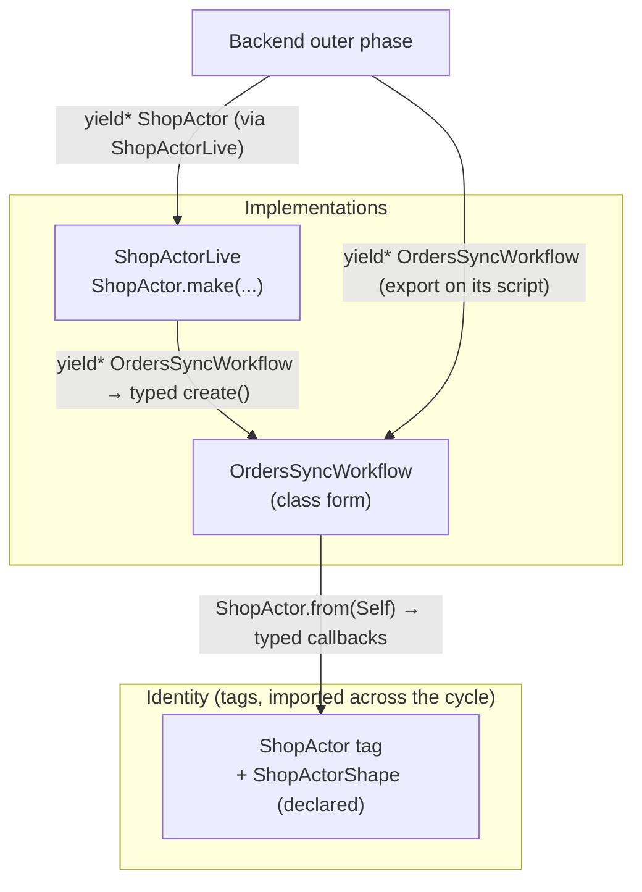

# The actor and the orders sync Workflow: how they are wired

Status: research, written 2026-10-17; rewritten the same day after review ("go deeper into how Alchemy works"). **Settled** the same day in chat: Q1–Q3 as recommended; Q4 declined (no staging baseline first). Implemented as `docs/actor-ownership-plan.md` §7 "Follow-up round 3". It lays out Alchemy's model from its own docs, legacy's architecture, this repo's before and after the actor ownership correction, the one edge that came out hand-rolled, and why. The finding: the design Alchemy documents for this case is the right one, it fails only because of a one-line bug in Alchemy's local provider, and the repo already has the mechanism to patch Alchemy.

Sources: Alchemy's docs under `refs/alchemy/website/src/content/docs/` (`infrastructure-as-effects/phases.mdx`, `runtime.mdx`, `binding.mdx`, `layers.mdx`, `circular-bindings.mdx`, `project-structure/file-layout.mdx`) and source under `refs/alchemy/packages/alchemy/src/`. Legacy paths are relative to `refs/baton-legacy/`.

---

## 1. Alchemy's model, in six rules

Each rule is quoted or paraphrased from the doc named.

1. **A Runtime is a Resource that carries its code** (`runtime.mdx`). A Worker, a Durable Object and a Workflow are each declared with an **Effectful Constructor**: an outer `Effect.gen` that binds what it needs and returns what it exposes. A Worker returns handlers, a Durable Object its RPC methods, a Workflow its run function.
2. **The outer phase runs twice** (`phases.mdx`): at plantime, to discover bindings, and again at cold start, where the same calls return live clients. The returned inner Effect runs per request.
3. **A `yield*` in the outer phase is a binding** (`binding.mdx`): it records, on the host script, what the code needs (a native Cloudflare binding), and returns a typed client. There is no config file; the code's dependency graph is the binding graph.
4. **A contract and its implementation are separate** (`layers.mdx`, `binding.mdx`): a tag (`Context.Service`, `Binding.Service`) names the capability; a Layer builds it. Consumers yield the tag; the Layer is provided where the unit is composed.
5. **Runtimes have three declaration forms** (`runtime.mdx`, "Three ways to declare a Runtime"): inline, class, and **tag and Layer**, where the class declares only identity and shape and `.make()` gives the implementation. "Other Runtimes bind to the Tag, never the implementation." "This split is what makes Circular Bindings possible."
6. **Cycles are resolved by letting only identity cross them** (`circular-bindings.mdx`): A and B each import only the other's tag, bind it by identity (`bindWorker(B)`), and keep their implementations behind `.make()`. At deploy, Alchemy precreates each side, then wires the bindings in a converge pass. Resources are memoized by logical id, so a resource yielded from two units is created once (`file-layout.mdx`).

What "identity-only" means per runtime kind:

| Runtime        | Identity-only reference                                                                                                                                 | Needs the other side's Layer?                               |
| -------------- | ------------------------------------------------------------------------------------------------------------------------------------------------------- | ----------------------------------------------------------- |
| Worker         | `Cloudflare.Workers.bindWorker(Tag)`                                                                                                                    | no                                                          |
| Durable Object | `Tag.from(<host Worker>)`, documented also for the host itself ("Using `.from(Self)` Inside the Host", `Cloudflare/Workers/DurableObject.ts`)           | no                                                          |
| Durable Object | `yield* Tag`                                                                                                                                            | **yes**: the tag's value comes from `Tag.make(...)`'s Layer |
| Workflow       | none: `Cloudflare.Workflow` has the inline and class forms only (`Cloudflare/Workflows/Workflow.ts`, `WorkflowClass`); yielding it runs its constructor | **yes** (it is the implementation)                          |

---

## 2. Legacy

### 2.1 What runs where

One Worker script. `wrangler.jsonc` declares every binding once, and every class in the script sees all of `env`.



### 2.2 How the two edges are found

Both by name, at runtime, through the agents SDK:

- **Object → Workflow:** `this.runWorkflow("ORDERS_SYNC_WORKFLOW", {shop})` finds the binding in `env` by name (`_findWorkflowBindingByName`, `refs/agents/packages/agents/src/index.ts`).
- **Workflow → object:** `this.agent` is `getAgentByName(env[<binding name from the params>], shop)` (`refs/agents/packages/agents/src/workflows.ts`).

Nothing at build time knows that the two point at each other, so the cycle never shows.

### 2.3 One sync



---

## 3. This repo

### 3.1 Before the correction (slice A)

The Backend created the Workflow; the Workflow called the actor. No cycle, so both edges were plain yields.



### 3.2 What A1 asked for

Legacy's arrows: the actor creates the Workflow, the Workflow calls the actor back.



### 3.3 What we have (`main` at c37ab3e)

| Edge                   | Wiring                                                                                                                                              | Form                                   |
| ---------------------- | --------------------------------------------------------------------------------------------------------------------------------------------------- | -------------------------------------- |
| Workflow → actor       | The Workflow's outer phase yields `ShopActors`, which yields the `ShopActor` tag.                                                                   | Alchemy yield, needs the actor's Layer |
| Actor → Workflow       | The actor reads `env.OrdersSyncWorkflow` by name when `create` runs (`makeOrdersSyncWorkflows`, `src/backend/shop-actor/orders-sync-workflows.ts`). | **hand-rolled**, legacy's way          |
| The Workflow's binding | The Backend's outer phase yields `OrdersSyncWorkflow`, so the binding and the class export live on the Backend's script, which the actor shares.    | Alchemy yield                          |

The runtime picture matches legacy (§3.2), and every suite passes. What is off is one edge's wiring style.

---

## 4. The cycle, exactly

An arrow means "building this needs that":



Both ends of the cycle use the **implementation-needing** forms from §1's table: the actor yields the Workflow class (the only form a Workflow has), and the Workflow yields the `ShopActor` tag (which needs `ShopActorLive`). Rule 6 says one edge must be identity-only. A Workflow has no identity-only form; a Durable Object does. So the edge to change is **Workflow → actor**, to `ShopActor.from(<host>)`.

The cycle shows in two places, and each has its fix:

| Where         | Symptom                                                                                                                                                                                                                                                            | Fix (Alchemy's)                                                                                                                       |
| ------------- | ------------------------------------------------------------------------------------------------------------------------------------------------------------------------------------------------------------------------------------------------------------------ | ------------------------------------------------------------------------------------------------------------------------------------- |
| TypeScript    | `TS2506: 'OrdersSyncWorkflow' is referenced directly or indirectly in its own base expression`: `ShopActor`'s shape was inferred from its implementation (`Effect.Success<Effect.Success<typeof makeShopActor>>`), so the tag's type depends on the implementation | Declare the shape on the tag: `Cloudflare.DurableObject<ShopActor, ShopActorShape>()("ShopActor")` (rule 5). **Verified in round 2.** |
| Effect Layers | `ShopActorLive` would require the `ShopActor` tag, which only it provides                                                                                                                                                                                          | The Workflow binds `ShopActor.from(<host>)`, which needs only the host Worker (rule 6). **Failed in round 2, see §5.**                |

---

## 5. Why `.from(Self)` failed: a bug in Alchemy's local provider

Round 2 (`docs/actor-ownership-plan.md` §7) built both fixes. Types passed. Every fresh local stack (each integ file, e2e, a first `alchemy dev`) then failed:

```
[TestBackend] fail (local) — Cannot coerce Output<TestBackend.workerName> to a string via JS coercion
```

The cause is one expression in `LocalWorkerProvider`'s `precreate` (`refs/alchemy/packages/alchemy/src/Cloudflare/Workers/LocalWorkerProvider.ts`):

```ts
precreate: Effect.fn(function* ({ id, fqn, news, bindings }) {
  const name = yield* createWorkerName(id, news.name);
  ...
  if (binding.type === "durable_object_namespace") {
    durableObjectNamespaces[binding.className] =
      binding.namespaceId ??
      encodeURIComponent(`${binding.scriptName!}-${binding.className}`);
```

- `precreate` reserves a Worker before the converge pass (rule 6). For a binding from `.from(Self)`, `scriptName` is the Worker's **own** name as an `Output`, which cannot exist yet while the Worker itself is being precreated; the template string coerces it and throws.
- The same file's `resolveConfig` already treats a self-binding as local: `!binding.scriptName || binding.scriptName === name`, using the Worker's own `name`. `precreate` is the one place that does not, and it even builds `undefined-ShopActor` for an ordinary local binding (no `scriptName`).
- The deployed provider is separate code (`WorkerProvider.ts`) and treats `scriptName === name` as owned locally in its migration logic (`ownedLocally = !("scriptName" in oldBinding) || oldBinding.scriptName === name`). Whether its own precreate and the Cloudflare API accept a self-`script_name` binding is **unverified**; staging is the check.

So the documented pattern is right for this case, and it breaks on a local-provider bug: `precreate` should use its own `name` when the binding's `scriptName` is the Worker itself (or is not yet a string), as `resolveConfig` does.

**The repo already patches Alchemy.** `patches/alchemy@2.0.0-beta.81.patch`, mapped in `pnpm-workspace.yaml` and described in `docs/dependency-patches-runbook.md`, adds an export Alchemy leaves out. A second hunk in the same patch can fix `precreate`, with an upstream issue so it retires on a release.

---

## 6. The design this gives



- `src/backend/shop-actor/` gains the tag module: `ShopActor` and `ShopActorShape` (the stub methods the Backend and the Workflow may call), the identity only. `shop-actor.ts` keeps `ShopActor.make(...)`. That is `file-layout.mdx`'s rule, one file per Resource or Layer, and round 2 found the split necessary anyway (load order).
- The Workflow's outer phase binds `ShopActor.from(<the Backend Worker>)` and wraps it in `ShopActors`; the Backend keeps `yield* ShopActor`.
- The actor's outer phase yields `OrdersSyncWorkflow` and uses Alchemy's handle. `orders-sync-workflows.ts` and `ORDERS_SYNC_WORKFLOW` go.
- The Backend keeps `yield* OrdersSyncWorkflow`: at runtime the Backend's init does not run the actor's constructor, so without it the Workflow class would be missing from the script's exports wherever no actor has started (round 2). Memoization by logical id makes the two yields one resource.

Costs: `ShopActorShape` is a hand-written interface to keep in step with the actor (it is also the written contract of what may call it); the Workflow's constructor re-runs on each actor activation, as every constructor a runtime yields does at cold start (rule 2).

---

## 7. Questions

1. **Which design?** **Recommendation:** §6, Alchemy's documented one: tag with declared shape, `ShopActor.from(Self)` in the Workflow, the actor yielding the Workflow class. Today's hand-rolled handle stays until it is proven on staging.
2. **How to get past the local bug?** **Recommendation:** a second hunk in `patches/alchemy@2.0.0-beta.81.patch` making `LocalWorkerProvider.precreate` use the Worker's own `name` for a self-bound (or unresolved) `scriptName`, recorded in `docs/dependency-patches-runbook.md` with when to retire it; and an upstream Alchemy issue with the error, the line and the fix.
3. **What proves it?** **Recommendation:** a spike before the change lands: the patch plus §6 green in `vp check`, the integ sync tests, e2e, and a fresh `alchemy dev`; then **staging**, since the deployed provider is separate code: the deploy output shows one `ShopActor` binding (self `script_name` accepted, migrations unchanged), and a Sync open orders shows `OrdersAgent.syncOpenOrders … status=started` then `OrdersSyncWorkflow.run … status=complete`. If staging refuses a self-`script_name`, keep today's handle and add that to the upstream issue.
4. **Staging now.** It runs today's code (deployed 2026-10-17). **Recommendation:** verify it by hand before the spike, so the spike's staging run is compared against a known-good baseline; push `main` after.
