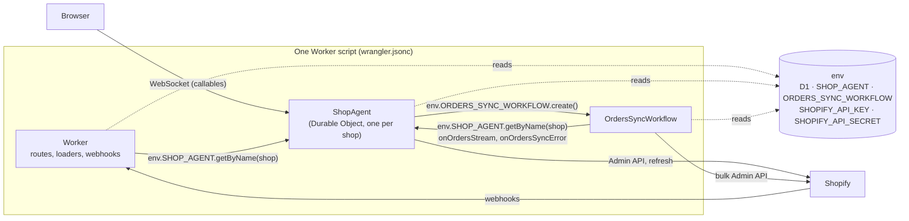
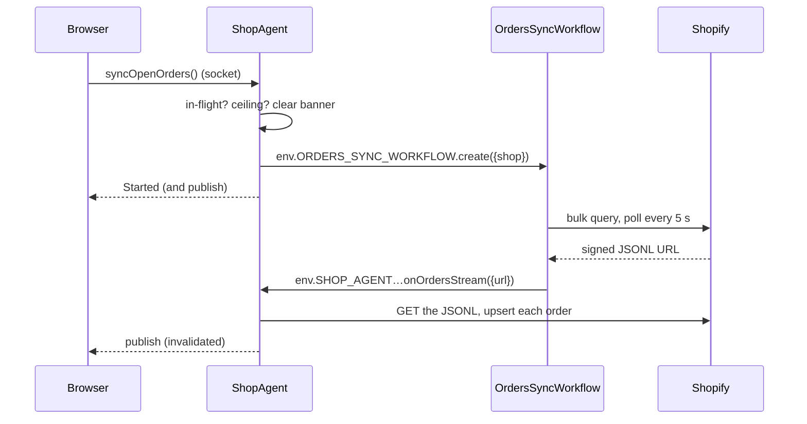
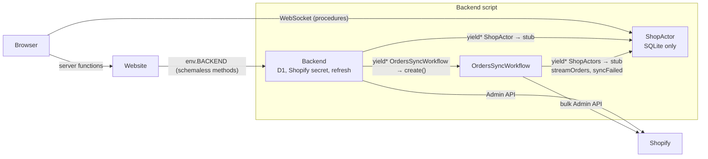
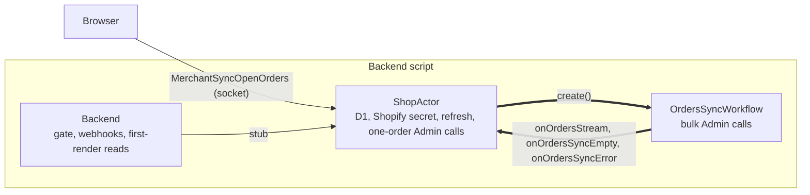
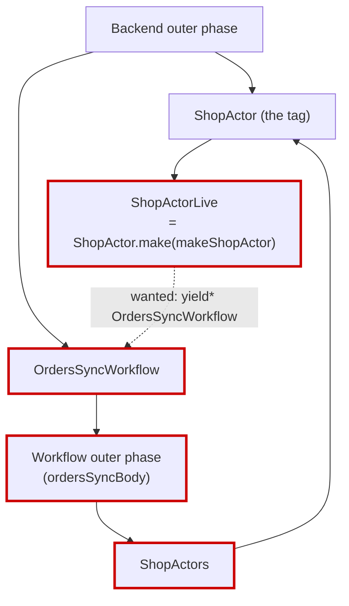

# The actor and the orders sync Workflow: how they are wired

Status: research, written 2026-10-17, for review. No code has changed. An explainer first: legacy's architecture, this repo's before and after the actor ownership correction (`docs/actor-ownership-plan.md`), what we wanted, and why one edge, the actor creating the Workflow, came out hand-rolled. The questions at the end decide whether that edge stays as it is.

Legacy paths are relative to `refs/baton-legacy/`.

---

## 1. The one idea that explains the problem

**Legacy declares its bindings in a config file and finds them by name at runtime. Alchemy declares its bindings in the code: yielding a class registers the binding and returns a typed handle.**

- In legacy, `wrangler.jsonc` lists `D1`, `SHOP_AGENT` and `ORDERS_SYNC_WORKFLOW` once, for the one Worker script. Any code in that script reads `env.SHOP_AGENT` or `env.ORDERS_SYNC_WORKFLOW` when it runs. Nothing at build time knows who uses what, so two pieces that call each other are no problem: each one looks the other up by name.
- In Alchemy, there is no config file. When the stack is planned, Alchemy runs each runtime's **outer phase** (the outer `Effect.gen`). Every `yield* SomeClass` there does two things: it tells Alchemy "this script needs a binding to `SomeClass`", and it hands back a typed handle. So the code's dependency graph **is** the binding graph, and TypeScript and Effect check it.

That checking is what makes Alchemy safe. It is also why two pieces that need each other, the actor and the Workflow, form a **cycle**: the actor's outer phase would yield the Workflow, and the Workflow's outer phase yields the actor.

---

## 2. Legacy

### 2.1 What runs where

One Worker script. Its `env` holds every binding, and every class in the script sees all of it.

### 2.2 How the two edges are found

- **Object → Workflow.** `ShopAgent.syncOpenOrders` calls `this.runWorkflow("ORDERS_SYNC_WORKFLOW", {shop})`. The agents SDK looks up the binding **by name in `env`** (`_findWorkflowBindingByName` in `refs/agents/packages/agents/src/index.ts`, "Workflow binding '…' not found in environment") and calls `create`.
- **Workflow → object.** `this.agent` in the Workflow is resolved by the SDK **by name in `env`** too: the binding name `SHOP_AGENT` travels in the params, then `getAgentByName(env[...], shop)` (`refs/agents/packages/agents/src/workflows.ts`, "Agent binding '…' not found in environment").

Both edges are string lookups at runtime. That is how legacy has the cycle and never notices it.

### 2.3 One sync, start to finish

---

## 3. This repo before the correction (slice A)

Two Workers and an actor. The Backend held D1, the Shopify secret and the Workflow; the actor held only its own SQLite.

There was no cycle: the Backend created the Workflow, and the Workflow called the actor. Both edges were Alchemy yields. That is also why it diverged from legacy without anyone deciding it: the Backend owning the start was the shape that wired cleanly.

---

## 4. What we wanted (A1) and what we have

A1 moved the start into the actor, as legacy's object does. The arrows we wanted are legacy's:

The two bold edges point at each other. Here is how each is wired today (`main` at f074b64):

| Edge                                 | How it is wired                                                                                                                                                                                             | Alchemy-typed?                                 |
| ------------------------------------ | ----------------------------------------------------------------------------------------------------------------------------------------------------------------------------------------------------------- | ---------------------------------------------- |
| Workflow → actor                     | The Workflow's outer phase yields `ShopActors`, which yields `ShopActor`: a typed stub (`orders-sync-workflow.ts`).                                                                                         | yes                                            |
| Actor → Workflow                     | The actor's outer phase yields `Cloudflare.WorkerEnvironment` and reads `env.OrdersSyncWorkflow` by name when `create` runs (`makeOrdersSyncWorkflows`, `src/backend/shop-actor/orders-sync-workflows.ts`). | **no**: a name lookup, as legacy's SDK does it |
| Who registers the Workflow's binding | The Backend's outer phase yields `OrdersSyncWorkflow` (`backend.ts`), which puts the binding and the Workflow class on the Backend's script. The actor shares that script, so its `env` has the binding.    | yes                                            |

So today's code is **legacy's shape on one edge and Alchemy's on the other**. It works locally and in every suite. Staging has it deployed (2026-10-17), not yet checked by hand.

---

## 5. Why the actor cannot simply yield the Workflow

### 5.1 The wiring graph

What runs when the Backend's stack is planned, as yields (an arrow means "its outer phase yields"):

The dotted edge closes a loop: building the actor's layer needs the Workflow, whose outer phase needs `ShopActors`, which needs the `ShopActor` tag, which is what the actor's layer is building. It fails twice, in two places:

1. **Types.** `ShopActor`'s shape (the list of its methods) was inferred from its implementation (`Effect.Success<Effect.Success<typeof makeShopActor>>`). The implementation yields the Workflow, the Workflow's type mentions `ShopActors`, `ShopActors` mentions `ShopActor`'s shape: TypeScript reports `TS2506: 'OrdersSyncWorkflow' is referenced directly or indirectly in its own base expression` (151 errors in the first try of S1).
2. **Layers.** Even with the types fixed, Effect cannot build a layer that requires itself: `ShopActorLive` would need `ShopActor`, which only `ShopActorLive` provides.

### 5.2 Alchemy's idiom, and where it broke

Alchemy's guide for cycles (`refs/alchemy/website/src/content/docs/infrastructure-as-effects/circular-bindings.mdx`) splits **identity** (a class used as a tag, with its shape declared by hand) from **implementation** (`.make()`), and lets only the identity cross the cycle. Follow-up round 2 tried both halves:

| Piece                                                                                                         | Fixes         | Result                                                                                                                                                                                                                                                                                                                                                                                                                             |
| ------------------------------------------------------------------------------------------------------------- | ------------- | ---------------------------------------------------------------------------------------------------------------------------------------------------------------------------------------------------------------------------------------------------------------------------------------------------------------------------------------------------------------------------------------------------------------------------------- |
| Declare `ShopActorShape` on the tag (`DurableObject<ShopActor, ShopActorShape>()("ShopActor")`)               | 1, the types  | **Worked.** `vp check` green; the tag moved to its own module (load order), as the guide does.                                                                                                                                                                                                                                                                                                                                     |
| The Workflow binds the actor with `ShopActor.from(<host Worker>)`, which needs only the Worker, not the layer | 2, the layers | **Failed on every fresh local stack**: `[TestBackend] fail (local) — Cannot coerce Output<TestBackend.workerName> to a string`. `from` names the host by its script name, which a local stack has not created yet when the binding is planned. Passing the `Backend` class instead would point the test Backend at the production Backend's script; a plain string is not available, since Alchemy generates local and test names. |

The second piece is documented by Alchemy for a Worker binding a Durable Object it hosts (`.from(Self)`, "Using `.from(Self)` Inside the Host"), and tested only across two Workers. A Workflow on the same script, on a local stack, is the case that breaks. That is a gap in Alchemy's local provider, not in our code; fixing it means a change or an answer from Alchemy. The round reverted to today's handle (33640ee records it).

One more finding from the round: **the Backend must keep `yield* OrdersSyncWorkflow` in every option.** At runtime the Backend's init does not run the actor's outer phase, so without the Backend's yield the Workflow class would be missing from the script's exports wherever no actor has started.

---

## 6. Options

| #   | Option                                                                                                                               | Matches legacy                  | Alchemy-typed on both edges | Cost                                                                                                                                                                       |
| --- | ------------------------------------------------------------------------------------------------------------------------------------ | ------------------------------- | --------------------------- | -------------------------------------------------------------------------------------------------------------------------------------------------------------------------- |
| 1   | **Keep today's**: the actor finds the Workflow's binding by name; the Workflow yields the actor.                                     | yes (legacy finds both by name) | no (one edge)               | 30 lines in `orders-sync-workflows.ts`; a typo in the name is a runtime defect, guarded by the shared constant `ORDERS_SYNC_WORKFLOW` and by the integ and e2e sync tests. |
| 2   | Today's plus the declared `ShopActorShape` (round 2's first piece)                                                                   | yes                             | no (one edge)               | A hand-written interface of the actor's stub methods to keep in step; gains a written-down list of what the Backend and the Workflow may call. No behaviour change.        |
| 3   | Wait for Alchemy: declared shape plus `ShopActor.from(Self)` once its local provider resolves the host's own name                    | yes                             | yes                         | Blocked; needs an issue filed with Alchemy and a release. Option 1 holds until then.                                                                                       |
| 4   | Flip the other edge: the Workflow finds the actor by name (`env.ShopActor`) and the actor yields the Workflow class                  | yes                             | no (the other edge)         | The Workflow's three callbacks lose their typed stub, which is the edge with more calls; also re-runs the Workflow's registration on every activation. Worse than 1.       |
| 5   | Remove the Workflow → actor edge: the Workflow returns the bulk URL as its result and the actor polls `get(id).status()` on an alarm | no (legacy calls back)          | yes                         | A new alarm loop and its staleness rules in the actor; sync completes on the next poll, not at once; more code than it removes. Rejected unless 1 is unacceptable.         |
| 6   | Back to slice A's shape: the Backend creates the Workflow                                                                            | no (A1 decided against it)      | yes                         | Reverses decision A1.                                                                                                                                                      |

---

## 7. Questions

1. **Is the architecture off?** **Recommendation:** no. The runtime picture (§4) is legacy's, and every behaviour test passes. What differs is wiring style: legacy wires both edges by name and so never sees the cycle; Alchemy wires by yield and does. Today's code wires one edge legacy's way, with the name in one shared constant.
2. **Which option?** **Recommendation:** option 1, with the handle's JSDoc saying in two sentences why the actor reads the binding by name (the cycle, and `.from(Self)` failing on local stacks). Take option 2 too only if you want the actor's stub list written down.
3. **Report the `.from(Self)` gap to Alchemy?** **Recommendation:** yes, as an issue with the error and the shape (a Workflow and a Durable Object on one script, each binding the other); if it is fixed, option 3 replaces the handle in one small change.
4. **Staging.** It runs today's code (deployed 2026-10-17). **Recommendation:** verify it by hand now, since no option changes behaviour, then push `main`.
