# Research: connection identity, roles and revocation for actors (spike S1)

Research date: 2026-10-11.
Status: research only, reviewed against sources 2026-10-11 and revised 2026-10-12 after review (see end of [§1](#1-summary)); the questions in [§12](#12-questions-with-recommendations) are open.
Versions: Alchemy `2.0.0-beta.81`, Effect `4.0.1`, Better Auth `1.7.7`, `@cloudflare/workers-types` `5.20261006.1`; Baton as pinned in `refs/baton` (`agents` `0.28.0`). Do not bump dependencies.
Background: [Baton port spikes research](./baton-port-spikes-research.md) §4.1 (this is spike S1), [ShopActor POC research](./shop-actor-poc-research.md) and [plan](./shop-actor-poc-plan.md), [glossary](./glossary.md) (**Actor**, **Notice**, **Shop key**).

Sources: `node_modules/alchemy/src/Cloudflare/Workers/{RpcWebSocket,RpcDurableObject,DurableObjectState,WebSocket}.ts`, `node_modules/alchemy/package.json` (exports); `node_modules/effect/src/rpc/{RpcServer,RpcClient,RpcMiddleware,Rpc,RpcGroup}.ts`, `node_modules/effect/src/socket/Socket.ts`, `node_modules/effect/src/reactivity/AtomRpc.ts`, `node_modules/effect/src/http/Headers.ts`, `refs/effect/packages/platform/node/test/fixtures/rpc-schemas.ts`; `refs/baton/src/worker.ts` (`authorizeShopAgentRequest`, `authorizeShopAgentMember`, `rebuildRequest`), `refs/baton/src/lib/ShopAgent.ts` (`CallerRole`, `connectionRoleGuard`, `callableEffect`, `closeMemberConnections`, `displaceConnections`), `refs/baton/src/lib/domain/{Platform,ShopWork}.ts` (`ConnectionRole`, `ConnectionState`, `ShopLimits`), `refs/baton/src/lib/{Auth,MemberAccess,ShopAgentSocketHost,SocketBanner}.ts(x)`, `refs/baton/src/routes/{app,shop.$shop}.tsx`, `refs/baton/test/integration/{worker-agent-gate,shop-agent-connections,shop-agent-callables,member-runs-socket,auth}.test.ts`, `refs/baton/docs/limits-plan.md`; `refs/agents/packages/agents/src/client.ts` (`isTerminalCloseEvent`); `refs/cloudflare-docs/src/content/docs/durable-objects/{api/state,best-practices/websockets,best-practices/rules-of-durable-objects}.mdx`, `refs/cloudflare-docs/src/content/compatibility-flags/{web-socket-auto-reply-to-close,websocket-close-reason-byte-limit}.md`, `refs/cloudflare-docs/src/content/docs/agents/runtime/operations/cross-domain-authentication.mdx`; `refs/better-auth/packages/better-auth/src/{db/with-hooks,db/internal-adapter,api/routes/session,api/routes/sign-out,plugins/admin/routes,plugins/admin/admin,context/create-context}.ts`; this repo's `src/backend/{worker,middleware,auth,members,shop-actor}.ts`, `src/api/{backend,shop-actor}.ts`, `src/shop-actor-client.ts`, `src/socket-session.ts`, `src/routes/api.actor.$key.ts`, `src/backend-transport.ts`, `migrations/0001_member.sql`.

## 1. Summary

- **The problem.** An actor serves two kinds of caller over one socket: the shop's owner (Baton's merchant) and the shop's members. They must reach different procedures, and a member's own id and teams must come from the connection, never from a payload. Today the Backend checks only that _a_ session exists, then forwards. The actor has no idea who is on any socket. A socket opened while signed in stays open through sign-out, ban, role change, removal and session expiry ([§4](#4-where-we-are)).
- **Baton's model is the target, and it is clean.** Baton builds it on hooks the Agents SDK and PartySocket provide ([§5.1](#51-how-baton-gets-this-from-the-agents-sdk-and-partysocket)); the port must supply those hooks, since Alchemy's transport has none of them.
  - The Worker gate resolves identity once per connect. It rebuilds the forwarded request from scratch, so a client cannot inject identity headers.
  - The object stores the identity with the socket, where it survives hibernation, and tags the socket by role and member.
  - Every method names its role, and the check cannot be forgotten.
  - The identity is a snapshot, so every change that matters actively closes sockets. Each close code tells the client whether to reconnect: 3401 means re-auth through the gate, 4403 means forbidden, 4409 means displaced; the last two are terminal.
  - A member may hold two connections; the newest wins.

  Details in [§5](#5-baton-the-model-to-port).

- **Alchemy's RPC socket can't carry any of it as shipped** ([§6](#6-what-alchemy-and-effect-give-us)):
  - it accepts every socket with one fixed tag;
  - it never shows the upgrade request to app code;
  - app code never holds the socket, so it can't attach data or close one connection;
  - the module isn't exported.

  Effect RPC itself has the right pieces: middleware that provides a `CurrentConnection` and fails with a typed `Forbidden`, per-group middleware for roles, and a client id that Alchemy restores after hibernation.

- **A security trap to design around:** the `headers` an RPC middleware sees are authored by the client. On Alchemy's socket they are nothing but the client's message headers; on the HTTP path Effect merges the raw request's headers first and the message's headers win on a collision (`Headers.fromInput`, later entries win). An identity header added by the Backend can therefore be overridden by any client that knows its name. Identity must never be read from RPC `headers` on a path a browser can reach ([§6.3](#63-the-header-trap)).
- **Four ways to get there** ([§7](#7-options)):
  - A: extend Alchemy's transport with an accept hook, a connection service and close-by-tag; prototype with `pnpm patch` and offer upstream.
  - B: vendor the transport into the repo with the same hooks.
  - C: keep the stock transport; every call carries a short-lived, Backend-signed **lease**; revocation is a self-pruning table plus a data-free notice.
  - D: RPC over HTTP through the Backend, plus our own raw socket for notices and revocation.
- **Recommendation: bind once on the socket, close to revoke, on stock Alchemy** ([socket identity research](./socket-identity-research.md)). The actor can list its sockets, read and write their attachments and close them; Alchemy's transport preserves our keys in the attachment. So a Backend-signed ticket on the first call binds identity to the socket, every later call reads it from the socket, and `Revoke` closes the sockets that match. No patch, no timers, no renewals. The Backend's own stub calls are told apart from socket calls by the presence of `HttpServerRequest`, to be verified first in the spike. The lease (C) was recommended for part of 2026-10-12 and withdrawn: its scheduled renewals were the wrong trade.
- **What the spike builds** ([§9](#9-proposed-spike)):
  - D1 tenancy from Baton's own migration: `ShopSession`, `Member`, `Team`, `TeamMember`, seeded; token columns unused.
  - A gate that answers 401, 403, 404 and 503 as Baton's does, on the upgrade and on the lease endpoint, and rebuilds what it forwards.
  - A signed lease, minted by the Backend, verified by actor middleware, carried by client middleware, renewed on demand when expired.
  - Role groups enforced by middleware, with a `System` lease for the Backend and Workflows.
  - `Revoke` plus a `recheck` notice, fired from Better Auth hooks and membership edits.
  - Tests at every tier, including a forged lease, an expired lease, a revoked lease and a renewal that returns 404.

**Revision (2026-10-12, later).** The claim in §6.1 that app code never holds a socket was wrong: `getWebSockets()` returns every socket with its attachment, and `ShopActor` already uses it. That makes Baton's connection model possible without a patch; see [the socket identity research](./socket-identity-research.md), which is now the recommendation. §3 and §7 C (the lease) are kept as written for the record. §9 and the questions should be read with the new document.

**Revision (2026-10-12).** [§3](#3-from-first-principles) was rewritten as a genuine first-principles derivation rather than a justification of option A, and it changed the recommendation from A to C, the lease. The Alchemy patch is no longer needed.

**Soundness review (2026-10-11).** Every source claim above was re-read against the cited files. The analysis stands. Corrected in this revision: the mechanism of the header trap on the socket path ([§6.3](#63-the-header-trap): Alchemy's transport merges no transport headers at all, the merge quoted before belongs to Effect's own socket servers); Baton's role vocabulary ([§5](#5-baton-the-model-to-port) rule 6: `ConnectionRole` is `merchant | member`, `rpc` is a `CallerRole`); the Website `POST` route is guarded by `rejectRequest`, so "unused" rather than "open" ([§4](#4-where-we-are)). Added: Better Auth runs `delete.after` hooks after the transaction commits ([§6.4](#64-platform-and-better-auth-facts)); `makeProtocolSocket` keeps the `retryTransientErrors` guard the client uses today ([§8.9](#8-design-points-common-to-every-option)); a question on how the `System` caller is recognised ([Q10](#12-questions-with-recommendations)); and [§2](#2-the-problem-plainly) for the reader who wants the problem before the sources.

## 2. The problem, plainly

Three questions have to be answered for every message that arrives on a shop's socket, and today none of them is:

1. **Who is this?** The actor must know the user, their session and their role in _this_ shop. It must learn it from something the user cannot write, which rules out the message payload and, as [§6.3](#63-the-header-trap) shows, the RPC headers.
2. **What may they call?** Owners and members reach different procedures. The check must be impossible to forget when a procedure is added.
3. **When do they stop being allowed?** Sign-out, a ban, a role change, removal from the shop, or plain session expiry. An HTTP request is checked every time it arrives. A socket is checked once, when it opens, and then stays open for hours: the keepalive defeats the edge's idle close and hibernation keeps it alive at no cost. So whatever the actor learned at connect time is a snapshot, and something has to go and close the socket when the snapshot goes stale.

The third question is the hard one, and it is why a socket cannot simply reuse the HTTP middleware the Backend already has.

### 2.1 Today

The Backend checks that _a_ session exists and forwards the upgrade untouched. The actor accepts every socket with the same single tag and no identity.

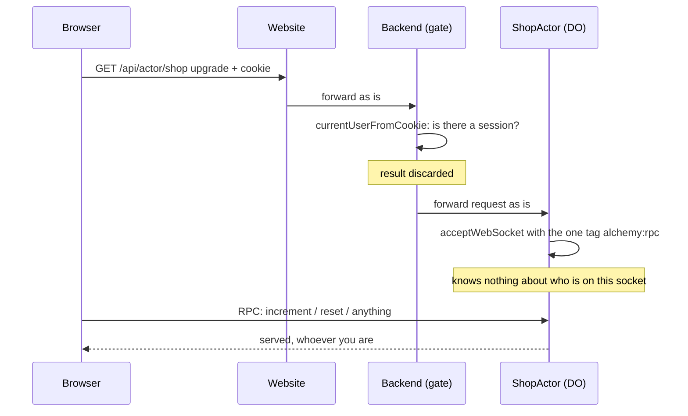

What this means in practice:

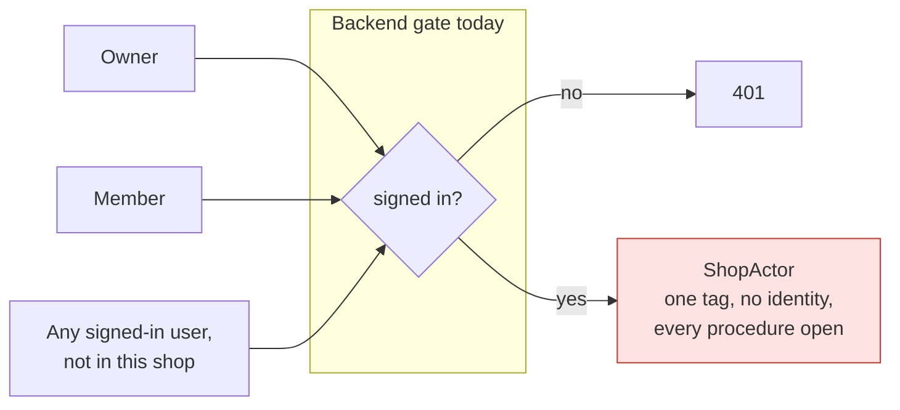

And the staleness problem, which no amount of gate work fixes on its own:

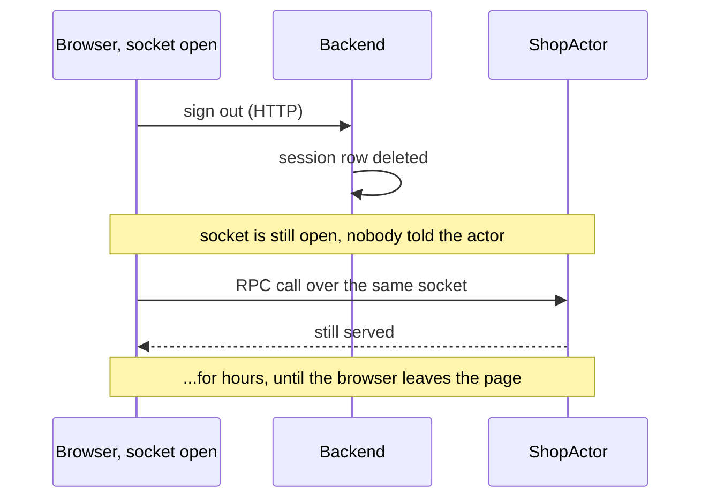

### 2.2 The target as first drafted (Baton's model)

This is the connection-bound model the research first aimed at; [§3.3](#3-from-first-principles) derives a different one from first principles and the document now recommends that. Both are kept here because the problem is the same and the diagrams below show it most concretely. In Baton's model, identity is resolved once by the gate, carried on a request the gate rebuilt from scratch, stored with the socket where hibernation keeps it, and read from there by middleware. Every change that matters closes the sockets it affects, with a code that tells the tab what to do next.

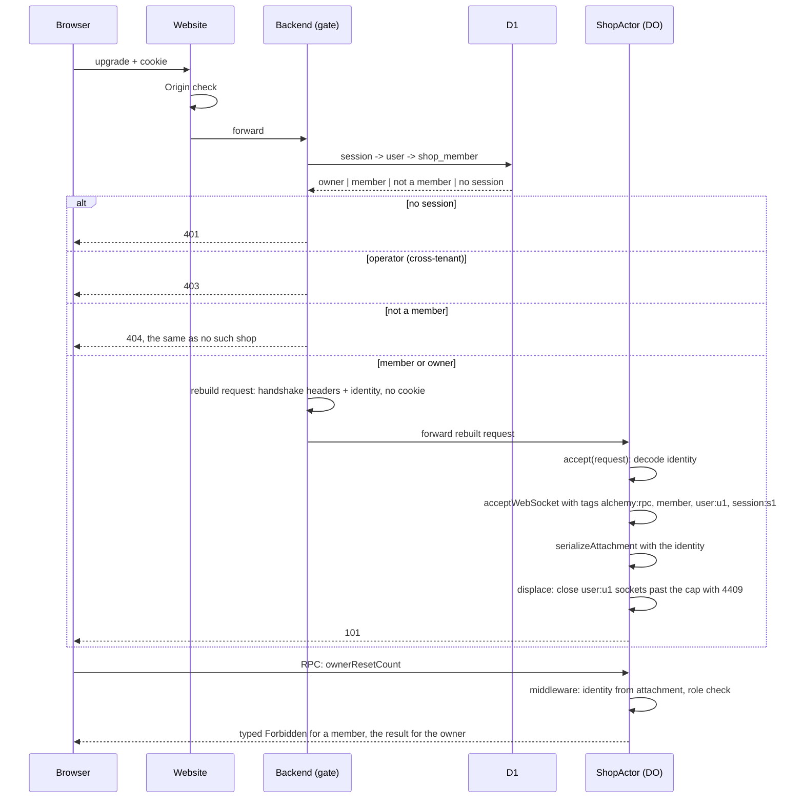

Revocation, the piece a socket needs that HTTP does not:

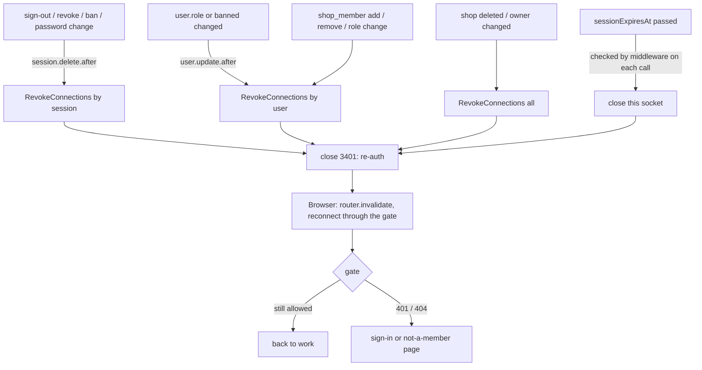

What the browser does with each close code:

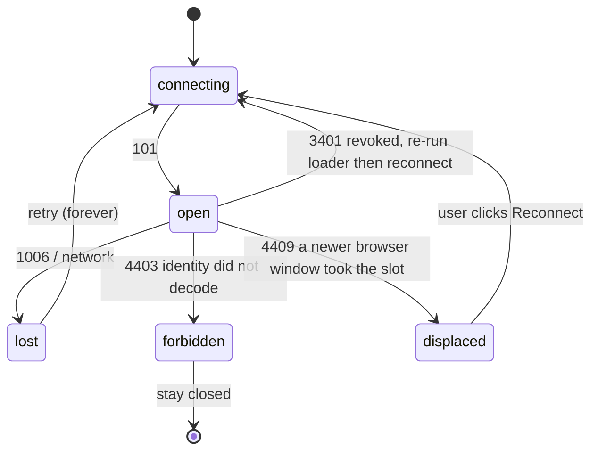

### 2.3 Why the stock transport cannot do it the connection-bound way

Alchemy's RPC socket does four things that each block one step of the connection-bound model _at accept time_. Correction, later the same day: three of the four are not blocks at all. After accept, the actor can list its sockets, read and write their attachments (Alchemy keeps our keys) and close them; only the upgrade request and the tags are out of reach. Binding identity on the first call instead of at accept is what [the socket identity research](./socket-identity-research.md) does.

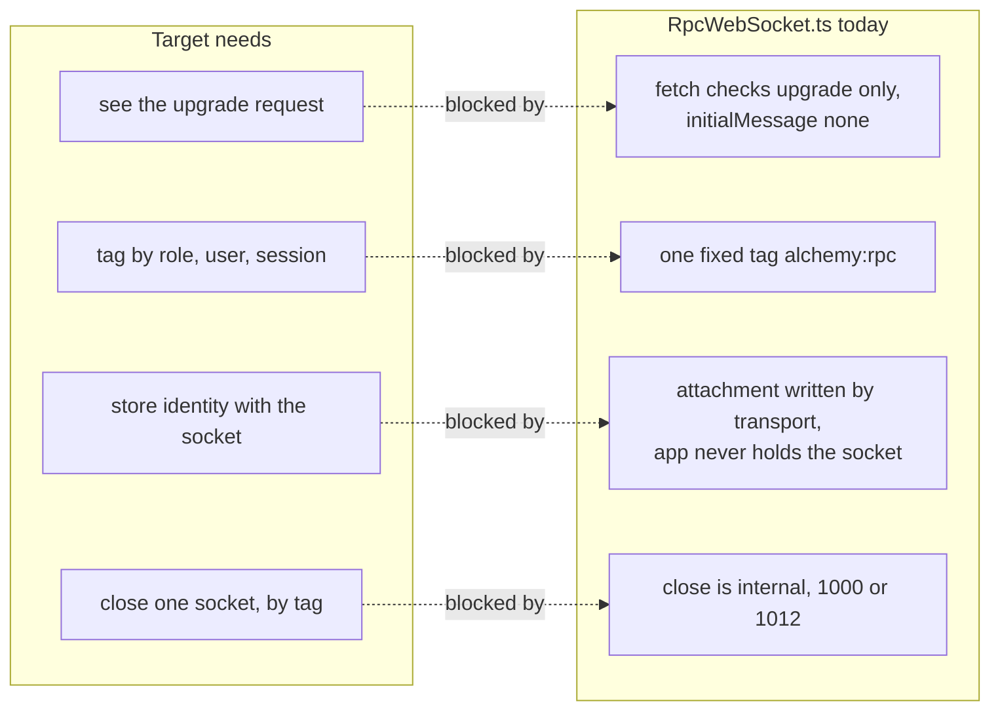

The four options in [§7](#7-options) are four ways around this: open the transport up (A), copy it (B), stop needing a connection identity by signing every call (C), or stop doing RPC on the socket (D).

### 2.4 The header trap in one picture

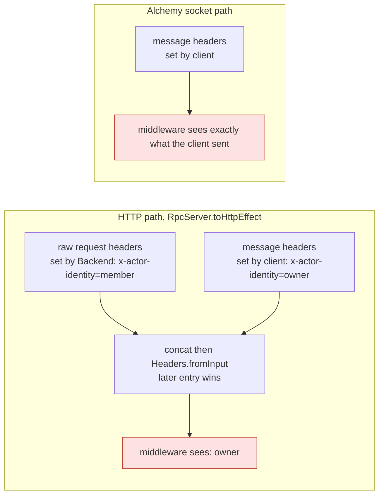

On neither path can a Backend-set RPC header be trusted. The attachment and the raw request, read before any merge, are the only trustworthy sources, which is what options A, B and D do; C makes the header trustworthy by signing it.

## 3. From first principles

This section does not argue for the design above. It asks what the right design is if we start from nothing, with only the situation, the platform and the parties, and then checks whether the research has been walking toward it or away from it. Short answer: away, in one important respect, and the rest of this document is revised to match.

### 3.1 The situation, stripped

A browser holds a long-lived connection to a stateful object that owns one shop's data. The browser sends calls and receives pushes. The object must answer three things for every call: who is this, what may they do, and is that still true. The people involved: a user with a Better Auth session on the Website, who is a member (or the merchant) of some shops and not others; operators, who are not members; and the Backend itself, which calls the object from webhooks and workflows.

### 3.2 Separate the three things that get tangled

Most of the difficulty in [§2](#2-the-problem-plainly) comes from treating one mechanism, "the connection", as the carrier of all three answers. From first principles they are different problems with different natural homes.

1. **Authentication** (who): verify a credential. Credentials live at the edge, in the Backend, with Better Auth and D1. Only the Backend can do this, and it should do it as often as needed and nowhere else.
2. **Authorization** (what): a decision about this shop's data. The object owns the data, so the object decides, from the authenticated identity plus the shop's own facts (membership, role). The decision belongs next to the data, not at the edge.
3. **Lifetime** (still true): an authentication is a fact about a moment. Anything that remembers it is a cache, and a cache is safe only if its staleness is **bounded by construction**: a deadline nobody can forget to set, not a list of events somebody has to remember to send.

Three principles follow:

- **Fail closed by default.** The safe state of a cached identity is "expired". Anything that keeps it alive must be an active, verified renewal. A design that stays open until someone remembers to revoke it is the wrong way round.
- **Notification is an optimisation, never the mechanism.** Telling a browser promptly that it lost access is good UX, and it should be best effort. Security must not depend on it.
- **Nothing the client authors carries privilege unless it is signed by us.** Headers, payloads, query strings: all client text. A signature is what turns client text into something the object may trust.

### 3.3 The design that falls out: a lease

Put the three homes together and a concrete design appears without reference to any SDK. **Superseded the same day.** Review of this section found two things: a lease renewed on a schedule gives up the idle socket that hibernation buys, and the premise below that the actor cannot reach its own sockets is false ([§6.1](#6-what-alchemy-and-effect-give-us)). The design now recommended, bind once on the socket and close to revoke, on stock Alchemy, is laid out in [the socket identity research](./socket-identity-research.md). The lease text is kept for the record.

- **The Backend issues a lease.** When a browser needs to talk to a shop's actor, it asks the Backend over HTTP. The Backend checks the session (one D1 read), checks membership in that shop, and returns a signed lease: `{ shop, userId, sessionId, role, iat, exp }`, with `exp` a few minutes out and never past the session's own expiry. The signature is an HMAC with a secret only the Backend's Worker holds; the actor lives in that Worker and verifies with the same secret. No session, 401. Operator, 403. Not a member, 404. D1 down, 503.
- **Every call carries its lease.** A client middleware puts the lease on each RPC, over the socket or over HTTP alike. The actor's middleware verifies the signature and `exp`, and provides the identity to the handler. Role middleware per procedure group does the rest. Forgery is impossible, the header trap is irrelevant because the header is signed, and the transport does not need to know anything about identity.
- **The browser renews when it needs to, not on a timer.** A lease is only needed at the moment of a call, so the browser renews only when it is about to call and its lease has expired. An idle browser sends nothing and its socket hibernates as today. Renewal is the same HTTP call as the first lease. It re-runs authentication and membership, so sign-out, ban, role change and removal all take effect at the next renewal without anyone sending anything. The renewal failing is also how the browser learns _why_: 401 means sign in, 404 means you are no longer a member. That is the signal the research wanted from close codes and `router.invalidate`, and here it is the ordinary response of an ordinary HTTP call.
- **Immediate revocation is one small, self-pruning table.** For the cases where minutes are too long (ban, removal), the Backend calls a `System` procedure `Revoke({ by: "user" | "session", id, at })`. The actor records it in SQLite and refuses any lease for that user or session with `iat < at`. An entry can be deleted once it is older than the lease lifetime, because every lease it could have refused has expired by then. The table never grows past the number of revocations in the last few minutes.
- **The browser is told, without being told anything.** On a revocation the actor broadcasts a data-free notice, `recheck`, to every socket. Each browser renews at once. The removed member's browser gets 404 and shows "not a member"; every other browser gets a fresh lease and carries on. Nothing in the notice says who was removed.
- **The socket is still gated.** The upgrade still goes through the Backend, which still requires a session and membership and still rebuilds the request. That keeps strangers off the socket entirely; it is defence in depth, not the security boundary.
- **The Backend and Workflows are `System`.** They present a lease saying `caller: system`, minted in-process. Only the Backend can sign, so a browser can never present one, and the actor never has to guess that a request with no user must be the Backend ([Q10](#12-questions-with-recommendations)).

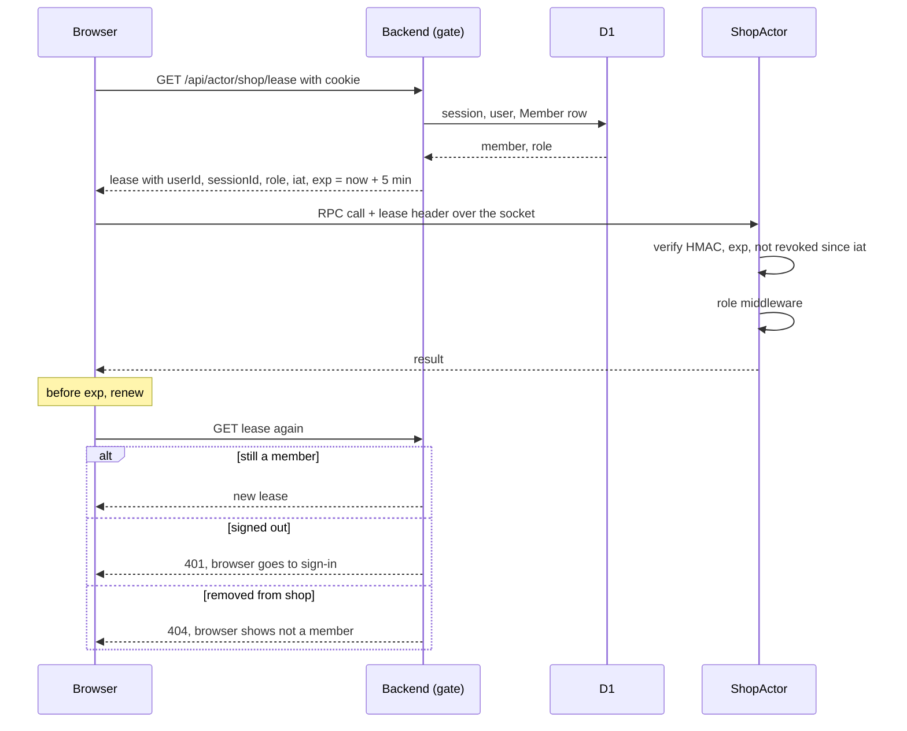

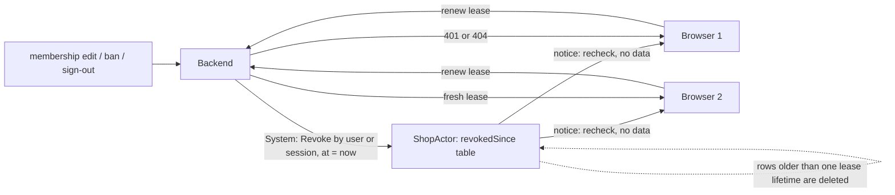

### 3.4 Where this departs from the research so far

The research has been walking toward Baton's design: identity bound to the connection at accept, kept in the attachment, enforced by closing sockets, with Alchemy's transport patched to make that possible. The first-principles design differs on exactly the points that made the research hard.

| Point                      | Research direction (A, Baton's model)                                                              | First principles (lease)                                                                                                                                          |
| -------------------------- | -------------------------------------------------------------------------------------------------- | ----------------------------------------------------------------------------------------------------------------------------------------------------------------- |
| Where identity is bound    | to the socket, at accept, in the attachment                                                        | to each call, in a signed lease; the socket is just a pipe                                                                                                        |
| Staleness bound            | none by construction: a snapshot lives until a trigger fires or the session's 7-day expiry         | lease lifetime (minutes), by construction; nothing to forget                                                                                                      |
| Revocation                 | the security mechanism: enumerate every Better Auth path that ends a session, fan out, best effort | an optimisation: one `Revoke` call plus a data-free notice; if it fails, the lease expires anyway                                                                 |
| How the browser learns why | close code 3401, then `router.invalidate` to find out over HTTP                                    | the renewal's own 401 / 404                                                                                                                                       |
| Close codes                | the protocol between actor and browser                                                             | not needed for security; the transport's own codes suffice                                                                                                        |
| Displacement, caps         | built in, by closing the oldest socket                                                             | a product feature, deferred; approximable later by counting live leases per user                                                                                  |
| Alchemy transport          | patched (accept hook, connection service, close by tag)                                            | stock; nothing to patch, vendor or upstream                                                                                                                       |
| Steady-state cost          | none                                                                                               | none while idle; an active browser renews at most once per lease lifetime (one Website hop, one Backend hop, one D1 read); an HMAC verify per call (microseconds) |
| Per-call identity cost     | attachment read                                                                                    | HMAC verify, cacheable per `Rpc.ServerClient` activation                                                                                                          |
| Sockets of a revoked user  | closed                                                                                             | stay open as a push channel until the browser leaves; calls refused; notices are data-free so nothing leaks                                                       |
| Baton fidelity             | exact                                                                                              | the gate, the role groups, the `System` caller and the surface test port as they are; the connection table and close codes do not                                 |

The research dismissed C, the signed-token option, because "no socket ever closes" and "no real displacement". From first principles those are not security requirements. Closing a socket is a way of telling a tab something, and the lease has a better way: the tab finds out over HTTP, with a status code, at a moment it chose. Displacement is a seat-sharing deterrent that Baton pairs with a session cap; it is a product decision and it does not need to drive the transport design.

What the research did not weigh is that the lease has a safety property A lacks. Under A, the complete list of revocation triggers in [§8.7](#8-design-points-common-to-every-option) has to be right and has to stay right as Better Auth changes, and each trigger is best effort. A missed or failed one leaves a socket with old rights for up to seven days, bounded only by the expiry check. Under the lease the worst case after any failure is one lease lifetime. That is the difference between a design that is secure because every part works and one that is secure because of its shape.

### 3.5 Why Baton did it the other way, and what to keep

Baton's design is the natural one on the Agents SDK ([§5.1](#51-how-baton-gets-this-from-the-agents-sdk-and-partysocket)): the SDK gives hooks on the connection (tags, state, close) and nothing for per-message auth, so identity went onto the connection and revocation became closing. It works, and its tests pin it. It was never a first-principles choice, and the Agents SDK is exactly what the port is leaving behind. Keep from Baton what is independent of the connection model: the gate that answers 401, 403, 404, 503 and rebuilds the request; role-per-procedure with a test that walks every procedure; identity read only from a trusted source, never from a payload; the `System` caller for the Worker; the D1 schema. Leave behind what was SDK-shaped: the connection table, `connection.state`, tag-based revoke, and the close-code vocabulary.

### 3.6 Honest costs and open edges of the lease

- **A renewal before the first call after a lease expires.** Only when the browser is active, never while idle. The lifetime is a knob: longer means fewer renewals and a longer worst case.
- **The client does more.** A client middleware that holds the lease, renews before `exp`, retries once on `Unauthorized`, and surfaces 401 / 404 to the route. All ordinary Effect code; `RpcMiddleware.layerClient` is effectful and can renew inside the call.
- **Clock skew.** The Backend and the actor are in one Worker, so skew is zero in practice; the lease still gets a small grace.
- **A revoked member's socket stays open.** It cannot call; it still receives data-free notices until it reconnects or closes. Acceptable; if Alchemy ever exposes connection close upstream, closing becomes a one-line UX improvement with no security role.
- **Membership still lives in D1.** An alternative worth noting: make the actor the authority on its own membership (SQLite in the object), so removal takes effect in the same storage write as the edit and the gate only authenticates. It is cleaner in isolation, but it diverges from Baton's schema, which the port wants to keep, and the lease already bounds the window. Not recommended for S1; recorded in [Q12](#12-questions-with-recommendations).

### 3.7 Does this take us away from the research?

Yes, on Q1, Q4, Q6, Q7 and Q11, and it makes the Alchemy patch unnecessary. The rest of the document is revised to recommend the lease, with A kept as the described alternative for a reader who wants Baton's connection model exactly. The gate, the schema, the role groups, the `System` caller and the surface test are unchanged.

## 4. Where we are

| Concern                     | Today                                                                                                                                                                                                                                                                                                                                               |
| --------------------------- | --------------------------------------------------------------------------------------------------------------------------------------------------------------------------------------------------------------------------------------------------------------------------------------------------------------------------------------------------- |
| Who may open a shop's actor | Any signed-in user; `worker.ts` JSDoc: "Any member may open any key for now; which member may open which shop is a product decision not yet taken."                                                                                                                                                                                                 |
| Tenancy in D1               | None. `member` is an invite list (`email`, `role admin\|user`); `ShopKey` is a slug with no table behind it.                                                                                                                                                                                                                                        |
| Identity into the actor     | None. The Backend calls `currentUserFromCookie` and discards the result before `actors.fetch(key, request)`.                                                                                                                                                                                                                                        |
| Roles inside the actor      | None; every procedure is open to every socket.                                                                                                                                                                                                                                                                                                      |
| Revocation                  | None. `socket-session.ts` notices a dead session only when an open fails three times; a session that ends while the socket is open is never noticed (plan §9).                                                                                                                                                                                      |
| Role drift                  | `auth.ts` copies `member.role` onto Better Auth's `user.role` once, at user creation; nothing syncs later changes; `currentUserFromCookie` reads `user.role`.                                                                                                                                                                                       |
| Browser HTTP into the actor | `src/routes/api.actor.$key.ts` forwards `POST` too, but nothing in the app uses it: SSR goes Website → `env.BACKEND.fetch` directly (`backend-transport.ts`). `rejectRequest` guards it (RPC headers or NDJSON required, so a cross-site form cannot reach it), but it is an unused path that the identity work would otherwise have to defend too. |
| Cross-site upgrade          | The Website forwards any `GET` upgrade with no `Origin` check. Better Auth's cookie is `SameSite=Lax`, so a cross-_site_ page sends no cookie, but a same-site sibling origin would.                                                                                                                                                                |

## 5. Baton: the model to port

Baton's spec for this is the connection table on `Domain.ConnectionRole` (`domain/Platform.ts`), and every row of it names the test that pins it. The rules, quoted where they are rules:

1. **Only the Worker can tell callers apart.** "The object never sees a cookie or a token — so the Worker's connect gate resolves identity once and forwards it as `x-baton-*` headers on the rewritten upgrade request."
2. **Rebuild the forwarded request, never copy it.** `rebuildRequest` starts from an empty `Headers` and carries forward only the handshake headers. "A browser cannot set headers on a WebSocket upgrade, but a non-browser client can, so copying them forward would let a caller present `x-baton-role: merchant` alongside a member cookie and pick their own role." The cookie and `Authorization` header are dropped too: "the object has no business holding credentials it cannot verify."
3. **Status codes are not a side channel.**
   - No session gets 401.
   - An operator gets 403: operators are cross-tenant and never members.
   - A non-member gets 404, "the same 'no such shop' the page returns".
   - A lapsed subscription gets 402.
   - D1 being down gets 503, because "reporting 'not yours' for an outage would evict a legitimate member's tab".
4. **Identity is a connect-time snapshot** stored with the hibernatable socket, so it does not follow later edits. The keepalive defeats the edge's ~300 s idle close, so every change that matters must close sockets actively.
5. **Read identity from the connection, never from a message.** "`memberId` / `teamIds` are exactly the privileged inputs a member must not be able to name for themselves." Member inputs have no identity fields at all.
6. **Every method names its role**, so "the check cannot be forgotten when a method is added — that, and not the check itself, is what keeps this safe over time."
   - The connection roles (`Domain.ConnectionRole`, what the gate forwards and the socket is tagged with) are `merchant` and `member`. The method roles (`CallerRole` in `ShopAgent.ts`) add `rpc`, which covers plain DO RPC, which only a Worker binding can make.
   - A connectionless caller passes `merchant` and `rpc`, but never `member`, "because it needs an identity, not just trust".
   - The check runs before input decoding, so a refused caller learns nothing from a schema error.
   - Methods that a role may write are named `<role><Verb>`, and there is one method per role rather than one method with a role switch.
7. **Tags carry only what a fan-out selects by:** `["merchant"]` or `["member", "member:<id>"]`. Everything else lives in the connection's state: `memberId`, `memberEmail`, `teamIds` and `connectedAt`.
8. **Close codes steer the client.** Baton's client (the Agents SDK's `isTerminalCloseEvent`) treats 1008 and 4000–4999 as terminal.

   | Code | Meaning                 | When                                                                                                           | Client                                                                        |
   | ---- | ----------------------- | -------------------------------------------------------------------------------------------------------------- | ----------------------------------------------------------------------------- |
   | 3401 | revoked, re-auth        | membership or team edit, member or team deleted, session cap evicted a session, plan changed (all connections) | reconnect through the gate; the page re-runs its loader (`router.invalidate`) |
   | 4403 | forbidden, unidentified | identity on the forwarded request does not decode                                                              | stay closed                                                                   |
   | 4409 | displaced               | a member's third connection                                                                                    | stay closed; banner "Signed in elsewhere" with Reconnect                      |

9. **Displacement:** on connect, list `member:<id>`, sort the others by `connectedAt` descending, and close all but the newest `maxConnectionsPerMember - 1 = 1` with 4409. The new connection always wins, because "refusing the new connection would lock them out". 4409 is terminal because "a displaced screen that reconnected on its own would displace the newer screen back". It pairs with `maxSessionsPerMember: 2`: "a connection cap alone is beaten by taking turns; a session cap alone is beaten by one device with many windows."
10. **Authorization beyond role.** Run and task actions are decided by `Domain.runActions` and `taskActions`, which are read fresh inside the write. A member sees a run if any of its tasks is on one of their teams. An unseen run reads as `None`, "so a member cannot probe run ids". Publish is not scoped: an invalidation carries no data, and each tab re-reads through its own authorized read.
11. **Best effort, by design.** Every revoke and close is wrapped and logged, and never fails the write that triggered it.

### 5.1 How Baton gets this from the Agents SDK and PartySocket

Baton writes none of the socket plumbing itself. Each rule above lands on a hook the Agents SDK (`agents` 0.28.0, on top of PartyServer and PartySocket) provides, which is exactly the set of hooks Alchemy's transport lacks today. The port has to reproduce these hooks, not Baton's logic, which is ordinary Effect code.

| Need                                      | Agents SDK / PartySocket hook Baton uses                                                                                                                                                                                                                                                          | Alchemy today                                                                                         | Alchemy with option A                                                                                                                     |
| ----------------------------------------- | ------------------------------------------------------------------------------------------------------------------------------------------------------------------------------------------------------------------------------------------------------------------------------------------------- | ----------------------------------------------------------------------------------------------------- | ----------------------------------------------------------------------------------------------------------------------------------------- |
| Gate before the object sees the request   | `routeAgentRequest(request, env, { onBeforeConnect, onBeforeRequest })`: the callback returns a `Response` to refuse (401/402/403/404/503) or a `Request` to forward. `authorizeShopAgentRequest` returns `rebuildRequest(...)`, so the object only ever sees the rewritten request.              | The Backend's `fetch` plays this role already; it must return a rebuilt request instead of `request`. | Same; the gate is ours in every option.                                                                                                   |
| See the upgrade request inside the object | `getConnectionTags(connection, ctx)` and `onConnect(connection, ctx)` both receive `ctx.request`, the forwarded upgrade. Baton decodes `x-baton-*` headers from it (`connectionStateFromHeaders`).                                                                                                | `RpcWebSocket.fetch` reads the request only for `upgrade:`; handlers never see it.                    | `connection.accept(request)` runs in `fetch`.                                                                                             |
| Tag the socket                            | `getConnectionTags` runs before accept; its array is passed to `acceptWebSocket`. Baton returns `["merchant"]` or `["member", "member:<id>"]`, or `[]` when the headers do not decode.                                                                                                            | One fixed tag `alchemy:rpc`.                                                                          | `accept` returns `tags`, appended after `alchemy:rpc`.                                                                                    |
| Store identity with the socket            | `connection.setState(state)` in `onConnect`; the SDK persists it in the socket's attachment and restores `connection.state` after hibernation. Baton stores `role`, `memberId`, `memberEmail`, `teamIds`, `connectedAt`.                                                                          | The attachment keeps foreign keys (`...previous`) but app code never holds the socket.                | `accept` returns `identity`, written next to Alchemy's key.                                                                               |
| Read identity per call                    | A `@callable()` method receives the `Connection` as its last argument; `callableEffect` reads `connection.state` and checks `role` before decoding the input. A call with no connection is DO RPC from a binding (`rpc` role).                                                                    | Middleware sees only `client.id`; nothing maps it to a socket.                                        | `RpcConnection.current` maps `client.id` to its attachment.                                                                               |
| Find sockets by tag                       | `this.getConnections(tag)` (unordered). `revokeMemberConnections` lists `member:<id>`; `displaceConnections` lists it, sorts by `state.connectedAt`.                                                                                                                                              | `state.getWebSockets(tag)` exists on the DO, but the transport's `byId`/`bySocket` maps are private.  | `RpcConnection.byTag(tag)`.                                                                                                               |
| Close one socket with a code              | `connection.close(code, reason)` on the SDK's `Connection`; Baton sends 3401, 4403 and 4409. Closed from `onConnect` (undecodable identity, displacement) and from plain-RPC revoke methods the Worker calls after a D1 write.                                                                    | `close(socket, code, reason)` is private; only 1000 and 1012 are ever sent.                           | `RpcConnection.close(selector, code, reason)`.                                                                                            |
| Worker calls into the object              | `getAgentByName(env.ShopAgent, shop)` and a plain method (not `@callable()`), so a browser can never reach it over a socket.                                                                                                                                                                      | `getByName(shop)` exists; every procedure is one RPC group reachable from the socket.                 | A `SystemRpcs` group with `RequireSystem` middleware; see [Q10](#12-questions-with-recommendations).                                      |
| Client reconnect policy                   | `AgentClient` (PartySocket): reconnects with backoff on any close, except `isTerminalCloseEvent` (1008 and 4000–4999). So 3401 reconnects through the gate on its own, 4403 and 4409 stay closed. `onSocketClose` hands the `CloseEvent` to the route, which calls `router.invalidate()` on 3401. | `layerProtocolSocket` retries forever with no way to see the code.                                    | `makeProtocolSocket({ retryPolicy })` with `Schedule.while` on `SocketCloseError.code` ([§8.9](#8-design-points-common-to-every-option)). |
| Displaced banner                          | `ShopAgentSocketHost` holds `displaced` from the 4409 close until the socket next opens; `SocketBanner` reads it to show "Signed in elsewhere" with Reconnect, which creates a new `AgentClient`.                                                                                                 | Nothing.                                                                                              | `connectionStateAtom` plus `reconnectAtom`.                                                                                               |

Two things the SDK does that we should not copy:

- `onConnect` runs after `acceptWebSocket`, so an undecodable identity is accepted and then closed with 4403. Alchemy's `fetch` has the request before accept, so option A refuses with an HTTP status instead, which is cheaper and leaves no half-open socket.
- `getConnectionTags` and `onConnect` each decode the headers separately, because the SDK calls them at different moments. One `accept` returning both `identity` and `tags` decodes once.

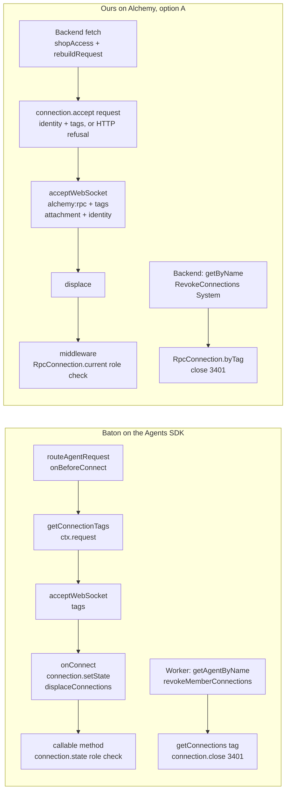

Gaps in Baton worth not porting:

- Explicit sign-out revokes nothing, so another window on the same session keeps its socket.
- `deleteMember` leaves Better Auth sessions alive.
- The session-cap revoke closes every socket of the member, not just the evicted session's, because tags are per member.

## 6. What Alchemy and Effect give us

### 6.1 Alchemy's RPC socket transport

Read in full (`RpcWebSocket.ts`, 339 lines; `RpcDurableObject.makeHandlers`):

| Need                          | What the transport does                                                                                                                                                                                                                                                                                                                                                                                         |
| ----------------------------- | --------------------------------------------------------------------------------------------------------------------------------------------------------------------------------------------------------------------------------------------------------------------------------------------------------------------------------------------------------------------------------------------------------------- |
| See the upgrade request       | `fetch` reads `HttpServerRequest` only to check `upgrade: websocket`; `initialMessage: Effect.succeedNone`. Nothing reaches handlers.                                                                                                                                                                                                                                                                           |
| Tags                          | `state.acceptWebSocket(socket, ["alchemy:rpc"])`; one constant tag.                                                                                                                                                                                                                                                                                                                                             |
| Per-connection data           | `persist` writes `{ ...previous, __alchemyRpcWebSocket: { version, clientId, pending, serialization } }`, so it **keeps other keys**. App code never holds the socket at accept time, but can reach every socket afterwards through `DurableObjectState.getWebSockets()`, match Alchemy's `clientId` to the middleware's `client.id`, and write its own key. `ShopActor` already lists sockets to push Notices. |
| Stable connection id          | `clientId` is persisted in the attachment and restored on wake (`register(socket, metadata.clientId)`); `nextId` continues past the largest restored id. It is reused once every socket has closed and the object restarts.                                                                                                                                                                                     |
| Close one connection          | `protocol.end(id)` and `close(socket, code, reason)` are internal, but any socket from `getWebSockets()` has a public `close(code, reason)`; the transport's own cleanup after an app-initiated close is to be verified.                                                                                                                                                                                        |
| Middleware                    | `RpcServer.layer(props.schema.middleware(RpcRequestLifetime))` serves group and per-procedure middleware; the handler layer can provide implementations. Type-tested only in Alchemy (`RpcWebSocket.types.ts`).                                                                                                                                                                                                 |
| Close from our code on a wake | Restore closes, with 1012, any socket whose attachment shows a request pending or whose serializer differs.                                                                                                                                                                                                                                                                                                     |
| Export                        | `package.json` exports `./Cloudflare/RpcWebSocketClient`, not the server transport; `./Cloudflare/*` resolves to `*/index`, and `Workers/index.ts` does not re-export it. No deep import.                                                                                                                                                                                                                       |
| HTTP path                     | `RpcServer.toHttpEffect(schema)` per request, inside the same object; the raw `HttpServerRequest` is available there but not passed on.                                                                                                                                                                                                                                                                         |

### 6.2 Effect RPC

- **Server middleware** (`RpcMiddleware.Service<Self, { provides?, requires? }>()(id, { error })`) wraps the handler. It receives `{ client, requestId, rpc, payload, headers }`, with the payload already decoded. It can fail with its declared error, which is added to every procedure's failure schema and so arrives typed at `AtomRpc`. It can also `provideService` a `CurrentConnection`.
- **Middleware placement:** `RpcGroup.middleware(M)` applies to every procedure added before it, and `Rpc.middleware(M)` applies to one procedure. This repo already uses the group form (`BackendRpcs` = Public + Member + Admin).
- **`Rpc.ServerClient`** has `id` and a mutable `annotations: Context`. It is created on a client's first message and dropped on disconnect. After a wake it is recreated empty, so annotations are a per-activation cache, never the source of identity.
- **Client headers:** `RpcClient.CurrentHeaders`, `withHeaders`, the per-call `{ headers }` option, or a client middleware (`RpcMiddleware.layerClient`, which can be effectful and fetch a token). With `AtomRpc`, the client middleware layer goes in the `protocol` layer.
- **Close handling on the client:**
  - Every close fails the socket reader with `SocketCloseError { code, closeReason }`, including a clean 1000.
  - `makeProtocolSocket` broadcasts any non-open error as an `RpcClientError` (with the close in `reason`) to pending calls, then retries under `retryPolicy`. The default retries forever.
  - **`layerProtocolSocket` does not expose `retryPolicy`; `makeProtocolSocket` does.** So "stop on 4403 or 4409" is a `Schedule.while` on the policy's input. When the schedule stops, the loop ends for good and later calls fail until the protocol layer is rebuilt.
  - `ConnectionHooks.onDisconnect` gets no code.
  - `Socket.makeWebSocket(url: string | Effect<string>)` re-evaluates the URL on every reconnect.
- **No built-in auth.** The canonical example (`rpc-schemas.ts`) is a header-reading `AuthMiddleware` with `provides: CurrentUser`, `error: Unauthorized` and `requiredForClient: true`, plus a client middleware that sets the header.

### 6.3 The header trap

The `headers` a middleware receives are the message's own headers, optionally preceded by transport headers:

- **HTTP path** (`RpcServer.toHttpEffect`, used by Alchemy's HTTP view): `requestHeaders.concat(message.headers)`, then `Headers.fromInput`, where a later entry wins. The raw request's headers are there, but the client's message overrides any of them.
- **Alchemy's socket path**: the transport hands each decoded message to `RpcServer` directly (`receive(connection.id, request)`) and merges nothing. The headers are the client's, and only the client's. (The `headers.concat(message.headers)` in `RpcServer.onSocket` belongs to Effect's own socket servers, `makeProtocolSocketServer` and `makeProtocolWithHttpEffectWebsocket`, which Alchemy does not use.)

**Either way, a client controls every RPC header it names, whatever the transport carried.** For the Backend's existing `CurrentUserLive` (reads `headers.cookie`) this is harmless: a client can only substitute a cookie it already holds. For an identity header added by the Backend, it is privilege escalation: a member who sends `x-actor-identity: {"role":"owner"}` inside the message would become the owner.

Consequences for any design:

- Identity must come from the **attachment** (socket) or from the **raw HTTP request**, captured before the merge (HTTP). Never from RPC `headers`.
- The Backend must still rebuild what it forwards, as Baton does, so a raw HTTP header cannot be injected either.
- A design that does read identity from RPC headers must make it unforgeable, i.e. signed. That is option C.

### 6.4 Platform and Better Auth facts

- **Hibernation API** (`api/state.mdx`, `best-practices/websockets.mdx`):
  - at most 10 tags per socket, 256 characters each;
  - at most 32,768 sockets per object;
  - `getWebSockets(tag)` is an unordered set, and may include sockets still closing;
  - the attachment is at most 16 KiB, structured-clonable, kept across hibernation while the socket lives; call `serializeAttachment` again after a change;
  - auto-response and protocol pings do not wake the object.
- **Closing** (compat flags, both on at our date 2026-07-01):
  - `web_socket_auto_reply_to_close` makes the runtime answer a client's close itself.
  - `websocket_close_reason_byte_limit` makes `close()` throw on a reason over 123 UTF-8 bytes.
  - Codes 1005, 1006 and 1015 cannot be sent.
  - 3000–4999 are application codes and reach the browser's `CloseEvent` unchanged on a clean close.
- **Browsers** cannot set headers on an upgrade, and do send cookies on a same-origin upgrade (`cross-domain-authentication.mdx`). Cloudflare's docs have no guidance on `Origin` checks.
- **Better Auth lifecycle** (`db/with-hooks.ts`, `internal-adapter.ts`):
  - `databaseHooks.session.delete.after` fires once per row for `signOut`, `revokeSession(s)`, `revokeOtherSessions`, admin `banUser`, `revokeUserSession(s)`, `removeUser`, `/delete-user`, password change and reset, and `stopImpersonating`. Bulk paths go through `deleteManyWithHooks`, which still runs the hook per entity, and after hooks are queued to run after the transaction commits, so a revoke never races a rollback.
  - Admin `setRole` fires `user.update` only, and revokes nothing.
  - **Expiry fires nothing.** An expired session is deleted lazily the next time `getSession` reads it, so a live socket never hears of it; we must compare `expiresAt` ourselves.
  - Defaults: 7-day expiry, 1-day sliding refresh; `cookieCache` off.
  - `getSession` is one D1 read (session joined to user, so `role` and `banned` are current).

## 7. Options

All four options share these parts:

- the Backend gate: resolve the session, then the shop membership in D1;
- answers of 401, 403, 404 or 503;
- the `owner` / `member` / `System` roles;
- role middleware on procedure groups;
- revocation triggers in the Backend and in Better Auth hooks.

They differ in how identity reaches a socket call, and in how a particular socket is found and closed.

### A. Extend Alchemy's transport (patch, then upstream)

Add three things to `RpcWebSocket.make` and `RpcDurableObject`. Names are provisional:

1. **An accept hook.** `RpcDurableObjectProps` gains an optional `connection`. It has a `schema` for the identity and an `accept(request) => Effect<{ identity, tags }, HttpServerResponse>`, which runs in `fetch` before `acceptWebSocket`.
   - A failure is returned as the response, which is how 4403 becomes an HTTP refusal; Baton closed after accept instead.
   - On success the transport accepts with `["alchemy:rpc", ...tags]` and writes the encoded identity into the attachment next to its own key.
   - The HTTP path runs the same `accept` on each raw request, before `toHttpEffect`.
2. **A `RpcConnection` service** available to handlers and middleware. It has `current` (the decoded identity for `client.id`, from the socket's attachment or from the HTTP request), `byTag(tag)`, and `close({ tag } | { clientId }, code, reason)`.
3. **An `onAccepted` hook** (or simply calling `RpcConnection` from the accept hook) so the app can displace older connections in the same turn.

What it gives:

- Baton's semantics one for one. Identity is kept with the socket across hibernation and cannot be forged: it never touches RPC headers.
- Close codes by tag.
- Socket RPC unchanged.
- Middleware reads `RpcConnection.current` and provides `CurrentConnection`.

What it costs:

- `pnpm patch alchemy` until upstream merges it, re-applied on every beta bump. The diff is localized to `RpcWebSocket.ts` and `makeHandlers`.
- The API may change in review.

### B. Vendor the transport

Copy `RpcWebSocket.ts` (339 lines) and `makeHandlers` (about 60 lines) into `src/backend/actor-transport.ts`, add the same hooks as A, and build actors on plain `Cloudflare.DurableObject`. That requires re-creating `RpcDurableObject`'s HTTP view and its `getByName` typed client.

What it gives:

- The same semantics as A, with no dependency on upstream.

What it costs:

- We own hibernation, heartbeat and restore code that Alchemy tests live and locally; we drift from their fixes.
- `getByName` typing has to be rebuilt.
- Every Alchemy bump needs a manual diff.

### C. Stock transport, signed lease per call (recommended; derived in [§3.3](#3-from-first-principles))

The Backend mints a short-lived HMAC lease `{ shop, userId, sessionId, role, iat, exp }` (`exp` a few minutes out, never past the session's `expiresAt`), with a secret only the Backend's Worker holds. The actor runs in that Worker and verifies with the same secret.

- The page gets its first lease at SSR, dehydrated with the loader data; a client middleware (`requiredForClient: true`) puts it on every call and renews it over HTTP before `exp`.
- The actor's middleware verifies signature and `exp`, consults the `revokedSince` table, and provides `CurrentConnection`.
- `Revoke({ by, id, at })` is a `System` procedure; its rows are deleted once older than one lease lifetime. It broadcasts a data-free `recheck` notice, and every browser renews.
- The Backend and Workflows present a `system` lease; see [Q10](#12-questions-with-recommendations).

What it gives:

- No patch, no vendored transport; the socket and HTTP paths are the same code.
- Forging is impossible, and the header trap is irrelevant because the header is signed.
- **Staleness bounded by construction**: one lease lifetime after any failure, including a failed `Revoke` or a Better Auth path nobody enumerated.
- The browser learns _why_ from the renewal's status code, over HTTP, with no close-code protocol.
- The Backend's own calls (webhooks, Workflows) carry a `System` lease that only the Backend can sign, so the actor recognises the Backend by something it shows, not by the absence of a user.

What it costs:

- A renewal before the first call after a lease expires: one Website hop, one Backend hop, one D1 read. Nothing while idle.
- An HMAC verify per call (microseconds; cacheable per `Rpc.ServerClient` activation).
- Sockets are never closed by us: a revoked member's socket stays open as a push channel, calls refused, until the browser leaves the page.
- Displacement and connection caps are not available as socket closes; they would be counted leases, if wanted at all.
- The most client code of the four: hold, renew, retry once on `Unauthorized`, surface 401 / 404.

### D. RPC over HTTP through the Backend, raw socket for push

Calls go browser → Website → Backend → actor as HTTP RPC. The Backend resolves the session per call, and forwards identity as a raw header on a rebuilt request. The actor reads it from the raw request, never from RPC headers.

The socket becomes a plain hibernatable notice channel that we own, built from `Cloudflare.DurableObject` primitives:

- `acceptWebSocket(ws, tags)`;
- a typed attachment;
- our own auto-response ping;
- close codes.

The ShopActor research rejected this earlier as option D, because the brief wanted RPC on the socket.

What it gives:

- **Identity is fresh on every call**: no snapshot, no staleness window, expiry and bans honoured at once. That is the strongest security of the four.
- Revocation is only needed for push, and it is fully ours.
- No patch, no vendored RPC transport.
- Simplest to reason about and to test.

What it costs:

- Every call is three Worker invocations (Website, Backend, actor request) plus a D1 session read, against 1/20 of a request for a socket message. That means more latency per click (same colo, so likely single-digit ms per hop, unmeasured) and more billed requests.
- It gives up the "direct to the actor" shape the POC proved.
- Two transports on the client.

### Comparison

| Criterion                             | A: patch                                   | B: vendor               | C: lease (recommended)                                  | D: HTTP + push socket                  |
| ------------------------------------- | ------------------------------------------ | ----------------------- | ------------------------------------------------------- | -------------------------------------- |
| RPC over the hibernating socket       | yes                                        | yes                     | yes                                                     | no                                     |
| Identity forgery                      | impossible (attachment, raw req)           | impossible              | impossible (HMAC)                                       | impossible (raw req, rebuilt)          |
| Identity freshness                    | snapshot + revoke + expiry check           | same as A               | lease lifetime + `Revoke`                               | per call                               |
| Staleness bounded by construction     | no (triggers must be complete and succeed) | no                      | **yes**, one lease lifetime                             | yes, zero                              |
| Close a member's or session's sockets | yes, by tag                                | yes, by tag             | no (refuse calls; `recheck` notice)                     | yes, by tag (push socket)              |
| Displacement with a banner            | yes                                        | yes                     | not as a close; counted leases if wanted                | yes                                    |
| Survives hibernation                  | yes (attachment)                           | yes                     | yes (stateless)                                         | yes                                    |
| Code we own                           | ~60-line patch + actor + client            | ~400 lines of transport | lease mint/verify, client middleware, `Revoke` (~250)   | push socket (~150), Backend forwarding |
| Upgrade risk                          | patch re-apply per bump                    | manual diff per bump    | none                                                    | none                                   |
| Per-call cost                         | 1/20 request                               | 1/20 request            | 1/20 request + HMAC verify                              | 3 invocations + D1 read                |
| Steady-state cost                     | none                                       | none                    | none idle; at most one renewal per lifetime when active | none                                   |
| Baton fidelity                        | exact                                      | exact                   | gate, roles, System, test: exact; connection model: no  | exact for push; calls differ           |

## 8. Design points common to every option

Items 3, 6, 7 (close by tag), 8 and 9 describe A's connection model and apply only if A is chosen; under C they are replaced by the lease, `Revoke` and the renewal path in [§3.3](#3-from-first-principles). Items 1, 2, 4, 5, 10 and 11 hold for every option.

1. **Tenancy in D1: Baton's tables, as they are.** The spikes exist to port Baton, so take `refs/baton/migrations/0001_init.sql` verbatim: `ShopSession` (the shop; its token columns stay null, nothing reads them), `Member (shop, email)`, `Team` and `TeamMember`, plus Baton's Better Auth tables, which match ours in shape. Membership is by email, joined to the Better Auth `User` at the gate exactly as Baton's `findMemberAccess` does, so a member row can exist before the person ever signs in. Baton has no owner row: the merchant is the shop itself, proved by a Shopify token at the gate. The global `User.role` (`admin`) stays the operator flag, 403 at the actor. How S1 stands in for the merchant without Shopify is [Q2](#12-questions-with-recommendations). Teams are seeded but unused ([Q3](#12-questions-with-recommendations)).
2. **Identity schema** (`src/api/shop-actor.ts`, shared): `ConnectionIdentity = Union(Owner { userId, email, sessionId, sessionExpiresAt, connectedAt }, Member { userId, email, sessionId, sessionExpiresAt, connectedAt })`. A separate `System` caller is recognised on the HTTP path by a marker the gate can never forward ([Q10](#12-questions-with-recommendations)). Only bindings reach the actor without passing the gate; `getByName` also arrives through the object's `fetch`, so the actor cannot tell a binding from a forwarded request by the path alone. That is Baton's "connectionless caller" rule, made explicit.
3. **Tags** (A, B, D): `owner` or `member`, plus `user:<id>` and `session:<id>`. That is three tags, within the limit of 10. The `session:` tag fixes Baton's over-broad session-cap revoke, and lets sign-out close exactly that session's sockets.
4. **Role groups.** The actor's role names are `owner` (Baton's `merchant`, renamed only because this app has no Shopify yet; keeping `merchant` is equally fine) and `member`.
   - `ShopActorRpcs = OwnerRpcs.middleware(RequireOwner)` merged with `MemberRpcs.middleware(RequireMember)` and `SystemRpcs.middleware(RequireSystem)`.
   - A shared outer `CurrentConnectionMiddleware` provides the identity, or `System`.
   - Procedure names follow Baton's `<role><Verb>` rule.
   - The failure is `Forbidden` (a `Schema.TaggedError`), typed at the client.
   - Payloads are decoded before middleware runs. That differs from Baton's guard-before-decode, but the schemas ship to the browser in the `RpcGroup` anyway, so a refused caller learns nothing new.
5. **Surface test.** Replace Baton's `_isCallable` role map with a unit test that walks `ShopActorRpcs.requests` and asserts each procedure carries exactly one of `RequireOwner`, `RequireMember` or `RequireSystem`. A new procedure without a role fails the test, which is Baton's "cannot be forgotten".
6. **Expiry check.** Middleware compares `sessionExpiresAt` with `Clock` on every socket call. Past it, it fails `Unauthorized` and closes the socket with 3401. Better Auth fires nothing on expiry, so this is the only way a kept-alive socket learns of it. The sliding refresh (`updateAge` 1 day) only moves `expiresAt` forward, so a stale snapshot errs toward an early 3401 and a reconnect, never toward extra access.
7. **Revocation triggers** (Backend, best effort, never failing the triggering write):
   - **`session.delete.after`** (sign-out, revoke, ban, removal, password change): close `session:<id>` with 3401 in every shop the user belongs to. The user's shops come from one `shop_member` read.
   - **`user.update.after`** when `role` or `banned` changes: close `user:<id>` everywhere.
   - **Shop membership edits** (add, remove, change role): close `user:<id>` in that shop.
   - **Shop deleted** or an owner-level change: close all.

   The fan-out is a `System` procedure, `RevokeConnections({ by: "user" | "session" | "all", id })`, called through `getByName(shop)`.

8. **Displacement.** On accept, list `user:<id>` excluding the new socket, sort by `connectedAt` from the attachment, and close all but the newest one with 4409, keeping Baton's tie rule. Owners are not capped, as in Baton. A session cap through Better Auth (`keepNewestSessions`) is a separate decision ([Q6](#12-questions-with-recommendations)).
9. **Close codes and the client.**
   - Keep Baton's numbers: 3401 revoked, 4403 forbidden, 4409 displaced.
   - Build the browser protocol with `RpcClient.makeProtocolSocket({ retryPolicy, retryTransientErrors, onTransientError })`, not `layerProtocolSocket`. `makeProtocolSocket` accepts the same `retryTransientErrors` and `onTransientError` the client passes today, so the `socket-session` guard carries over unchanged. The policy stops on 4403 and 4409 (`Schedule.while` on the input's `SocketCloseError.code`) and taps the close code into a `connectionStateAtom` with the states `connecting | open | lost | displaced | forbidden`.
   - **On 3401 the client re-runs the route loader** (`router.invalidate()`) rather than just reconnecting. A browser sees no HTTP status on a refused upgrade, so the loader, over HTTP, is what decides between sign-in, "not a member" (404) and back to work. The existing `socket-session` guard stays as the backstop.
   - Reconnect after 4409 rebuilds the protocol layer through a `reconnectAtom` counter read in `protocol: (get) => ...`.
10. **Gate hygiene.**
    - Rebuild the forwarded request: handshake headers plus the identity, with no cookie or `Authorization`.
    - Drop the unused Website `POST /api/actor/$key`.
    - Check `Origin` against the Website's own origin on the upgrade, a one-line defence against cross-site WebSocket hijacking that Cloudflare does not do for us.
11. **Best-effort closes.** A send or close to a socket that is already closing throws in workerd. Alchemy wraps `send` as `Effect.sync`, so the throw is a defect (ShopActor already uses `Effect.catchDefect` for notices). Revocation follows the same rule, and logs.

## 9. Proposed spike

For C, the lease ([Q1](#12-questions-with-recommendations)). The A-shaped spike from the first draft is summarised at the end for comparison.

1. **D1:** Baton's `0001_init.sql` tables replacing `member`; seeds give the shop `alchemy-sandbox1` two members (`m1@m.com`, `m2@m.com`) and a second shop that `m2` is not in; the merchant stand-in per [Q2](#12-questions-with-recommendations).
2. **Lease** (`src/api/shop-actor.ts`, shared): `Lease` schema `{ shop, caller: User { userId, sessionId, role } | System, iat, exp }`; `LeaseLive` in the Backend mints with an `Alchemy.Random` secret bound to the Backend; `verifyLease` in the actor. Lifetime 5 minutes, renewed on demand, grace 30 seconds ([Q4](#12-questions-with-recommendations)).
3. **Gate** (`worker.ts`, `middleware.ts`): `shopAccess(cookie, key)` returning the caller or 401 / 403 / 404 / 503, used by both the upgrade route and a new `GET /api/actor/$key/lease`; the rebuilt upgrade request; the `Origin` check; the `POST` route removed.
4. **Actor:** `LeaseMiddleware` (verify, `revokedSince`, provide `CurrentConnection`) wrapping `RequireOwner` / `RequireMember` / `RequireSystem` groups; `Revoke` (System) writing `revokedSince` and broadcasting `recheck`; a pruning alarm or prune-on-write. The count POC becomes the role demo: `memberGetCount`, `memberIncrement`, owner-only `ownerResetCount`, and `memberWhoAmI` returning the identity from the lease.
5. **Revocation wiring:** Better Auth `session.delete.after` and `user.update.after` hooks and `Member` edits call `Revoke` through `getByName`, best effort, logged.
6. **Client:** a lease client middleware (`RpcMiddleware.layerClient`) that holds the lease in an atom, renews on demand when expired, retries once on `Unauthorized`, and on 401 / 404 from the renewal hands the status to the route; `recheck` notice triggers an immediate renewal; the existing `socket-session` guard stays for the upgrade path.

**Done when** each of these is observed and pinned by a test:

| Check                                                                                                                     | Tier          |
| ------------------------------------------------------------------------------------------------------------------------- | ------------- |
| Owner can `ownerResetCount`; member gets typed `Forbidden`; both over socket and SSR HTTP                                 | integ         |
| A lease with a bad signature, a tampered role, or a past `exp` fails `Unauthorized`                                       | unit + integ  |
| A lease issued before a `Revoke` for its user or session is refused; one issued after is accepted                         | integ         |
| `revokedSince` rows older than one lifetime are gone after the prune                                                      | integ         |
| Non-member 404, no session 401, operator 403, D1 down 503, cross-origin upgrade refused, on upgrade and on `/lease`       | integ         |
| `memberWhoAmI` is unchanged after a hibernation (Activation id changed)                                                   | integ         |
| Sign-out in window A: window B on the same session renews, gets 401, goes to sign-in; another session keeps working       | e2e           |
| Removing `m1` from the shop: `m1`'s browser renews on `recheck`, gets 404, shows "not a member"; `m2` carries on          | e2e           |
| No `Revoke` at all: a removed member's calls fail within one lifetime                                                     | integ (clock) |
| Every procedure has exactly one role middleware                                                                           | unit          |
| The client renews only when a call finds the lease expired, never while idle, and retries one call once on `Unauthorized` | unit          |

**Size:** M, all ordinary Effect code; no part of it touches Alchemy's transport.

**The A-shaped spike, for comparison:** an Alchemy patch (`connection` option with `accept`, an `RpcConnection` service, close by tag) and its integ tests; identity in the attachment with `owner` / `member` / `user:` / `session:` tags; `RevokeConnections` closing by tag with 3401; displacement with 4409; a `makeProtocolSocket` retry policy that stops on 4403 / 4409 and a `connectionStateAtom` banner. Same gate, schema, role groups and surface test.

## 10. Risks

1. **Lease lifetime is a security knob.** Too long and a removed member keeps calling for that long if `Revoke` fails; too short and renewals cost. Five minutes is the proposal; it is one constant.
2. **Renewal failure during a network blip.** The browser's lease lapses while the socket reconnects; calls fail `Unauthorized` until renewal succeeds. The client middleware must treat `Unauthorized` as "renew and retry once", and the route must show a connection state, not a sign-in page, until the renewal itself returns 401.
3. **Secret handling.** The HMAC secret lives in the Backend Worker only (`Alchemy.Random` binding). It must never reach the Website Worker or a client bundle. A test asserts the Website cannot mint.
4. **A lease stolen from a browser** is a bearer credential for its lifetime, like the session cookie it was derived from but shorter-lived and shop-scoped. It is carried in RPC headers over the same origin; no new exposure beyond the cookie's.
5. **`Revoke` is best effort.** A failed call leaves the removed member able to call until the lease expires. That is the designed worst case and it is bounded; the spike measures it with a clock-controlled test.
6. **Close codes through the Vite dev proxy.** No longer load-bearing; the client reads HTTP statuses from renewal instead. The transport's own 1006 and 1012 still drive reconnect, which the POC already exercised.
7. **If A is chosen instead:** the risks of the first draft apply, chiefly upstream fit of the patch, the `accept` hook running in the transport's uninterruptible block, and the completeness of the revocation trigger list.

## 11. Out of scope

Teams and run- or task-level authorization (the next slice, after the role plumbing); Baton's merchant path (Shopify session tokens); subscription lapse (402); a Better Auth session cap; per-member authorization of notices (they stay unscoped and data-free, as in Baton); jurisdiction or location hints.

## 12. Questions with recommendations

Q1. **How does identity reach a socket call?** Superseded: answer in [the socket identity research, Q1](./socket-identity-research.md#9-questions-with-recommendations). Bind once on the socket with a ticket on the first call, close to revoke, stock Alchemy. A, B, C and D below are kept for the record.

- [ ] Bind on first call, close to revoke, stock Alchemy (recommended; see the socket identity research)
- [ ] A: patch + upstream
- [ ] B: vendor
- [ ] C: signed lease per call
- [ ] D: HTTP calls + push socket
- [ ] Other

Q2. **Tenancy model for the spike.** Reuse Baton's D1 schema verbatim (`ShopSession`, `Member`, `Team`, `TeamMember`; token columns null), so the port later changes nothing here. The open point is the merchant: Baton has no owner row, and its merchant identity comes from a Shopify App Bridge token at the gate, which S1 does not have.
Recommendation: keep the schema untouched and give the gate a merchant branch shaped like Baton's, fed by a stand-in credential instead of a Shopify token: a per-shop merchant secret in the seed (dev and e2e stages only), presented by the page as Baton presents the App Bridge token. That keeps `ShopSession` and `Member` exactly as Baton has them, keeps the gate's two branches (merchant by token, member by session plus `Member` row) in the shape the port needs, and the stand-in is deleted when the Shopify branch arrives. The alternative, a `merchantEmail` column or an `owner` role on `Member`, is less work today but is a schema divergence the port would have to undo.

- [ ] Baton's schema verbatim; merchant from a stand-in token at the gate (recommended)
- [ ] Baton's schema plus an `owner` role column on `Member`
- [ ] Our own `shop` + `shop_member(owner|member)` tables (the first draft)
- [ ] Other

Q3. **Teams in S1?**
Recommendation: no. Teams add team-scoped reads and run- and task-level rules, which are domain authorization, not connection identity. Do them in the slice that ports runs. S1 proves role plumbing, revocation and displacement. The identity schema leaves room for `teamIds` (or a read of D1 per call, which Baton avoided).

- [ ] No teams in S1 (recommended)
- [ ] Include teams and team-scoped revocation
- [ ] Other

Q4. **Lease lifetime and renewal.** How long is a lease valid, and when does the browser renew?
Recommendation: 5-minute lifetime, renewed on demand (only when the browser is about to call with an expired lease, never on a timer, so an idle socket stays idle), a 30-second verification grace for a call already in flight, and `exp` never past the session's `expiresAt`. Five minutes is the worst-case window after a failed `Revoke`.

- [ ] 5 min, on demand, 30 s grace (recommended)
- [ ] 15 min (fewer renewals, longer worst case)
- [ ] 1 min (tightest, most renewals)
- [ ] Other

Q5. **Revoke granularity.** `Revoke` by `user` (membership and role changes, ban) and by `session` (sign-out, session revoke), each a row in `revokedSince`.
Recommendation: both. Sign-out revokes exactly that session's leases, so another device of the same user is untouched, which fixes Baton's over-broad session revoke; membership changes revoke the user. Both rows prune after one lifetime.

- [ ] By user and by session (recommended)
- [ ] By user only
- [ ] Other

Q6. **Displacement and the session cap.** Baton closes a member's oldest socket past two with 4409 and caps Better Auth sessions at two. Under the lease, closing is not available; a connection cap would count live leases per user.
Recommendation: neither in S1. Both are seat-sharing deterrents, a product decision, not identity plumbing. If wanted later, a Better Auth session cap is a hook with no transport involvement, and a lease count per user is a small addition to the mint path.

- [ ] Neither in S1 (recommended)
- [ ] Session cap now (Better Auth hook)
- [ ] Both now, with lease counting
- [ ] Other

Q7. **How the browser learns it lost access.** Under the lease, from the renewal's HTTP status: 401 goes to sign-in, 404 shows "not a member", 503 shows a connection banner and retries. A `recheck` notice makes that renewal immediate. No close-code protocol.
Recommendation: as stated. The browser gets a real status code at a moment the client chose, instead of inferring from a close and re-running a loader to find out why.

- [ ] Renewal status drives the UI; `recheck` notice for promptness (recommended)
- [ ] Also keep Baton's close codes on the socket (requires A)
- [ ] Other

Q8. **Gate hygiene now:** remove the unused Website `POST /api/actor/$key`, add an `Origin` check on the upgrade, and rebuild the forwarded request.
Recommendation: yes, all three. Each is small, and each closes a hole the identity work would otherwise widen.

- [ ] All three (recommended)
- [ ] Other

Q9. **Upstream.** Under C there is nothing to patch, so nothing to upstream for this spike. The commented-out `idFromName` / `idFromString` / `get` on Alchemy's namespace is still worth an issue on its own.
Recommendation: a small issue about the namespace methods, drafted here for your review; the connection-hook proposal only if A is chosen.

- [ ] Namespace issue only, drafted for you to send (recommended)
- [ ] Nothing upstream
- [ ] Other

Q10. **How is the `System` caller recognised?** Under the lease, by a `System` lease minted in-process by the Backend: a positive, signed marker that no browser-origin request can present. There is no "absence means System" path.
Recommendation: as stated; it falls out of C. If A is chosen, use a positive `x-actor-caller: system` header the gate never forwards, for the reasons given in the first draft.

- [ ] `System` lease (recommended; follows from C)
- [ ] Other

Q11. **Is a patch acceptable at all?** Only relevant if A is chosen over C.
Recommendation: moot under C. If A, upstream first with the patch as a bounded bridge, as the first draft argued.

- [ ] Moot: C chosen (recommended)
- [ ] A, with upstream first and a bridging patch
- [ ] A, patch is fine
- [ ] Other

Q12. **Who is the authority on shop membership?** D1 (Baton's `Member` table, read by the gate at mint) or the actor's own SQLite (read at every call, written by the same procedure that removes a member).
Recommendation: D1 for S1. The lease bounds the window either way, and D1 keeps Baton's schema and the Backend's "which shops am I in" read. The actor-local alternative is cleaner in isolation and worth revisiting if membership edits move into the actor during the port.

- [ ] D1, Baton's `Member` table (recommended)
- [ ] Actor-local membership in SQLite
- [ ] Other
