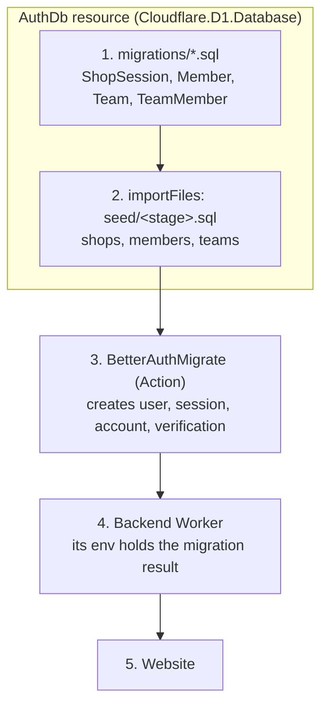
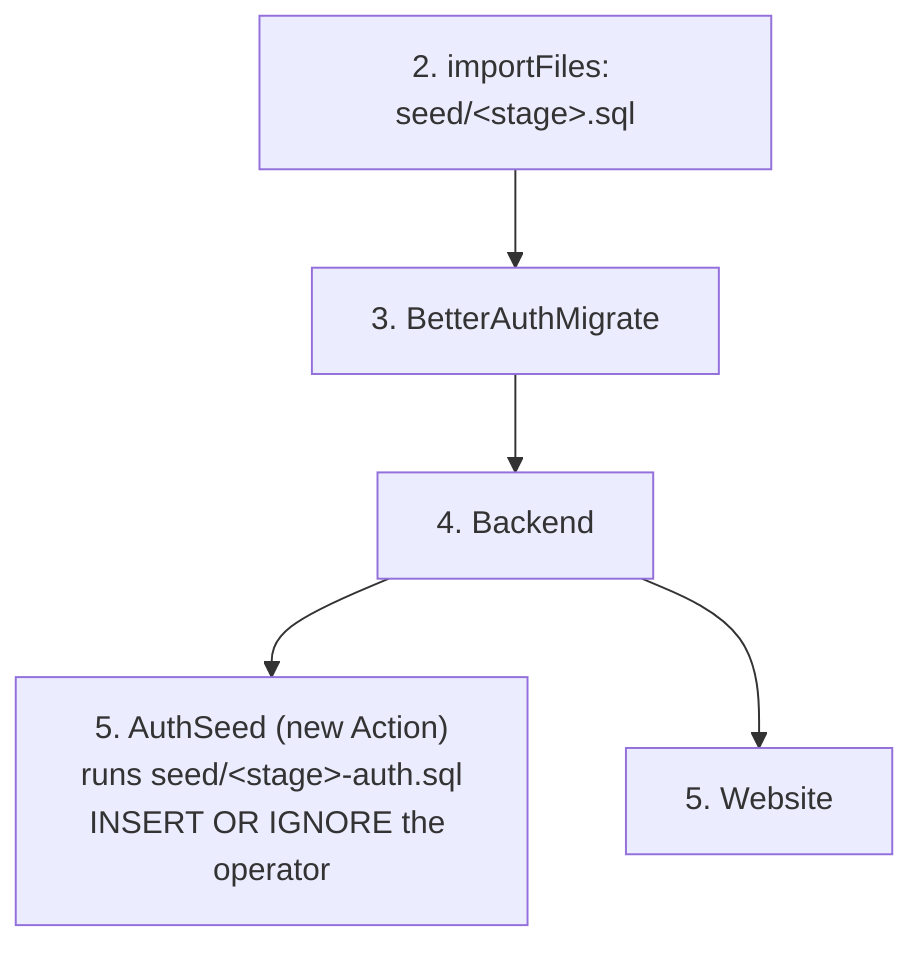

# Research: per-checkout dev stages and the operator row

Research date: 2026-10-14 · Alchemy `2.0.0-beta.81`. Status: all questions answered 2026-10-14 (every recommendation accepted); nothing implemented yet.
Background: [Alchemy stages and deployments](./alchemy-stages-and-deployments-research.md) (why dev is stage `dev`), [T3 Code worktrees](./t3-code-worktrees-research.md) (decision 5: every checkout stays on `--stage dev`), [Staging research](./staging-research.md) (§4.1, the operator on staging).

## 1. Summary

Every checkout (main, `wt-01`, …) runs `alchemy dev --stage dev`. Dev state lives in Cloudflare, so all checkouts share one set of state records, while each checkout's data lives in its own `.alchemy/local`. That mismatch is a latent bug. The fix is a stage per checkout: `dev_mw` on main, `dev_mw_wt01` in `wt-01`.

A fresh stage exposes two problems that the shared `dev` stage has hidden:

1. **The operator (`a@a.com`) needs a manual SQL insert on every fresh dev database.** The README says so, and it is accurate. That cannot stay; §4 seeds it with an Alchemy Action that runs after Better Auth's migration.
2. **The seed is picked by exact stage name.** `dev_mw` would get `seed/test.sql` instead of `seed/dev.sql`.

Proposed order: operator (§4), then seed selection (§5), then the stage change (§3).

## 2. How Alchemy picks a stage

From `resolveStage` in `refs/alchemy/packages/alchemy/src/Cli/commands/flags.ts`, first match wins:

1. `--stage <name>`
2. `$ALCHEMY_STAGE`, read from the process environment, `--env-file`, or `.env`. Alchemy loads `.env` itself.
3. `dev_${USER}` for `alchemy dev`; `live_${USER}` for deploy, destroy, plan, logs, drift.
4. `dev_unknown` / `live_unknown` without `$USER`.

Stage names must match `[a-z0-9]+([-_a-z0-9]+)*`. In cloud resource names Alchemy replaces anything outside `[a-zA-Z0-9-]` with `-` (`createPhysicalName` in `PhysicalName.ts`), so `dev_mw_wt01` becomes `…-dev-mw-wt01-…`; you can see the same with `e2e_mw` in `.alchemy/local`. Names over 64 characters are truncated with a hash, so they stay distinct.

@see `refs/alchemy/website/src/content/docs/environments/stages.mdx`, "The default stage"

## 3. The stage problem

### 3.1 What is shared today

`alchemy state list Alchemy-sandbox1/dev -r` (read-only, 2026-10-14):

```
Alchemy-sandbox1/dev/AuthDb
Alchemy-sandbox1/dev/Backend
Alchemy-sandbox1/dev/BetterAuthMigrate
Alchemy-sandbox1/dev/BetterAuthSecret
Alchemy-sandbox1/dev/ShopifyApiSecret
Alchemy-sandbox1/dev/Website
Alchemy-sandbox1/dev/output
```

The stack uses `Cloudflare.state()`, so these records are shared by every checkout and every developer on the account. Consequences:

- **Better Auth's migration is likely skipped in a second checkout.** `BetterAuthMigrate` is an Alchemy `Action`; it re-runs only when its input (schema fingerprint plus database identity) changes. A new worktree has the same stage, so the same identity, and its empty local D1 never gets the Better Auth tables. Not reproduced: `wt-01` has never run dev (no `.alchemy/local/d1`). The stage change makes the question moot.
- **`db:reset` in one checkout deletes the `AuthDb` and `BetterAuthMigrate` records** that every other checkout relies on.
- **A second developer** on the account would share the same records.

e2e (`e2e_<user>`) and integ (`test_<user>`) already use `Alchemy.localState()`, so their state is per checkout. Staging and production pass `--stage` explicitly. Only dev is affected.

### 3.2 Proposal

| Checkout | Today | Proposed      |
| -------- | ----- | ------------- |
| main     | `dev` | `dev_mw`      |
| `wt-01`  | `dev` | `dev_mw_wt01` |
| `wt-NN`  | `dev` | `dev_mw_wtNN` |

- The user part separates developers. It also keeps any future cloud-only dev resource (one with no local emulation) in the developer's own stage.
- The checkout part separates worktrees, matching each checkout's own `.alchemy/local`.
- Main's stage is what a bare `alchemy dev` already picks, so main follows Alchemy's convention.
- Underscores only, as discussed.

The stage stays explicit on the command line, computed by our scripts; it is never left to Alchemy's default or `.env`.

### 3.3 Changes

1. One function in `scripts/lib/worktree.ts` computes the stage from `$USER` and the checkout (`checkoutKind`, `currentBranch`, `worktreeIndex` are already there). It fails with a clear message when `$USER` is missing or not a valid stage part, instead of producing `dev_unknown`.
2. The `dev:alchemy` script: `alchemy dev --stage dev` → `alchemy dev --stage "$(node scripts/dev-stage.ts)"`, a tiny script that prints the stage.
3. `scripts/dev.ts`: `SERVER_PROCESS` becomes `alchemy dev --stage <this checkout's stage>`, which is more precise than today. It still excludes Playwright's e2e server, which sets its stage through `ALCHEMY_STAGE`, not on the command line. `AUTH_DB_STATE` is built from the stage.
4. README: the "stage `dev`" sentence.
5. One-time cleanup: delete the `Alchemy-sandbox1/dev/*` records and the old stage's local files under `.alchemy/local`. All of them describe local resources, so nothing in Cloudflare is touched.

### 3.4 Gotchas

1. **Main's dev database starts empty.** Local data is keyed by stage name, so `dev_mw` gets a new D1. Fine once §4 and §5 land: the seeds and the auth seed recreate everything.
2. **A bare `alchemy dev` in a worktree picks `dev_mw`, main's stage.** Start dev only with `vp run dev`. Hand-run `alchemy state` and `alchemy destroy` commands need `--stage`.
3. **Never put `ALCHEMY_STAGE` in `.env`.** Alchemy reads it for every command, so a stray bare `alchemy deploy` would target that stage.
4. **Cloud-only resources multiply.** Once the stack has one, each checkout gets its own copy: correct isolation, more cost. Retiring a worktree then needs `alchemy destroy --stage dev_mw_wtNN` first.
5. **`$USER`** is the source, as for Alchemy's default and `playwright.config.ts`. A username with characters such as `.` fails fast instead of producing an invalid stage.

## 4. Seeding the operator

### 4.1 Why the seed cannot insert it

The operator is a row in Better Auth's `user` table (`role = 'admin'`, no `Member` row). `Auth.maySignIn` admits an address with an existing user or a `Member` row, so the operator can sign in only if that row exists.

Two different steps create tables in `AuthDb`, and our seed runs between them:



An `INSERT INTO "user"` in step 2 fails on a fresh database with `no such table: user`: that table only appears in step 3. S1 hit exactly this on a scratch stage.

The order is fixed. `importFiles` is a prop of the D1 resource, and Alchemy applies it inside the resource's create or update, right after `migrations` (`Cloudflare/D1/Database.ts`). `BetterAuthMigrate` needs the database to exist, so it always comes after the whole D1 resource. Nothing inside the D1 resource can see Better Auth's tables on a fresh database.

Today's workarounds:

- Test stages: test control's `ResetData` (`TestData.reset`) inserts the operator if missing.
- Dev and staging: "a one-off manual insert", which S1 left as a follow-up. The current dev database works only because its `a@a.com` row survived from the old invite flow.
- Staging's operator (`support@mw10013.com`) is the open [staging research](./staging-research.md) §4.1. Whether its row exists on staging is unverified.

### 4.2 What Alchemy offers

- **Seeding in Alchemy means `importFiles`** (D1, Neon and PlanetScale docs). It runs inside the database resource, so it has the problem above.
- **The Better Auth integration does not seed.** `examples/cloudflare-better-auth` creates no rows, the Better Auth docs (`website/src/content/docs/better-auth/`) never mention seeding, and `BetterAuth` takes no hook to run after its migration (beyond Better Auth's options it accepts only `id`, `migrate`, `secret`).
- **An Action can seed D1.** The Action docs show exactly this: an Action that runs SQL against a D1 database through `Cloudflare.D1.QueryDatabaseLocal`. Under `alchemy dev` that layer talks to the local simulator; it is what `BetterAuthMigrate` itself uses in dev.

@see `refs/alchemy/website/src/content/docs/infrastructure-as-code/action.mdx`, "Binding resources"

So seeding Better Auth rows is not a big deal. It needs its own step after step 3, and Alchemy's Action is that step.

### 4.3 Proposal: an `AuthSeed` Action after the migration



- **What:** an Action, declared next to `AuthDb` in `src/backend/resources.ts`, that runs the stage's Better Auth seed file (`seed/dev-auth.sql`, `seed/test-auth.sql`, `seed/staging-auth.sql`) through `QueryDatabaseLocal`. Each file holds `INSERT OR IGNORE INTO "user" …` for the stage's operator. Both stacks yield it: `alchemy.run.ts` and the integ stack in `test/integ/stack.ts`.
- **Order:** its input includes an Output of the Backend (its `url`). The Backend already waits for the migration: `registerMigration` binds the migration's result into the host's env, "giving the engine a Worker/Function → Migration dependency edge" (`refs/alchemy/packages/better-auth/src/Migrate.ts`). So `AuthSeed` runs only once Better Auth's tables exist.
- **Re-runs:** an Action runs when its input hash changes. The input also holds the seed file's content and the database id, so editing the file re-runs it (as `importFiles` does) and a recreated database is seeded again.
- **Operator stays seed data**, as S1 decided. Staging gets `support@mw10013.com` from its file on the next deploy; production gets a file when it exists.
- **`TestData.reset`'s operator insert becomes redundant.** Reset deletes only `@e2e.test` users, so a seeded operator survives it.
- **`db:reset`** forgets `AuthSeed`'s state record along with `AuthDb` and `BetterAuthMigrate`.

Gotchas:

1. **Ordering through the Backend is indirect.** `@alchemy.run/better-auth` does not return the migration's Output, so `AuthSeed` cannot depend on it by name. If a later release exposes it, depend on it directly.
2. **Better Auth's column shapes.** The seed must match them: ISO text dates, 0/1 booleans. `TestData.reset`'s insert already does, so it is the template.
3. **Not run yet.** A spike must confirm, on a fresh stage under `alchemy dev`, that `AuthSeed` runs after the migration and writes to the local D1, then that the operator signs in. A staging deploy confirms the remote path.

### 4.4 Alternatives

- **Baton's way:** a list of operator addresses; first sign-in creates the user with the admin role (`refs/baton/src/lib/Auth.ts`, `ADMIN_EMAILS`). No ordering at all, but the operator becomes config, which reverses S1, and the role is stamped only at creation.
- **Own Better Auth's tables** in `migrations/` with `migrate: false`, so the seed can insert the operator. Manual schema upkeep on every Better Auth or plugin change.
- Dropped from the first draft: an Action that re-runs Better Auth's migration itself (`applyMigrations`) before inserting. The Backend edge gives the order without duplicating the migration.

## 5. Seed selection

`seedFile` in `src/backend/resources.ts` gives `seed/dev.sql` only to the stage named exactly `dev`, plus `staging` and `production` their own; everything else gets `seed/test.sql`. Under §3, `dev_mw` would get the test seed. The two files hold the same rows today, so nothing breaks yet; it would once they diverge. Fix: match `dev` and `dev_*` to `seed/dev.sql`, with a `Match` on the prefix. The auth seed (§4.3) uses the same mapping.

## 6. Questions

:::question
Should dev move to one stage per checkout?

§3. The shared `dev` stage shares state records across checkouts while their data stays separate.

- [x] `dev_<user>` on main, `dev_<user>_wtNN` in worktrees, set explicitly by `scripts/dev.ts` — isolates checkouts and developers; small script change
- [ ] `dev_<user>` everywhere — isolates developers only; worktrees still share state
- [ ] Keep `dev` — no change; the shared-state issues stay
:::

:::question
How should the operator row reach a fresh database?

§4. This replaces [staging research](./staging-research.md) §6's first question, which recommended a one-off insert; a stage per checkout makes fresh databases routine, so a manual step no longer fits.

- [x] An `AuthSeed` Action after the migration, running a per-stage auth seed file — operator stays seed data; needs a spike
- [ ] Operator addresses in source, admin role on first sign-in (Baton's way) — no ordering; reverses S1's "operator is data"
- [ ] Own Better Auth's tables in our migrations — manual schema upkeep

:::

:::question
Where should the Better Auth seed rows live?

If `AuthSeed` is chosen. They cannot go in `seed/<stage>.sql`, which `importFiles` runs before the tables exist.

- [x] A second file per stage, `seed/<stage>-auth.sql` — same shape as today's seeds; one more file per stage
- [ ] Rows in TypeScript next to the Action — no new files; data moves out of `seed/`

:::

:::question
Should test stages drop `TestData.reset`'s operator insert?

With `AuthSeed`, test stages get the operator from `seed/test-auth.sql`, and reset keeps non-`@e2e.test` users.

- [x] Drop it — one path for every stage; tests exercise the real seed
- [ ] Keep it — no test changes; two ways to make an operator

:::

:::question
Should anything happen to the existing `dev` stage beyond deleting its state records?

Its local data under `.alchemy/local` is keyed by the old stage name and becomes unused.

- [x] Delete the `Alchemy-sandbox1/dev/*` records and the old stage's local files — clean; the seeds recreate everything
- [ ] Delete the records only — leaves orphaned local files
:::

:::question
Should staging be checked before the change lands?

§4.1. If `support@mw10013.com` has no `user` row on staging, the operator is locked out today. With `AuthSeed`, the next deploy inserts it.

- [x] Ship `AuthSeed` and verify on staging that the operator signs in — fixes it whether or not the row exists
- [ ] Read staging's `user` table first (read-only) — tells us whether staging is broken now

:::
