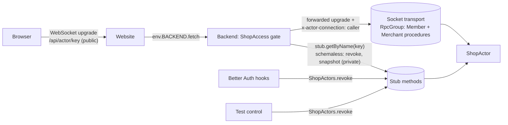
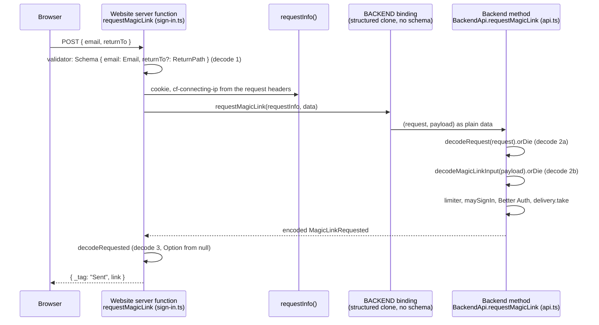

# Simplification research

Date: 2026-10-14. Status: revised after review rounds 1 and 2, awaiting decisions.

The question: the app is small and we are prototyping, yet there is a lot of code and a lot of
architecture. What can be simplified, especially architecturally, while staying on idiomatic Effect
and Alchemy patterns? The sandbox code is reference material for an active site, so the answer must
not trade rigor for line count.

## 0. Revisions after review

The first draft proposed three architectural replacements; round 1 showed each was wrong. The
second draft proposed trimming the Baton mechanisms that ride on socket identity; round 2 pointed
out that this is a spike porting Baton, with the rest of Baton coming soon, so removing ported
mechanisms now is churn, not simplification.

The position after two rounds: the architecture is right for what it is, a faithful port of Baton's
production mechanisms onto Effect and Alchemy. The excess is not in `src/`'s design. It is in
placeholders, test doubles beside real implementations that could run in tests, generality for
stages that do not exist, and above all in docs and tooling. The savings in `src/` are a few hundred
lines; the savings outside `src/` are thousands.

| Draft move                                              | Objection                                                                                                                 | Outcome                                            |
| ------------------------------------------------------- | ------------------------------------------------------------------------------------------------------------------------- | -------------------------------------------------- |
| Replace the socket with `RpcDurableObject`, no identity | The object serves one group on both transports, so without socket identity a member socket could call merchant procedures | Withdrawn (round 1). See 2.1                       |
| Replace the notice frame with a streaming procedure     | A stream is an in-memory fiber; eviction kills it silently, so it either breaks on hibernation or prevents it             | Withdrawn (round 1). See 2.2                       |
| Replace schemaless methods with `HttpApi`               | Alchemy recommends schemaless RPC worker-to-worker; the adapters would move, not disappear                                | Withdrawn (round 1). See 2.3                       |
| Trim displacement, revocation, expiry off the identity  | These are Baton's mechanisms and the rest of Baton is coming; removing them now means re-adding them soon                 | Withdrawn (round 2). One question remains, see 3.1 |
| Dedupe the second decode in the Backend's methods       | Asked for a diagram; the decode is real, consistent with the boundary rule, and the trim is four lines                    | Withdrawn (round 2). See 2.4                       |

## 1. Where the weight is

Line counts on 2026-10-14, `src/web/routeTree.gen.ts` excluded.

| Area                                               | Lines   | What it is                                                    |
| -------------------------------------------------- | ------- | ------------------------------------------------------------- |
| Actor slice (gate, socket, client atoms, ShopPage) | ~1,700  | one integer, live across browsers, with Baton's socket rules  |
| Website to Backend plumbing                        | ~500    | server functions, `RequestInfo`, `rescue`, three proxy routes |
| Test control                                       | ~300    | a second RPC surface, a second socket route, a body guard     |
| Playground hello/shout                             | ~200    | placeholders                                                  |
| All of `src/`                                      | ~4,400  |                                                               |
| `test/`                                            | ~2,400  |                                                               |
| `scripts/`                                         | ~2,100  | `scripts/dev.ts` alone is 614                                 |
| `docs/`                                            | ~11,300 | research and plans                                            |

The counter itself is about 30 lines of `src/backend/shop-actor.ts`. The rest of the actor slice is
Baton's connection model: the gate, identity at accept, tags, displacement, revocation, the notice
frame, and the browser's handling of each close code.

## 2. What is load-bearing and why

### 2.1 Two transports into the actor, and why the socket needs identity

Two kinds of caller reach the object. A browser reaches it only over the socket, after the gate.
The Backend reaches it over the stub, which no browser can hold. `Cloudflare.RpcDurableObject`
serves a single `RpcGroup` on both HTTP RPC (the stub's typed client) and WebSocket RPC (the
browser), so a procedure in the group is reachable from both, and per-message RPC headers cannot
separate them because the browser writes those too. The object must therefore know who is on each
socket, fixed when the socket is accepted, from a header only the gate can set. That is what
`actor-socket.ts` does, and why it exists: `RpcDurableObject` accepts the socket before the object's
code sees the upgrade, and cannot host schemaless methods beside its group. Keeping the socket
surface (procedures, public, locked down) apart from the stub surface (schemaless, private,
efficient) is the right split, and schemaless RPC is Alchemy's recommendation worker-to-worker.

### 2.2 The notice frame, and why a stream is not a substitute

A streaming procedure is served by a fiber in the object's memory. A Durable Object with
hibernatable sockets is evicted when idle: the sockets survive, the memory does not. After a wake,
Alchemy's transport re-registers each socket from its attachment, but a stream that was mid-flight
is gone and the browser is never told. The notice frame needs no memory between messages: after a
write, the object lists its sockets with `state.getWebSockets()` and sends one frame to each. That
is Baton's and PartyKit's model. It stays.

### 2.3 Schemaless methods, and why `HttpApi` would not help

The server functions are mostly route-level decisions (which failure redirects where), which exist
in any design; `RequestInfo` is 12 lines; `rescue` is 15 lines and does what a derived
`HttpApiClient` would do for errors. `HttpApi` would add JSON serialization on a binding that today
carries structured clones, put an Effect HTTP client in the browser bundle, and need two
`HttpClient` layers. The 2026-10-13 decision (server functions plus schemaless Backend) stands.

### 2.4 The second decode, diagrammed

The claim was that each Backend method decodes arguments its server function already validated.
It is true, and it is also the boundary rule working as designed. For `requestMagicLink`:

The full walk-through, with the code at each step and what each decode guards against, is in
`docs/double-decode-research.md`. In short: decode 1 is the browser boundary, decode 2 is the binding
boundary (the binding is typed at compile time only, and it is what re-establishes the brands on the
Backend side), and decode 3 is a transform the binding forces because it cannot carry an `Option`.
All three follow the glossary's rule that data is decoded with Schema at every boundary. There is no
problem. The one thing worth doing is sharing the three duplicated input schemas through
`src/contract/` so the two sides cannot drift; that question is asked in the other document.

## 3. Moves, revised

### 3.1 The socket identity stays as ported

Displacement, member revocation, tags, `teamIds`, and the close codes are Baton's, and the rest of
Baton is coming. They stay. One question remains about the pieces the sandbox added on top of Baton
to fit Better Auth: `sessionId` and `sessionExpiresAt` on the caller, the `session:` tag, the
session-delete hook that revokes one session's sockets, and the expiry backstop before each
dispatch. These have no Baton counterpart; they exist because Better Auth sessions can end without
a membership change.

:::question
Keep the Better Auth session additions (session revoke, expiry backstop, session fields and tag)?

They are about 60 lines across the contract, the actor, `auth.ts` and the test-only upgrade route
that tests them. Better Auth is the auth that ships, so a session that ends should end its sockets.

- [ ] Keep them — Better Auth is the real auth and a socket must not outlive its session
- [ ] Remove them — a stale socket is bounded by the next reconnect, and the gate refuses it then

Recommended: Keep them
:::

The one real simplification for `actor-socket.ts` is upstream. An `RpcDurableObject` option that
lets the object fix an identity at accept and tag the socket (an `onAccept` hook on Alchemy's
`RpcWebSocket.make`) would retire the local wrapper and the package patch, and the actor would be
the plain `RpcDurableObject` plus handlers. This matters more now that the wrapper stays for good.

:::question
Propose identity-at-accept upstream to Alchemy, so `actor-socket.ts` and the patch can retire?

- [ ] Yes, open an issue now with the use case (the wrapper is the worked example) and offer the PR
- [ ] Later, once the Baton port settles the final shape of the identity
- [ ] No, keep the local transport wrapper

Recommended: Yes, open an issue now
:::

### 3.2 Trim around the notice frame

- One `GetCount`, one `WhoAmI`, one `Activation`, under a `RequireCaller` middleware that admits any
  caller; `Increment` keeps `RequireMember`, `ResetCount` keeps `RequireMerchant`. The merchant's
  fake `activation` atom in `ShopPage` goes with it. Baton declares a shared read once per role;
  this would deviate from that, so it is a question, not a recommendation.
- `seedShop` writes serialized nodes straight into the atom registry so the first live render
  matches the server render. The alternative keeps rendering the loader's snapshot until the first
  socket read answers, one round trip after hydration, with no visible change when the count has not
  moved.

:::question
Keep the per-role procedure copies (Baton's rule) or merge the shared reads under an any-role middleware?

- [ ] Keep per-role copies — Baton's rule, and the role is visible in every procedure name
- [ ] Merge the shared reads — three fewer procedures and atoms

Recommended: Keep per-role copies
:::

:::question
Keep `seedShop`, or render the loader's snapshot until the first socket read answers?

- [ ] Drop `seedShop`; render the snapshot until the first read — simpler, one extra round trip per page load
- [ ] Keep `seedShop` — zero refetch on load is the point of sending a snapshot

Recommended: Drop `seedShop`
:::

### 3.3 Test control

With the session additions kept, the test-only upgrade route stays (it is how a test opens a socket
as an expired session), and the body guard stays with the route. The one duplicate is
`IssueMagicLink`, which is `requestMagicLink` minus the rate limit. The limiter is already open under
`alchemy dev`; opening it on e2e stages the same way lets tests sign in through the real path, and
`IssueMagicLink` goes.

:::question
Open the sign-in limiter on e2e stages and drop `IssueMagicLink`?

- [ ] Yes
- [ ] No, keep the test procedure — tests should not depend on the limiter's configuration

Recommended: Yes
:::

### 3.4 Cut stage generality to the stages that exist

- `seedsFor` handles `dev`, `dev_*`, `staging`, `production` and a test fallback. Production has no
  seed and, per the README, is "reserved for a separate future instance". Two guards in
  `alchemy.run.ts` protect it.
- `Auth.layer`, `Shopify.layer` and `MagicLinkDelivery.layer` each repeat the same check: if
  `__ALCHEMY_RUNTIME__` and the config is none, die. One helper replaces three copies.
- `Members.layerTest` (45 lines) is an in-memory twin of the D1 implementation. The unit tests already
  run Better Auth on an in-memory database; `Members` can run its real SQL there and the twin goes.

:::question-multi
Which stage and test-double cuts apply?

- [ ] Drop the production branches and guards until a production stage exists
- [ ] Collapse the three runtime-marker checks into one helper
- [ ] Run `Members` on the in-memory SQL database in unit tests and delete `Members.layerTest`

Recommended: all three
:::

### 3.5 Delete placeholders and dead weight

- Playground hello and shout: `src/contract/playground.ts`, `src/web/server/playground.ts`,
  `src/web/components/Playground.tsx`, the admin index that renders it, two Backend methods, about 200
  lines. The Shop page is now the reference read and write.
- `docs/`: about 11,300 lines of research and plans. The repo's own rules say these get deleted, and
  `docs/glossary.md` already disagrees with the tree (it names `src/api/` and `src/server/`, which are
  `src/contract/` and `src/web/server/`).
- `scripts/dev.ts`: 614 lines to start, stop and report on `alchemy dev`, including herdr pane
  placement, a lock file and pid scanning. `scripts/refs-shopify-docs.ts` (753 lines) mirrors Shopify's
  docs for a Shopify slice that has not started.

:::question-multi
Which deletions?

- [ ] Playground hello/shout
- [ ] Research and plan docs for completed work (keep the glossary and runbooks, fix the glossary)
- [ ] Reduce `scripts/dev.ts` to start, stop, status and logs without herdr placement
- [ ] Remove the Shopify docs mirror script until the Shopify slice starts

Recommended: Playground, docs, and dev.ts; keep the Shopify docs mirror (it is tooling, not app code, and its refs are already fetched)
:::

## 4. What remains

The architecture is unchanged and, after two rounds, confirmed: two Workers over a schemaless
binding, a gate in the Backend, one actor with a public socket surface carrying Baton's connection
model and a private stub surface, a notice frame for liveness. With every recommendation taken,
`src/` loses roughly 400 lines (placeholders, one test double, one test procedure, `seedShop`, three
guard copies), `docs/` loses most of its 11,300, and `scripts/dev.ts` loses about half.

The honest answer to "why so much code for a small app" is: `src/` is a port of production
mechanisms, and the feeling of bulk comes mostly from the research docs and the tooling around the
dev server, which are three times the size of the app.

## 5. Order

3.5 (deletions) first, since it is the largest and touches nothing else. Then 3.4, 3.3 and 3.2 in
any order. The Alchemy proposal in 3.1 is independent.

:::question
Should the implementation land as one change or as one commit per move?

- [ ] One commit per move — each is reviewable and revertible on its own
- [ ] One change — fewer intermediate states that nobody will run

Recommended: One commit per move
:::
