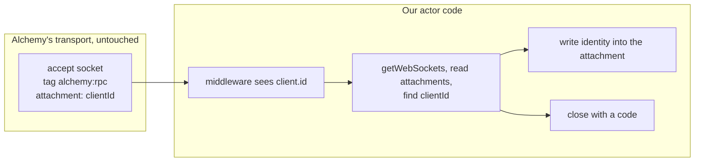
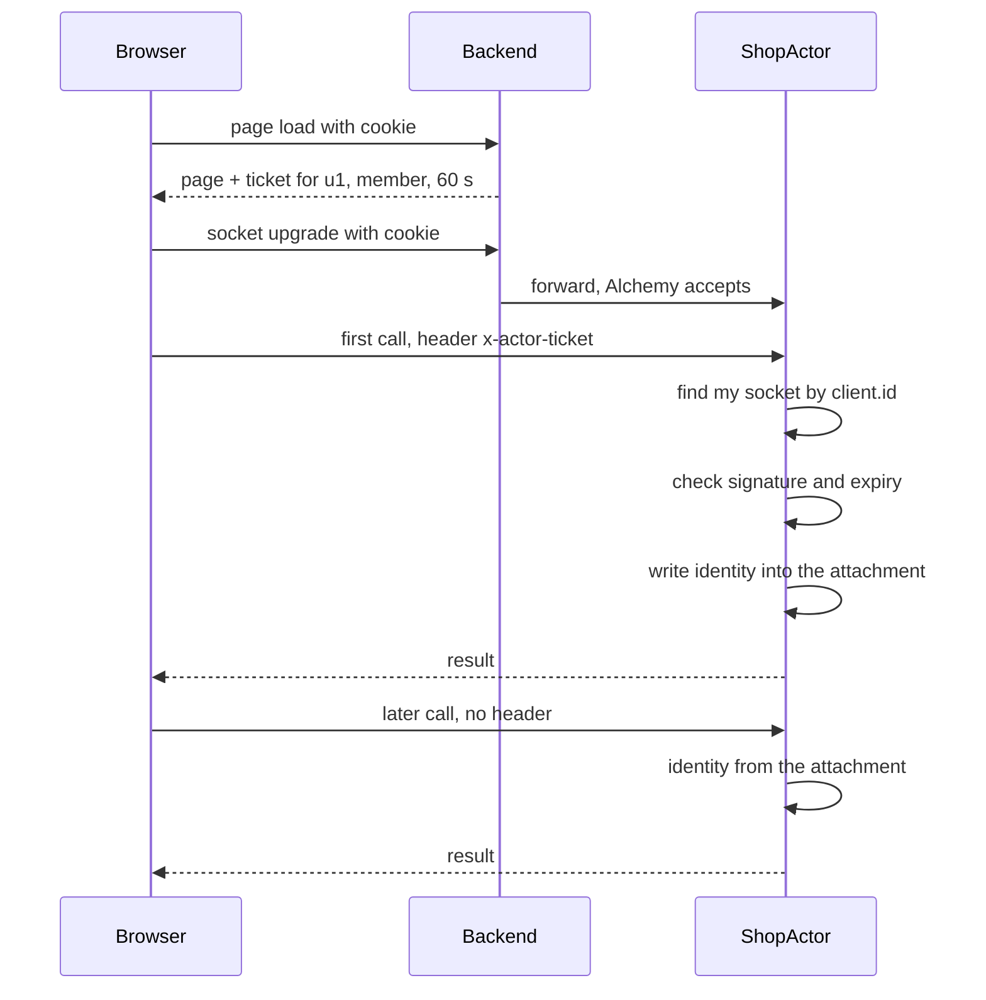
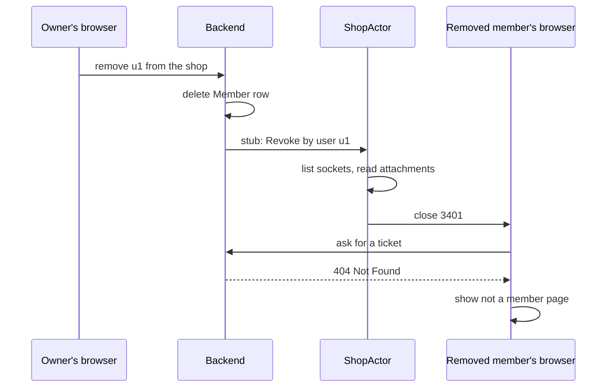
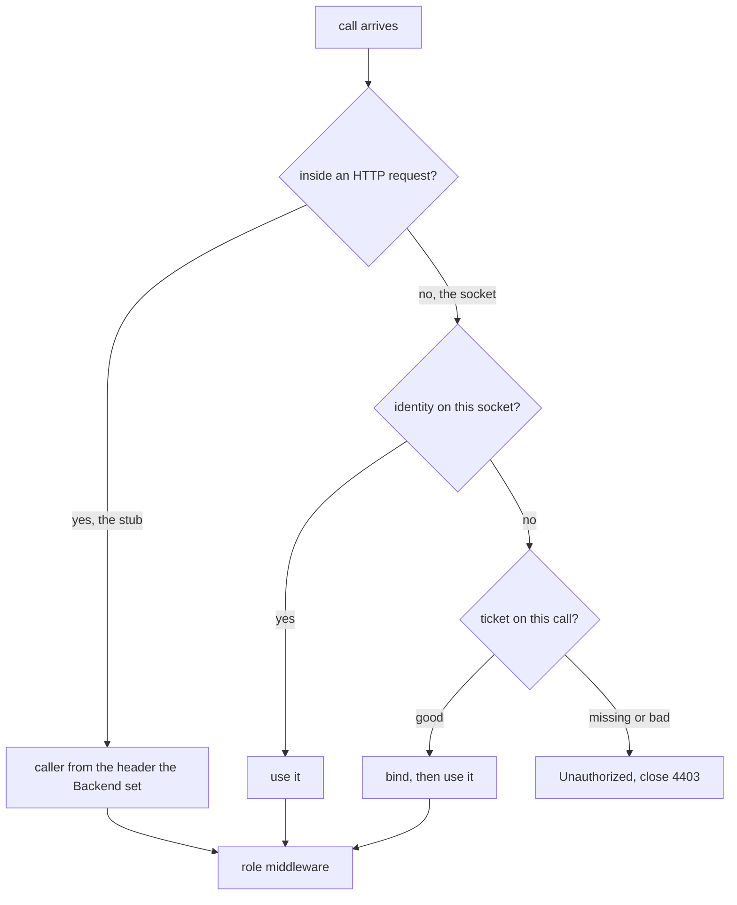

# Research: who is on the socket, on stock Alchemy

Research date: 2026-10-12.
Status: decided in Plannotator on 2026-10-12; every question in [§9](#9-questions-with-recommendations) is answered. Q6 went against the recommendation: displacement is in S1. This replaces the lease research of the same day, which went off the rails; [§1](#1-answers-to-the-review-comments) says how.
Versions: Alchemy `2.0.0-beta.81`, Effect `4.0.1`, Better Auth `1.7.7`. Do not bump dependencies.
Background: [connection identity research](./connection-identity-research.md) for the problem, Baton's model and the four options. [Glossary](./glossary.md): **Actor**, **Backend**, **Website**, **Binding**, **Procedure**, **Group**, **Client**, **Notice**, **Shop key**.

Sources: `node_modules/alchemy/src/Cloudflare/Workers/{RpcWebSocket,RpcDurableObject,DurableObjectState,WebSocket,Rpc}.ts`, `node_modules/effect/src/rpc/{RpcServer,RpcMiddleware}.ts`, `refs/cloudflare-docs/src/content/compatibility-flags/web-socket-auto-reply-to-close.md`, `refs/cloudflare-docs/src/content/docs/durable-objects/best-practices/websockets.mdx`, this repo's `src/backend/{worker,shop-actor}.ts`, `src/shop-actor-client.ts`.

## 1. Answers to the review comments

The comments on the lease research were right, and following them led to a simpler design. In the order they were made:

1. **"What is the System caller and why would it call through a WebSocket?"** It does not. The System caller is the Backend itself (a webhook handler, a Workflow, a timer) calling the actor through the Durable Object stub. The Backend has no socket. The browser has no stub. Two separate channels, and the procedures each one uses are separate too: `SystemRpcs` is for the stub, the owner and member Groups are for the socket. The lease research muddled this by giving the Backend a credential. It needs none.
2. **"Why would the Website need a lease to talk to the actor?"** It does not. Server-rendered reads go Website → Binding → Backend → stub → actor. Every step is our own server code. The Backend knows who the person is from the cookie and says so on the request it forwards. No lease.
3. **"The busy shop renews at the frequency of the lease lifetime."** Correct, and that was the flaw. A design that renews anything on a schedule gives up what the hibernating socket is for. The design below renews nothing. A browser proves who it is once, when its socket opens. After that, nothing is sent until the person does something, and nothing expires on a timer.
4. **"Why can't the actor just close the socket?"** It can. The connection identity research said the actor never holds its sockets. That is wrong: the actor can list every socket at any time with `getWebSockets()`, read and write each one's attachment, and close any of them with a code. `ShopActor` already lists them to push Notices. What the actor cannot do is see the upgrade request or choose the tags when the socket is accepted, because Alchemy's transport does that. [§3](#3-what-the-actor-can-do-with-its-sockets) lays out exactly what is and is not possible, and the design works within it.
5. **"Is it a limitation of Alchemy that the actor can't get at an individual socket?"** No, see above. Alchemy's transport writes its own bookkeeping into each socket's attachment and preserves any other keys we put there. So the actor can write "this socket belongs to user u1" into the attachment and read it back after hibernation. The broadcast-"close yourself" idea is not needed.
6. **"Backend to actor is via the stub, not WebSocket RPC, right?"** Right. The two channels are physically different, and the actor's code can tell which one a call arrived on. The only reason it comes up at all: Alchemy feeds both channels into one Effect RPC server, and Effect's middleware is handed `client.id`, the headers and the payload, nothing that names the channel. The channel is known to Alchemy's transport; it just is not passed along. One check in our middleware recovers it ([§4.8](#48-the-backends-own-calls)): a stub call runs inside an HTTP request, a socket call does not. That is the whole of it.

## 2. Words used in this document

| Word                 | Meaning here                                                                                                                                                                                                                 |
| -------------------- | ---------------------------------------------------------------------------------------------------------------------------------------------------------------------------------------------------------------------------- |
| **Browser**          | The signed-in person's browser running our page. It holds one socket to the shop's actor and makes calls on it. ("Client" is the glossary's `AtomRpc` service inside the browser, so it is not used for the browser itself.) |
| **Signed-in member** | A person with a Better Auth session. In a shop they have a role, `owner` or `member`.                                                                                                                                        |
| **Gate**             | The Backend code that decides whether a request may reach a shop's actor and as whom. Today: `currentUserFromCookie` then `actors.fetch` in `worker.ts`.                                                                     |
| **Stub**             | The Durable Object stub the Backend holds for one actor. `getByName(shop)` in Alchemy. HTTP underneath, never a socket.                                                                                                      |
| **Ticket**           | A short-lived signed note from the Backend saying who the browser is. Shown once, when the socket opens, and then thrown away. [§4.1](#41-the-ticket).                                                                       |
| **Signed**           | Carries a checksum (HMAC-SHA256) made with a secret only the Backend's Worker has. Anyone can read it; nobody else can make or alter it.                                                                                     |
| **Bind**             | The actor writing the identity from a ticket into the socket's attachment. From then on the socket itself says who is on it.                                                                                                 |
| **Attachment**       | Cloudflare's per-socket storage (16 KiB) that survives hibernation. Alchemy keeps its own key in it and leaves ours alone.                                                                                                   |
| **Revoke**           | The Backend telling the actor "user u1 (or session s1) may no longer call"; the actor closes their sockets.                                                                                                                  |
| **System caller**    | The Backend calling the actor through the stub. No person, no browser.                                                                                                                                                       |

## 3. What the actor can do with its sockets

Read from Alchemy's source, not assumed.

| Can the actor...                        | Yes or no | Where                                                                                                                                                   |
| --------------------------------------- | --------- | ------------------------------------------------------------------------------------------------------------------------------------------------------- |
| list every open socket                  | yes       | `DurableObjectState.getWebSockets()`; `ShopActor` does it today to push Notices                                                                         |
| read a socket's attachment              | yes       | `socket.deserializeAttachment()`                                                                                                                        |
| write its own key into the attachment   | yes       | `socket.serializeAttachment({ ...previous, ours })`; Alchemy's `persist` spreads `...previous`, so our key survives every rewrite and every hibernation |
| know which socket a call came from      | yes       | middleware sees `client.id`; Alchemy stores that same id in the attachment as `__alchemyRpcWebSocket.clientId`; match the two                           |
| close one socket with a code and reason | yes       | `socket.close(code, reason)`                                                                                                                            |
| see the upgrade request                 | no        | Alchemy's `fetch` accepts the socket before any of our code runs                                                                                        |
| choose tags at accept                   | no        | one fixed tag, `alchemy:rpc`; so "find by tag" becomes "list and read attachments", which is fine at a shop's scale                                     |

So everything Baton does with a connection can be done here, except at the moment of accept. The one consequence: the actor cannot know who is on a socket until that socket's first call. The design below makes the first call carry a ticket.

## 4. The design, piece by piece

In one sentence: the browser shows a ticket on its first call, the actor binds the identity to the socket, every later call reads it from the socket, and losing access closes the socket.

### 4.1 The ticket

| Field              | Example            | Why                                                                                    |
| ------------------ | ------------------ | -------------------------------------------------------------------------------------- |
| `shop`             | `alchemy-sandbox1` | good for one shop's actor only                                                         |
| `userId`           | `u1`               | who; from the Better Auth session                                                      |
| `sessionId`        | `s1`               | which sign-in; lets a sign-out close only this session's sockets                       |
| `role`             | `member`           | `owner` or `member`, from the shop's `Member` row                                      |
| `sessionExpiresAt` | tomorrow 10:00     | the Better Auth session's own expiry; the actor's backstop ([§4.6](#46-losing-access)) |
| `expiresAt`        | now + 60 s         | a ticket is for opening a socket now, not for keeping                                  |
| signature          | 32 bytes           | made with the Backend's secret; cannot be forged or altered                            |

The Backend mints it after the same checks the gate makes today plus the membership check: no session 401, operator 403, not a member 404, D1 down 503. The browser gets it with the page: the route loader runs on the Website during server rendering, asks the Backend over the Binding, and the ticket is dehydrated with the loader data. No extra round trip.

The signature is HMAC-SHA256 with a secret from `Alchemy.Random` bound to the Backend Worker. The actor runs in that Worker and checks with the same secret. The Website Worker and the browser never have the secret, so neither can make a ticket.

### 4.2 The socket opens through the gate

Unchanged from today: the browser's upgrade goes Website → Binding → Backend, the Backend checks the session (and, new, the membership) and forwards to the actor. Alchemy's transport accepts the socket. The actor does not yet know who is on it.

### 4.3 The first call binds

The browser's RPC client has a middleware. On the first call after a socket opens, it puts the ticket in a header. The actor's middleware:

1. finds the socket for `client.id` by listing sockets and reading Alchemy's `clientId` from each attachment;
2. checks the ticket's signature and `expiresAt`;
3. writes `{ userId, sessionId, role, sessionExpiresAt, boundAt }` into that socket's attachment, next to Alchemy's key;
4. remembers it on `client.annotations` so later calls in this activation do not re-read the attachment;
5. provides the identity to the role middleware, which lets the call through or fails it `Forbidden`.

A call on a socket that has no identity yet and carries no ticket fails `Unauthorized`. A ticket that does not check out fails `Unauthorized` and the socket is closed with code 4403, forbidden.

### 4.4 Every later call

Identity comes from the socket. Headers are ignored on the socket path, which is what makes the header trap from the earlier research irrelevant here: a browser can write anything in a header and the actor does not read it. The role middleware checks `role` from the attachment against what the procedure requires.

### 4.5 Hibernation and idleness: nothing happens

The attachment survives hibernation. A browser that is idle for a day sends nothing, renews nothing, and when the person clicks, the socket wakes the actor, the middleware reads the identity from the attachment, and the call runs. There is no timer anywhere in this design.

### 4.6 Losing access

When a person signs out, is banned, is removed from the shop, or changes role, the Backend calls `Revoke({ by: "user" | "session", id })` on the shop's actor through the stub. The actor lists its sockets, reads each attachment, and closes every socket whose identity matches, with code 3401, revoked. That is Baton's behaviour, done without a patch.

Two backstops, because `Revoke` is best effort and a trigger could be missing:

- **Session expiry.** The attachment holds `sessionExpiresAt`. The middleware checks it on every call; past it, the call fails and the socket is closed 3401. Better Auth fires nothing on expiry, so this is the only way an open socket learns of it. It bounds a stale identity to the session's own life (7 days by default).
- **A rebind deadline, optional.** `boundAt` plus a long period (say 24 hours). Past it the actor closes 3401 and the browser gets a fresh ticket. One HTTP call per browser per day, and the worst case after a failed `Revoke` becomes a day instead of the session's life. This is the one place a timer could come back, and it is a question ([Q3](#9-questions-with-recommendations)).

The triggers for `Revoke`: Better Auth's hooks after a session row is deleted (sign-out, revoke, ban, password change, account deletion) and after a user row changes (role, banned), and our own membership procedures on add, remove and role change. Each is wrapped and logged and never fails the write that caused it.

### 4.7 What the browser does after a close

The browser's socket layer sees the close code.

| Code       | Meaning                     | Browser                                                                                                                                                                                                  |
| ---------- | --------------------------- | -------------------------------------------------------------------------------------------------------------------------------------------------------------------------------------------------------- |
| 3401       | revoked, or expired         | ask the Backend for a new ticket over HTTP. 401: go to sign-in. 404: show "not a member". 200: open a new socket, bind, carry on. The HTTP answer is how it learns _why_, since a close code cannot say. |
| 4403       | ticket did not check out    | stop; this does not get better by retrying                                                                                                                                                               |
| 1006, 1012 | network drop, actor restart | reconnect as today, then bind again with a fresh ticket                                                                                                                                                  |

A reconnect for any reason means a new socket with no identity, so the client middleware asks for a ticket before its first call on the new socket. That is one HTTP call per reconnect, never per period. The existing `socket-session` guard (three failed opens, then ask if signed in) stays as it is.

### 4.8 The Backend's own calls

Webhook handlers, Workflows and timers call the actor through the stub. The browser calls it over the socket. The Backend never has a socket; the browser never has a stub. The procedures are split the same way: `SystemRpcs` for the stub, the owner and member Groups for the socket.

Alchemy routes both channels into one Effect RPC server, and the middleware Effect hands us does not say which channel a call came from. The actor's code can still tell, with one check: a stub call runs inside an HTTP request, so `HttpServerRequest` is in the middleware's context; a socket call runs in Alchemy's socket message handler, which has no request. So:

- `HttpServerRequest` present: the stub. Trust the request. The Backend put `x-actor-caller` on it (`system`, or the identity of the member whose server-rendered page is being built). Nothing else can reach the stub.
- `HttpServerRequest` absent: the socket. Identity comes from the socket's attachment; headers are ignored.

The spike runs this check first, because it is read from Effect's source, not yet from a test ([§7](#7-what-the-spike-must-verify-first)). If it turned out not to hold, the Backend's stub client would stamp its calls with a signed header instead: one line, in-process, and nothing else in the design moves.

### 4.9 Displacement

Decided for S1 ([Q6](#9-questions-with-recommendations)). When a bind would give a member a third socket, the actor lists the sockets bound to that `userId`, sorts the others by `boundAt`, and closes all but the newest one with 4409, displaced. The new socket always wins, as in Baton: refusing it would lock the person out. The browser treats 4409 as final and shows "Signed in elsewhere" with a Reconnect action, so a displaced window does not reconnect on its own and displace the newer one back. Owners are not capped. Baton's `maxConnectionsPerMember` is 2.

## 5. Six walkthroughs

1. **A member opens the shop page.** The loader asks the Backend for a ticket and the first reads. The browser opens the socket through the gate. Its first call carries the ticket; the actor binds; later calls carry nothing.
2. **The same member comes back after a day.** The socket hibernated. They click. The actor wakes, reads the identity from the attachment, serves. No ticket, no renewal, no extra round trip.
3. **The owner removes a member who is online.** The Backend deletes the `Member` row and calls `Revoke` through the stub. The actor closes that member's sockets with 3401. Their browser asks for a ticket, gets 404, shows "not a member". The owner's own sockets are untouched.
4. **A member signs out in one window with another open.** Better Auth deletes the session; the hook calls `Revoke` by session. The other window's socket closes 3401; it asks for a ticket, gets 401, goes to sign-in. The same person's phone, on another session, is untouched.
5. **A webhook arrives.** The Backend calls a System procedure through the stub with `x-actor-caller: system`. The middleware sees `HttpServerRequest`, trusts the header, `RequireSystem` admits it. A browser calling the same procedure over its socket has no `HttpServerRequest`, its attachment says `member`, `Forbidden`.
6. **Someone forges.** They put `x-actor-caller: system` in a socket message header: ignored, the socket path never reads it. They alter a ticket's role: the signature fails, 4403. They replay an old ticket after being removed: expired after 60 seconds, 4403; and had they bound before removal, `Revoke` closed them.

## 6. Costs

| Cost            | Size                                                                                                     |
| --------------- | -------------------------------------------------------------------------------------------------------- |
| Idle            | Nothing. No timers, no renewals, no polling.                                                             |
| Per call        | One attachment read on the first call of an activation, then an annotation lookup. No cryptography.      |
| Per socket open | One ticket (minted with the page, or one HTTP call on a reconnect) and one HMAC check on the first call. |
| Per bind        | One listing of the shop's sockets to find this one by `clientId`.                                        |
| Per `Revoke`    | One listing of the shop's sockets, one close per match.                                                  |
| Code in Alchemy | None.                                                                                                    |

## 7. What the spike must verify first

Three facts this design rests on were read from source, not run. Each is a small integ test, and each has a fallback.

1. **Our key in the attachment survives.** Write `{ shopActor: {...} }` next to Alchemy's key, make a call, hibernate (new activation), read it back. Alchemy's `persist` spreads the previous attachment, so it should. Fallback: none needed if true; if false, identity goes in a SQLite row keyed by `clientId` with a restart generation.
2. **Closing a socket from our code leaves the transport clean.** Call `socket.close(3401, ...)` on a socket Alchemy owns. With `web_socket_auto_reply_to_close` on, a later `close()` by Alchemy's handler is ignored, and a stale entry is cleaned by its own `send` failure path. Confirm no abort and no stuck connection. Fallback: close through a System procedure that goes through Alchemy's own `end(clientId)`, which exists but is not exposed; that would be the one small upstream ask.
3. **`HttpServerRequest` is present on the stub path and absent on the socket path.** Fallback: the Backend signs its stub calls ([§4.8](#48-the-backends-own-calls)).

## 8. What would be built

1. **Schema** (`src/api/shop-actor.ts`): `Ticket`, `SocketIdentity`, `Unauthorized`, `Revoke` in a `SystemRpcs` Group, the close codes.
2. **Backend** (`worker.ts`, `middleware.ts`, new `ticket.ts`): the secret from `Alchemy.Random`; `shopAccess(cookie, shopKey)` returning identity or 401 / 403 / 404 / 503; mint; `GET /api/actor/<shop key>/ticket`; the upgrade gate reusing `shopAccess` and rebuilding the forwarded request with `x-actor-caller`; `Revoke` calls from Better Auth hooks and membership procedures; the Website's `POST` route into the actor removed.
3. **Actor** (`shop-actor.ts`): `CallerMiddleware` (stub path or socket path, bind on ticket, expiry backstop, displacement on bind); `RequireOwner`, `RequireMember`, `RequireSystem`; `Revoke` handler.
4. **Browser** (`shop-actor-client.ts`, new `ticket-client.ts`): the client middleware that sends the ticket on the first call after each connect (`ConnectionHooks.onConnect` resets it); the socket layer built with `makeProtocolSocket({ retryPolicy })` so 3401 fetches a ticket and reconnects, 4403 and 4409 stop, with a displaced banner and Reconnect for 4409; the route reacting to 401 and 404 from the ticket request.
5. **D1**: Baton's tables from `refs/baton/migrations/0001_init.sql` (`ShopSession`, `Member`, `Team`, `TeamMember`), seeded.
6. **Tests**: the three verifications in [§7](#7-what-the-spike-must-verify-first); forged and expired tickets; a call before bind; identity unchanged after hibernation; `Revoke` by user and by session closes exactly the right sockets; expiry backstop; 401 / 403 / 404 / 503 on upgrade and ticket; every procedure has one role middleware; the browser sends a ticket exactly once per connect; a member's third socket closes the oldest with 4409 and that window does not reconnect by itself.

## 9. Questions with recommendations

Q1. **Which design?** This one (bind once on the socket, close to revoke, stock Alchemy), or the lease (a signed note on every call, renewed on a schedule), or patching Alchemy to bind at accept.
Recommendation: this one. It keeps the hibernating socket idle when the person is idle, it closes sockets like Baton, it needs no patch, and the Backend's own calls stay plain stub calls. The lease is withdrawn: its renewals were the wrong trade. The patch buys only "bind at accept instead of at first call", which is not worth carrying.

- [x] Bind on first call, close to revoke, stock Alchemy (recommended)
- [ ] Lease on every call
- [ ] Patch Alchemy to bind at accept
- [ ] Other

Q2. **How the browser gets its ticket.** With the page (minted in the loader, dehydrated), plus one HTTP call per reconnect; or always by HTTP call just before opening a socket.
Recommendation: with the page. No extra round trip on load; the reconnect case is the only HTTP fetch.

- [x] With the page, HTTP on reconnect (recommended)
- [ ] Always by HTTP call
- [ ] Other

Q3. **A rebind deadline?** None (identity lives as long as the socket and the session), or close and rebind after 24 hours.
Recommendation: none in S1. `Revoke` plus the session expiry backstop are Baton's guarantee. Add the deadline later if a missed trigger ever bites; it is one constant and one comparison.

- [x] None in S1 (recommended)
- [ ] 24-hour rebind
- [ ] Other

Q4. **Close codes.** Baton's: 3401 revoked, 4403 forbidden, 4409 displaced.
Recommendation: keep Baton's numbers. They already mean the right things and the browser logic ports with them.

- [x] Baton's numbers (recommended)
- [ ] Other

Q5. **If `HttpServerRequest` is not a reliable stub-path marker** ([§7](#7-what-the-spike-must-verify-first) item 3): have the Backend sign its stub calls, or give System procedures their own Group served only over HTTP (would need an Alchemy change).
Recommendation: sign the stub calls. One client middleware on the Backend's stub client, in-process, microseconds.

- [x] Signed stub calls as the fallback (recommended)
- [ ] Ask Alchemy for per-transport Groups
- [ ] Other

Q6. **Displacement in S1?**
Recommendation was no. Decided: yes, Baton's cap of two sockets per member; a third closes the oldest with 4409.

- [ ] No (recommended)
- [x] Yes, Baton's two-socket cap with 4409
- [ ] Other
