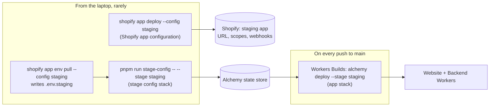
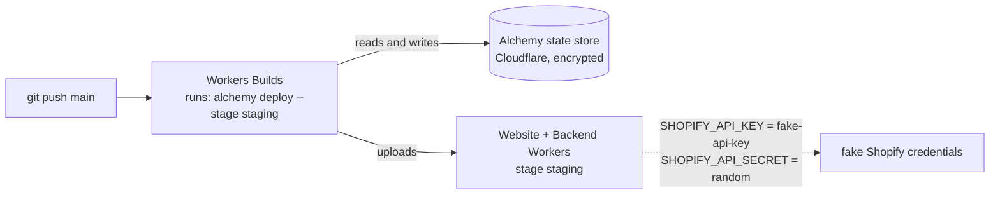
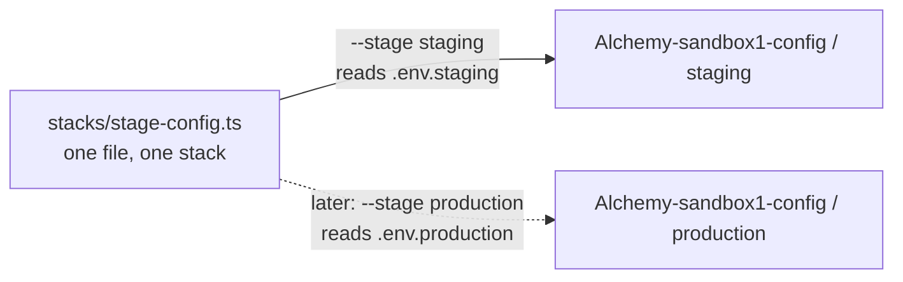
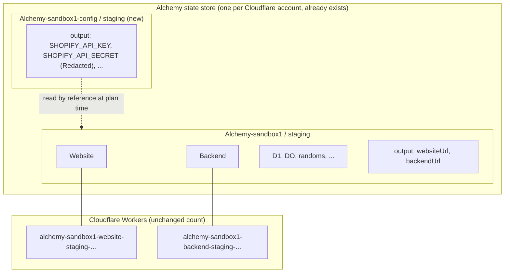
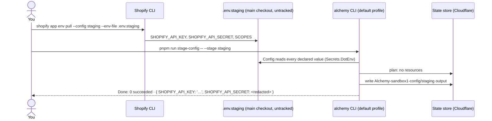
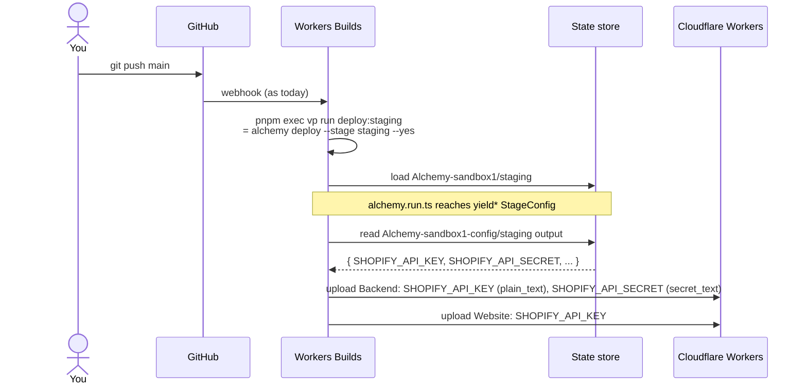

# Research: staging's externally issued configuration, and the staging Shopify app

Research date: 2026-10-14, revised 2026-10-15 after four annotation rounds · Alchemy `2.0.0-beta.81`, Shopify CLI as installed. Status: research for annotation. Nothing implemented; nothing created in Cloudflare, GitHub or Shopify. The stack mechanism (§7) was run locally in a throwaway directory, since deleted.
Background: [Alchemy stages and deployments](./alchemy-stages-and-deployments-research.md) (how Workers Builds was connected), [Taking S1 to staging](./staging-research.md) (what the next staging deploy carries).

## 1. Summary

Staging needs values that another service issues: today the Shopify staging app's client id and client secret, later others. Workers Builds deploys staging on every push to `main`, and Workers Builds is not something Alchemy manages. So these values cannot reach staging the usual Alchemy way, which is reading them from the environment of whoever runs the deploy.

**Decided so far:**

- Keep Workers Builds exactly as it is.
- Add a second, tiny Alchemy stack, the **stage config stack**. It holds a stage's externally issued values, secret and public. You deploy it **from your laptop**, once and then whenever a value changes. Its deploy creates nothing in Cloudflare. It only writes one encrypted record into the state store staging already uses.
- On every push, the app's deploy on Workers Builds reads that record by reference and binds the values to the Workers. Secrets stay secrets, because each value's type decides how it is bound (§4).
- The values come from an untracked `.env.<stage>` file on the laptop.
- The stack refuses every stage but `staging` until `production` is designed.

Separately, **the staging Shopify app has to be set up and deployed with Shopify CLI** (§3). That is a third kind of deploy. It is rare, runs from the laptop, and touches only Shopify. The repository's `shopify.app.staging.toml` is still a skeleton, so this comes first.



## 2. Today



`ShopifyApp` (`src/backend/stack.ts`) is `Some` only when Shopify CLI injects `APP_URL`, `SHOPIFY_API_KEY` and `SHOPIFY_API_SECRET`, which happens only under `shopify app dev`. In the Workers Builds container none of the three is set, so staging gets the fake key and a random secret, and the embedded app cannot authenticate.

In Alchemy, a `Config` value is read **from the environment of the process running `alchemy deploy`** and bound to the Worker (`environments/secrets.mdx`). For staging, that process runs in Workers Builds' build container. Its environment can only be set through Workers Builds' build variables, and Alchemy has no resource for those (its source has no Workers Builds resource). That gap is the whole problem.

## 3. The staging Shopify app

### 3.1 Client id is the API key

Shopify's own docs say so: "Some tools and documentation call these the API key and API secret: `SHOPIFY_API_KEY` holds your client ID, and `SHOPIFY_API_SECRET` holds your client secret" (`apps/build/authentication-authorization/manage-credentials.md`). App Bridge's `shopify.config.apiKey` is likewise documented as "the client ID (also known as the API key)". The client id is permanent and safe in frontend code. The secret is not, and it can be rotated.

So `client_id` in `shopify.app.staging.toml` and staging's `SHOPIFY_API_KEY` are the same value.

### 3.2 What a Shopify app TOML is, and what deploying it does

A Shopify app is registered in Shopify's Dev Dashboard. Its **configuration** (name, `application_url`, scopes, auth redirect URLs, webhook subscriptions) is kept in a `shopify.app.<name>.toml`. `shopify app deploy --config <name>` sends that configuration (and any extensions) to Shopify as a new **app version** and releases it to the stores where the app is installed. It "doesn't deploy your web app": hosting is ours (`api/shopify-cli/app/app-deploy.md`). Here, hosting is the Alchemy deploy.

So the two deploys are independent:

|             | Shopify app deploy                            | Alchemy app deploy      |
| ----------- | --------------------------------------------- | ----------------------- |
| Sends       | `shopify.app.staging.toml`                    | Workers, D1, bindings   |
| To          | Shopify                                       | Cloudflare              |
| Who runs it | You, from the laptop                          | Workers Builds, on push |
| When        | When the TOML changes (URL, scopes, webhooks) | Every push              |

`shopify app dev` (the dev flow) applies `shopify.app.toml` to the dev store automatically, which is why the dev app has never needed `app deploy`.

### 3.3 Where the repository stands

`shopify.app.staging.toml` is a skeleton carried over from Baton: empty `client_id` and `application_url`, `name = "Baton Staging"`, `handle = "baton-staging"`. Its one working line is `web_directories = ["."]`. Shopify CLI merges `web_directories` across **every** `shopify.app*.toml`, and that line keeps the CLI from scanning the Baton checkout under `refs/` (see its header comment). That line must survive whatever replaces the file.

There is **no staging app** in the Dev Dashboard. The only app is the dev one, `client_id` `7c6cceb7…` in `shopify.app.toml`, which Baton created and which both repositories use (`refs/baton/shopify.app.toml` has the same `client_id`).

### 3.4 Setting it up, once

The finished file is already drafted in the repository (`shopify.app.staging.toml`, everything but `client_id`). `shopify app config link` overwrites the whole file with what it pulls, so the draft is set aside and restored around it. From the main checkout:

1. **Set the draft aside:** `cp shopify.app.staging.toml /tmp/shopify.app.staging.draft.toml`.
2. **Create the app:** `shopify app config link`. Choose the organisation, **create a new app**, name it "Baton Staging", and give the configuration name `staging`. Confirm overwriting `shopify.app.staging.toml`. The file now has the new app's `client_id` and little else.
3. **Restore the draft with the new `client_id`:** copy the `client_id` line from the linked file into the draft, and put the draft back as `shopify.app.staging.toml`. Nothing else from the linked file is kept. `git diff shopify.app.staging.toml` then shows only `client_id` against the reviewed draft.
4. **Restore the default config:** linking makes the new file Shopify CLI's default. Run `shopify app config use shopify.app.toml`. (`app:dev` passes `--config shopify.app.toml` anyway, but other commands would otherwise target staging.)
5. **Check it:** `shopify app config validate --config staging`.
6. **Deploy it:** `shopify app deploy --config staging`. It shows a summary of the configuration change and asks for confirmation.
7. **Install the app on `sandbox-shop-00`:** in the Dev Dashboard, open the app → **Install app** → choose the store (`apps/build/dev-dashboard/create-apps-using-dev-dashboard.md`, "Install your app"). The main checkout's `shopify app dev` also uses that store, so its admin then lists two apps, Baton Dev and Baton Staging. They are separate apps with separate sessions; open the one being tested. The app opens on the staging Workers, which do not have the real credentials until the implementation plan's push, so it cannot authenticate yet.
8. **Fill `.env.staging`:** `shopify app env pull --config staging --env-file .env.staging`, then check names only: `sed -E 's/=.*/=<hidden>/' .env.staging`.
9. **Commit** `shopify.app.staging.toml` and the rename in `shopify.app.toml` when the user says so. Nothing in them is secret.

What the draft sets, and why:

- `name = "Baton Staging"`.
- No `handle` line. It is optional; it sets the App Home URL slug, and changing it later breaks admin links (`app-configuration.md`), so it is left out for now.
- `application_url`: the staging Website's URL, `https://alchemy-sandbox1-website-staging-a6uwn3bzazl3yzgy.mw10013.workers.dev` (answers 200 today). It is stable: the Worker's name comes from the stage, and stays the same across deploys. The root is right: `/` redirects into the App Home at `/app` when Shopify's `shop` parameter is present, which is what the dev tunnel's root does too.
- `embedded = true`, `web_directories = ["."]`, `[build] automatically_update_urls_on_dev = false`: kept from the skeleton, with its header comment rewritten now that the file is real.
- `[access_scopes]`: the same as `shopify.app.toml` (`read_orders,read_products`).
- `[auth] redirect_urls`: the dev file's shape (`/api/auth`), on the staging URL. Shopify-managed installation does not use it.
- `[access_scopes]` and `[webhooks]`: the same as `shopify.app.toml`, which is Baton's, so both apps are configured alike. The order topics carry protected customer data, so the staging app needs protected customer data access before Shopify accepts the version: Partner Dashboard → the app → API access requests → Protected customer data access, with "Protected customer data" for the reason "Store management" and no protected fields, as the dev app has. Set on 2026-10-15; the staging app then deployed as `baton-staging-3`. Until the app serves `/webhooks`, deliveries answer 404.

Afterwards, `shopify app deploy --config staging` is rerun only when the TOML changes. `shopify app dev` keeps using `shopify.app.toml`: `app:dev` names it with `--config`.

### 3.5 Getting the values for staging's Workers

`shopify app env show --config staging` prints the values a deployed app needs. Run here against the dev app, with values hidden, it printed exactly `SHOPIFY_API_KEY`, `SHOPIFY_API_SECRET` and `SCOPES`. `shopify app env pull --config staging --env-file .env.staging` writes them into a file, keeping existing lines. That is how `.env.staging` gets filled (§8.4), with no copying by hand, and the key and secret always come from the same app.

### 3.6 Renaming the dev app to "Baton Dev"

Change `name = "Baton"` to `name = "Baton Dev"` in `shopify.app.toml`. `shopify app dev` applies the file's configuration to the app on every run, so the next dev session renames it; no `app deploy` is needed. `handle = "baton-local"` stays, since changing a handle breaks admin links.

The dev app is shared with the Baton repository, whose `shopify.app.toml` still says `name = "Baton"`. A `shopify app dev` run from Baton would rename it back, and each repository's next session would flip it again. The name is only a label, so nothing breaks, and Baton's files are not changed: this repository is taking Baton over and uses its names, so the label switching back and forth is accepted until Baton stops using the app.

## 4. What the stage config stack holds, and how each value is bound

| Kind                              | Example                                  | Home                                  | Field type         | Bound to the Worker as                  | Prints in logs as |
| --------------------------------- | ---------------------------------------- | ------------------------------------- | ------------------ | --------------------------------------- | ----------------- |
| Secret, issued by another service | `SHOPIFY_API_SECRET`                     | Stage config stack                    | `Redacted<string>` | `secret_text` (hidden in the dashboard) | `<redacted>`      |
| Public, issued by another service | `SHOPIFY_API_KEY`                        | Stage config stack                    | `string`           | `plain_text`                            | its value         |
| Generated by Alchemy              | Better Auth secret, fake Shopify secret  | App stack (`Alchemy.makeRandom`)      | `Redacted<string>` | `secret_text`                           | `<redacted>`      |
| Deploy output                     | Worker URLs, `AUTH_ORIGIN`, database ids | App stack                             | `string`           | `plain_text`                            | its value         |
| Test-only                         | `E2E_TOKEN`                              | Whoever runs tests; absent on staging | `string`           | `plain_text`                            | its value         |

**What decides redaction is the field's type, not where the value is stored.** Alchemy binds a `Redacted<string>` as `secret_text` and a `string` as `plain_text` (`Cloudflare/Workers/Worker.ts`, the `env` prop's JSDoc). So one stack can hold both kinds: the handle's types (§9.1) mark which fields are secret, and that marking travels through the state record to the binding. Every value of a stage stays in one file, and each keeps its own treatment.

## 5. The stage config stack, concretely

### 5.1 What a "stack" is, and what deploying one with no resources does

A stack is a TypeScript file whose default export is an `Alchemy.Stack(...)`. `alchemy deploy` does four things:

1. Runs that file.
2. Compares the resources the file declares with what the state store says exists.
3. Creates, updates or deletes the difference.
4. Saves **what the stack's effect returns** as the stack's output record for that stage.

The CLI runs `alchemy.run.ts` unless given `--config <file>` (`cli/deploy.mdx`).

A stack that declares **no resources** still deploys. The plan says `Plan: no resources`, steps 2 and 3 do nothing, and the only effect is step 4: the output record is written. So "deploying" the stage config stack means **saving a record**. Nothing is built, uploaded or run.

### 5.2 One stack, one record per stage

A stack's records are kept per stage: state is addressed `<stack>/<stage>/…` (`cli/state.mdx`). So **one** stage config stack serves every deployed environment, with a separate record for each:



The app stack has always worked this way: one `alchemy.run.ts`, one record set per stage. That is why no name in this design says "staging". The stage is chosen by `--stage` and by the file read for it (`.env.<stage>`). The stack refuses a stage outside its allowed list, which today is `staging`. `production` joins it, with its own `.env.production` and its own Shopify app TOML, when production is designed.

### 5.3 The two Alchemy stacks side by side

|                                  | App stack (exists)                      | Stage config stack (new)                           |
| -------------------------------- | --------------------------------------- | -------------------------------------------------- |
| File                             | `alchemy.run.ts`                        | `stacks/stage-config.ts`                           |
| Stack name                       | `Alchemy-sandbox1`                      | `Alchemy-sandbox1-config`                          |
| Creates in Cloudflare            | 2 Workers, D1, Durable Object, …        | **Nothing**                                        |
| Writes to the state store        | One record per resource, plus outputs   | **One output record per stage**                    |
| Has code that runs on Cloudflare | Yes                                     | **No**                                             |
| Deployed by                      | Workers Builds, on every push to `main` | **You, from the laptop**                           |
| How often                        | Every push                              | Once, then whenever a value is added or changed    |
| Gets the external values from    | The stage config stack's record         | `.env.<stage>` on your laptop, at that deploy      |
| Workers Builds knows about it    | Yes                                     | **No.** Builds keeps running only `deploy:staging` |

### 5.4 Where everything lives



The state store is the Cloudflare Worker Alchemy already deployed for staging's state. It encrypts records at rest, with the key held in the account's Secrets Store (`Cloudflare/StateStore/Token.ts`). A `Redacted` value goes into the record as a `Redacted` and comes back out as one, so it never prints.

### 5.5 How the app reads it

This is Alchemy's documented cross-stack reference (`project-structure/monorepo-multi-stack.mdx`, `infrastructure-as-code/references.mdx`):

- A **stack handle** is a class that names the stack and types its outputs.
- The stage config stack deploys _as_ the handle, so its outputs must match those types.
- The app stack `yield*`s the handle, which reads the saved outputs of **the same stage**.

Nothing about this is automatic or tied to Workers Builds. One `yield*` in the app stack's code asks for the record, and the Alchemy CLI fetches it from the same state store it is already talking to, wherever it runs: on Workers Builds, on your laptop for `alchemy plan --stage staging`, or anywhere else. If the record is missing, the app's plan fails before anything is touched:

```text
InvalidReferenceError: Reference to stack 'Alchemy-sandbox1-config' at stage 'staging' not found.
Have you deployed stage 'staging' of 'Alchemy-sandbox1-config'?
```

## 6. The flow

### 6.1 From the laptop, once and on every change



Your default profile can already read and write staging's state store (`vp exec alchemy plan --stage staging` works today), and this deploy creates no Cloudflare resource. So **no elevated credential is needed**. That is the difference from the GitHub Actions route, which needed a Global API Key to create a token (§10).

Every deploy of the stage config stack writes the **whole** record from what it reads. A declared value missing from the file fails the plan by name rather than being dropped. Extra lines, such as `SCOPES`, are ignored.

### 6.2 Every push, unchanged trigger



The Workers Builds build never has these values in its environment and needs no build variable. It only needs what it already uses to reach the state store.

### 6.3 Adding or changing a value

1. Put it in `.env.staging`, through `shopify app env pull` for Shopify's values or by hand for others.
2. If the value is new, add a field to the handle (§9.1), `Redacted` if secret, and bind it where it is used. The type checker then flags the stage config stack until it reads the new value too.
3. Run `pnpm run stage-config -- --stage staging`.
4. Redeploy the app: push to `main`, or press "Retry build" on the last Workers Builds build. A Worker binding is fixed when the Worker is uploaded, so the new value is live only after the app redeploys.

For a new value, step 3 must come before the push of step 2's code. Otherwise the Workers Builds deploy fails at plan time on the missing field. That failure is safe: nothing is touched and the old Workers keep serving.

### 6.4 Worktrees

`.env.<stage>` lives in the main checkout only. `vp run worktree:init` already links each worktree's `refs` to main's, and it gains the same for every `.env.<stage>` present in main: a symlink to main's file, verified on a second run. So a stage's values exist once, `shopify app env pull` and `pnpm run stage-config` work from any checkout, and an edit in one is seen by all. The stage config stack's record is in the Cloudflare state store, which is shared anyway.

## 7. What was verified

In a throwaway directory using this repo's Alchemy (`2.0.0-beta.81`), local state, no Cloudflare:

1. A stack with no resources, declared through a handle, reading `SPIKE_KEY` (`Config.String`) and `SPIKE_SECRET` (`Config.Redacted`), deployed on stage `staging`. Output: `Plan: no resources`, `Done: 0 succeeded`, `{ apiKey: 'k1', apiSecret: <redacted> }`.
2. Deployed with `SPIKE_KEY` unset, it failed at plan time: `SchemaError(Expected string at ["SPIKE_KEY"])`.
3. An app stack, run with **neither variable in its environment**, did `yield* Creds` and returned `{ key: 'k1', secretIsRedacted: <redacted> }`. The public field arrived as a string, the secret as a `Redacted`.
4. The app stack, deployed before the other stack existed, failed with the `InvalidReferenceError` quoted in §5.5.

Also checked: `shopify app env show --config shopify.app.toml` prints `SHOPIFY_API_KEY`, `SHOPIFY_API_SECRET` and `SCOPES` (names only were read; values were hidden).

Read but not run:

- `Redacted` → `secret_text`, `string` → `plain_text` (§4).
- The round trip on the **Cloudflare** state store rather than local state. It encrypts the same encoded record, so no difference is expected, but the first real deploy is the test.
- Workers Builds reading another stack's record. It uses the same store and the same credentials it already uses for the app's own records.
- `Secrets.DotEnv` with a per-stage path (`environments/secret-providers.mdx`, "Per stage"). The spike used the process environment.
- `shopify app env pull` writing into a named file, and `shopify app config link` overwriting the skeleton. These come from the CLI reference, not from a run.

## 8. Stage config in the code

A sketch to fix the shape, with the settled names (§11). The exact `Config` validation and JSDoc are left for the plan.

### 8.1 The handle, in `src/backend/stack.ts`

It lives in stack-time code that `alchemy.run.ts` already imports, so the Workers Builds deploy never imports the stage config stack's file. Fields are named after the bindings they become, so one name is used from `.env.<stage>` through to the Worker.

```ts
/**
 * The values another service issues for a deployed stage, held as the output of their own stack
 * so that a deploy in Workers Builds, which has no way to receive them as environment variables,
 * reads them from the state store instead. A secret is `Redacted`, which is what binds it as a
 * Worker secret. Deployed by hand from a laptop; every deploy writes the whole record.
 */
export class StageConfig extends Alchemy.Stack<
  StageConfig,
  {
    SHOPIFY_API_KEY: string;
    SHOPIFY_API_SECRET: Redacted.Redacted<string>;
  }
>()("Alchemy-sandbox1-config") {}
```

### 8.2 The stage config stack, `stacks/stage-config.ts` (new)

```ts
export default StageConfig.make(
  {
    providers: Cloudflare.providers(),
    state: stageState,
    secrets: Alchemy.Secrets.DotEnv(({ stage }) => ({ path: `.env.${stage}` })),
  },
  Effect.gen(function* () {
    const environment = yield* environmentOf(yield* Alchemy.Stage).pipe(Effect.orDie);
    // Only deployed environments have issued values; `production` joins when it is designed.
    if (environment !== "staging")
      return yield* Effect.die(`stage config is for staging, not ${environment}`);
    return {
      SHOPIFY_API_KEY: yield* Config.NonEmptyString("SHOPIFY_API_KEY"),
      SHOPIFY_API_SECRET: yield* Config.Redacted("SHOPIFY_API_SECRET"),
    };
  }),
);
```

- `secrets: Secrets.DotEnv(...)` is Alchemy's per-stage source. A file named this way must exist, so a missing `.env.staging` fails clearly. The process environment still overrides it, as with every source list.
- `state: stageState` makes it share the app's store on every stage.
- `Cloudflare.providers()` is there because `Cloudflare.state()` authenticates through the Cloudflare provider. It creates nothing.
- When `production` exists, the `if` becomes a `Match` over the environment, like `stageState`.

### 8.3 The app stack chooses its Shopify app by environment

`ShopifyApp` becomes an effect that matches on the stage's environment, the same way `stageState` does:

| Environment   | Key and secret                                                                | App URL                      |
| ------------- | ----------------------------------------------------------------------------- | ---------------------------- |
| `staging`     | `yield* StageConfig`                                                          | the Website's own URL        |
| `dev`         | Shopify CLI's injected variables when present, else fakes (today's behaviour) | the CLI's tunnel, else local |
| `test`, `e2e` | fakes                                                                         | local                        |

`wireBackend` binds the result as today. In `alchemy.run.ts`, the `Website`'s `SHOPIFY_API_KEY` comes from the same value.

Because staging reads the record and never `Config`, a stray variable in the Workers Builds environment cannot override it. And a staging deploy can no longer quietly fall back to the fakes: a missing record or field fails the plan.

### 8.4 The laptop commands and file

```json
"stage-config": "alchemy deploy --config stacks/stage-config.ts"
```

```sh
shopify app env pull --config staging --env-file .env.staging
pnpm run stage-config -- --stage staging
```

`.env.staging` is untracked (`.gitignore` has `.env.*`) and never committed.

## 9. Steps, in order

1. **Set up and deploy the staging Shopify app** (§3.4), install it on `sandbox-shop-00`, and rename the dev app (§3.6).
2. **Land the code** (§8, plus the `worktree:init` symlink) but **do not push yet**. Run `vp check --fix` and `vp test`. `test`, `e2e` and `dev` are unaffected.
3. **Fill `.env.staging` and deploy the stage config:** `shopify app env pull --config staging --env-file .env.staging`, then `pnpm run stage-config -- --stage staging`. This must come before the push, or the Workers Builds deploy fails with `InvalidReferenceError`. That failure is harmless: the plan fails, nothing is touched, and the old Workers keep serving.
4. **Check the record exists:** `vp exec alchemy state list Alchemy-sandbox1-config/staging` shows an `output` entry.
5. **Plan staging locally:** `vp exec alchemy plan --stage staging`. Expect updates, not creates, to `Website` and `Backend`. The next staging deploy also carries all the unshipped work listed in [Taking S1 to staging](./staging-research.md): a Durable Object, an irreversible D1 migration and new secrets. Read that plan in full.
6. **Push.** Workers Builds deploys as always.
7. **Verify:**
   - In Worker → Settings → Variables and Secrets, on the Backend, `SHOPIFY_API_SECRET` is a secret and `SHOPIFY_API_KEY` equals `client_id` in `shopify.app.staging.toml`.
   - Opened from the store's admin, the staging app loads embedded.

## 10. Alternatives, and why not

| Route                                                                                                                                                                                                    | Why not                                                                                                                                                                                                                                                                                                                                                                                                    |
| -------------------------------------------------------------------------------------------------------------------------------------------------------------------------------------------------------- | ---------------------------------------------------------------------------------------------------------------------------------------------------------------------------------------------------------------------------------------------------------------------------------------------------------------------------------------------------------------------------------------------------------- |
| **Move CI to GitHub Actions**, with a stack that creates a Cloudflare token and writes GitHub secrets (Alchemy's `environments/ci.mdx`)                                                                  | It replaces Workers Builds just to deliver a few values. It needs a root-equivalent Global API Key on the laptop (the OAuth login has no API-token scope, `Cloudflare/Auth/OAuthScopes.ts`), a token permission list found by failed deploys, a workflow file, and a cutover where two CIs could deploy one stage while the state store has no lock. Worth it if you want PR preview stages; not for this. |
| **Cloudflare Secrets Store** (`cloudflare/security/secrets-store.mdx`): the stage config stack creates a `SecretsStore.Secret` for each secret; the app binds them through `Secret.ref` and `ReadSecret` | The best home for a secret that rotates often, because Workers read it live without a redeploy. But each Worker would read it at runtime instead of as a binding, which changes every reader (for Shopify, `src/backend/shopify.ts`) and gives dev a different path. It can be adopted per secret later, because the stage config stack stays the place where values are entered.                          |
| **Workers Builds build variables**, set in the dashboard                                                                                                                                                 | The manual step you want to avoid, and the values would live outside Alchemy.                                                                                                                                                                                                                                                                                                                              |
| **A custom Alchemy resource** that writes build variables through Cloudflare's Workers Builds API                                                                                                        | It still needs a laptop deploy to supply the values, so it is the decided route with a detour through a build variable. It is also ours to write and maintain.                                                                                                                                                                                                                                             |
| **Doppler or Infisical** as a secret provider (`environments/secret-providers.mdx`)                                                                                                                      | A new paid service, and its own token would have to reach Workers Builds as a build variable.                                                                                                                                                                                                                                                                                                              |

## 11. Decisions

Settled across four annotation rounds, and written into the sections above:

| Decision                                | Choice                                                                                                                                |
| --------------------------------------- | ------------------------------------------------------------------------------------------------------------------------------------- |
| Route                                   | Keep Workers Builds; a stage config stack holds the values as stack outputs                                                           |
| Where values are entered                | An untracked `.env.<stage>` in the main checkout, read by `Secrets.DotEnv`                                                            |
| Worktrees                               | `vp run worktree:init` symlinks every `.env.<stage>` of main (§6.4)                                                                   |
| Allowed stages                          | `staging` only, until `production` is designed                                                                                        |
| Public and secret values                | Together in one stack; secrets typed `Redacted`                                                                                       |
| Names                                   | File `stacks/stage-config.ts`, stack `Alchemy-sandbox1-config`, handle `StageConfig` in `src/backend/stack.ts`, script `stage-config` |
| Staging's `SHOPIFY_API_KEY`             | From `.env.staging`, written by `shopify app env pull` with the secret                                                                |
| Staging Shopify app                     | New, created with `shopify app config link`, named "Baton Staging", no `handle`                                                       |
| Store                                   | `sandbox-shop-00`, alongside the dev app                                                                                              |
| Webhooks and scopes in the staging TOML | The same as `shopify.app.toml` (Baton's), and Baton's `baton-order-link` extension in `extensions/`                                   |
| Dev app                                 | Renamed "Baton Dev" (§3.6)                                                                                                            |
